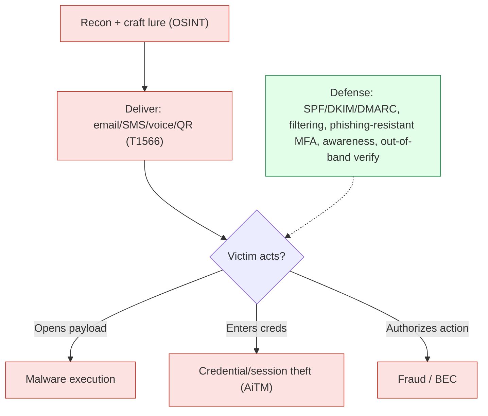

# Phishing and Social Engineering Campaigns

## Summary

**Social engineering** manipulates people into actions or disclosures that compromise security, and **phishing** — deceptive messages that trick recipients into revealing credentials, running malware, or authorizing fraud — is its most common form and a leading cause of breaches (**Phishing**, T1566; reconnaissance variant **Phishing for Information**, T1598). Phishing comes in variants: **bulk phishing** (mass, generic lures), **spear phishing** (targeted, personalized to a specific person/role using OSINT — far more effective), **whaling** (targeting executives), and non-email channels — **smishing** (SMS), **vishing** (voice calls), and QR-code phishing. Campaigns typically combine a **lure** (a pretext exploiting psychology — authority, urgency, fear, curiosity, or trust) with a **payload or ask**: a malicious attachment/macro, a link to a **credential-harvesting** page (increasingly an **adversary-in-the-middle** proxy that also steals session cookies to bypass MFA), or a request to take an action (wire transfer in **Business Email Compromise**). Attackers run phishing as organized campaigns — crafting convincing lures, spoofing or compromising senders, and sometimes chaining pretexts over multiple contacts. Defenses are layered: **technical** (email authentication via SPF/DKIM/DMARC, anti-phishing filtering, link/attachment sandboxing, and **phishing-resistant MFA** to blunt credential theft), **human** (security awareness training, simulated phishing, and a culture of verifying and reporting), and **process** (out-of-band verification for high-risk requests like payments). The core insight is that phishing targets **people, not technology**, bypassing many technical controls, so effective defense must combine technical filtering, phishing-resistant authentication, and a trained, skeptical workforce — recognizing that a single successful phish can give an attacker the foothold they need.

## Phishing variants and elements

| Element | Detail |
|---|---|
| **Bulk / spear / whaling** | Generic → targeted → executive-focused |
| **Channels** | Email, smishing (SMS), vishing (voice), QR |
| **Lure (psychology)** | Authority, urgency, fear, curiosity, trust |
| **Payload/ask** | Malware, credential page (AiTM), BEC action |
| **Info variant (T1598)** | Phishing to gather information |

Phishing targets people, not technology, so it bypasses many technical controls — defense must combine filtering, phishing-resistant MFA, and a trained workforce.

## Phishing flow

## Detection / value

- **Leading breach cause**: phishing is a top initial-access vector because it targets human judgment.
- **Spear phishing is potent**: personalization via OSINT dramatically raises success rates.
- **AiTM bypasses MFA**: proxy phishing steals session cookies, defeating non-phishing-resistant MFA.
- **BEC needs no malware**: pure social engineering can authorize fraudulent payments.

## Defense / practices

- **Deploy email authentication** (SPF/DKIM/DMARC) and anti-phishing filtering with link/attachment sandboxing.
- **Use phishing-resistant MFA** (FIDO2/WebAuthn) to blunt credential and session theft.
- **Train and simulate**: awareness, phishing simulations, and easy reporting.
- **Verify out-of-band** for high-risk requests (payments, credential changes).
- **Foster a skeptical, no-blame reporting culture**; treat reports as early warning.

## ATT&CK mapping

| ID | Name | Tactic |
|---|---|---|
| T1566 | Phishing | Initial Access |
| T1598 | Phishing for Information | Reconnaissance |

## Explanation

The easiest way into most organizations isn't hacking a computer — it's fooling a person, and phishing is the tool of choice. A phishing attack is just a deceptive message designed to trick you into doing something harmful: handing over your password on a fake login page, opening an attachment that infects your machine, or approving a payment to a scammer. It comes in flavors. Mass phishing sprays generic bait at everyone; spear phishing is tailored — the attacker researches you, mentions your boss by name, references a real project — which makes it far more convincing; whaling goes after executives; and it's not just email anymore, with scam texts (smishing), scam phone calls (vishing), and malicious QR codes all in play. What ties them together is psychology: the message pushes an emotional button — urgency ("act now!"), authority ("this is the CEO"), fear, or curiosity — to get you to react before you think. A particularly nasty modern version uses a fake login page that invisibly relays everything to the real site, stealing not just your password but your "logged-in" session, which lets it waltz past multi-factor authentication. Because phishing attacks the human rather than the machine, no single firewall stops it; defense has to be layered. Technical filters catch a lot, email-authentication checks flag forgeries, and phishing-resistant security keys defeat the credential theft — but the irreplaceable layer is a trained, skeptical workforce that pauses on suspicious messages, verifies unusual requests through a second channel, and reports anything odd without fear of blame. Because it only takes one person clicking one link to let an attacker in, turning your people from the weakest link into an alert sensor network is one of the highest-impact things a defender can do.
