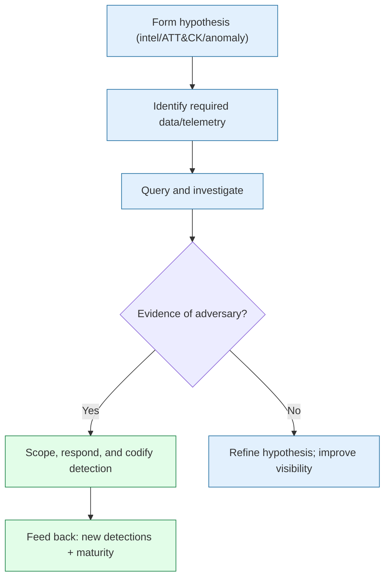

# Threat Hunting Methodology (Hypothesis, Pyramid of Pain, Maturity Model)

## Summary

**Threat hunting** is the proactive, hypothesis-driven search for adversaries who have **evaded automated detection** — it assumes a breach may already exist and goes looking, rather than waiting for an alert. Its defining method is the **hypothesis**: the hunter forms a testable idea about how an adversary might be operating ("if an attacker used technique X, I would see Y in the data"), grounded in threat intelligence, ATT&CK techniques, or anomalies, then queries telemetry to confirm or refute it; confirmed hunts become new detections, and even negative results improve understanding of the environment. Two conceptual anchors shape hunting. The **Pyramid of Pain** (David Bianco) ranks indicators by how much pain it causes an adversary to change them: hash values and IPs are trivial to swap (low pain), domains and artifacts harder, and **TTPs** the hardest of all — so hunting for behaviors/TTPs imposes far more cost on attackers than chasing easily-changed indicators. The **Hunting Maturity Model (HMM)** describes a team's progression from HM0 (reliant purely on automated alerts) through increasing use of data collection, procedures, and automation to HM4 (highly automated, continuously improving hunting). The methodology's value is that it finds the stealthy, behavior-based intrusions that signatures miss, turns successful hunts into durable detections, and systematically improves both coverage and the team's capability. Effective hunting depends on **rich telemetry** (you can only hunt in data you collect) and on framing hunts around adversary behavior rather than fragile indicators.

## Core concepts

| Concept | Idea |
|---|---|
| **Hypothesis-driven** | Testable idea → query data → confirm/refute |
| **Pyramid of Pain** | Hunt TTPs (hardest to change) over hashes/IPs |
| **Hunting Maturity Model** | HM0 (alerts only) → HM4 (automated, improving) |
| **Outcome** | Confirmed hunts become new detections |

Hunting assumes compromise and seeks behavior; targeting TTPs imposes the most cost on adversaries, and every hunt sharpens detection and team maturity.

## Hunting flow

## Detection / value

- **Finds evasive threats**: proactive hunting catches intrusions that bypassed automated alerts.
- **TTP focus imposes cost**: hunting behaviors forces attackers to change what is hardest to change.
- **Detections compound**: confirmed hunts become repeatable automated detections.
- **Capability grows**: the maturity model guides improvement from alert-reliant to automated hunting.

## Practices

- **Hunt from hypotheses** grounded in ATT&CK, intel, and anomalies.
- **Target TTPs** over easily-changed indicators (Pyramid of Pain).
- **Ensure telemetry** exists for the behaviors you want to hunt.
- **Codify successful hunts** into automated detections.
- **Advance maturity**: add data, procedures, and automation over time.

## Explanation

Most security tools wait passively for a known-bad thing to trigger an alarm. Threat hunting takes the opposite stance: it assumes a clever attacker may already be inside, quietly doing things no alarm was set to catch, and it goes looking for them. The hunter's main tool is a good guess — a hypothesis. Instead of searching randomly, they reason like a detective: "If an intruder were stealing credentials this particular way, then somewhere in our logs I'd expect to see *this* telltale pattern," and then they go check whether that pattern is there. If it is, they've caught something the automated systems missed; if it isn't, they've still learned about their environment and can sharpen the guess. Two ideas guide where to aim. The "Pyramid of Pain" points out that some clues are trivial for an attacker to change — they can swap a malicious file or server address in minutes — while their underlying *techniques* are deeply ingrained and painful to abandon; so hunting for behavior hurts attackers far more than chasing disposable indicators. The "maturity model" charts a team's growth from doing nothing but reacting to alarms, up to a sophisticated, partly automated hunting operation that keeps getting better. The real magic is the feedback loop: every successful hunt gets turned into a new automatic detection, so the thing you caught by hand today, the machine catches for free tomorrow.
