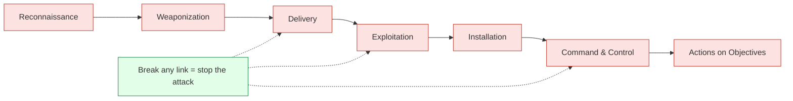

# Cyber Kill Chain

## Summary

The **Cyber Kill Chain**, introduced by Lockheed Martin, models a targeted intrusion as a sequence of stages an attacker must complete to achieve their objective, and its defensive power is that **breaking any single link stops the attack**. The classic seven phases are: **Reconnaissance** (researching the target), **Weaponization** (pairing an exploit with a payload, e.g. a malicious document), **Delivery** (transmitting it — email, web, USB), **Exploitation** (triggering the vulnerability or user action to execute code), **Installation** (establishing a foothold such as persistence/malware), **Command and Control (C2)** (the compromised host beacons to the attacker for instructions), and **Actions on Objectives** (the goal — data theft, destruction, lateral movement). The model's value is as an **analytical and defensive framework**: by mapping defenses and detections to each phase, defenders ensure coverage across the whole intrusion ("defense in depth" along the chain), and because the attacker must succeed at every stage while the defender need only disrupt one, early detection (at delivery or exploitation) is far cheaper than late (at exfiltration). The kill chain also structures intelligence — indicators and TTPs can be organized by phase. Its limitations are acknowledged: it is **linear and perimeter-oriented**, fitting malware-delivery intrusions better than insider threats, credential abuse, or cloud attacks, which is why it is often **complemented by MITRE ATT&CK** (richer, non-linear technique detail) and variants like the Unified Kill Chain. Still, as a mental model for "an attack is a chain you can break," it remains a foundational concept in defensive security.

## Kill chain phases

| Phase | Attacker action | Defender opportunity |
|---|---|---|
| **Reconnaissance** | Research the target | Reduce exposure, detect scanning |
| **Weaponization** | Build the payload | Threat intel on tooling |
| **Delivery** | Send it (email/web/USB) | Email/web filtering |
| **Exploitation** | Execute code | Patching, EDR, user awareness |
| **Installation** | Establish foothold | EDR, app control, persistence hunting |
| **Command & Control** | Beacon for instructions | Network detection, C2 blocking |
| **Actions on Objectives** | Steal/destroy/spread | DLP, segmentation, monitoring |

The asymmetry favors the defender: the attacker must complete every link; you only need to break one — and breaking it early is cheapest.

## Kill chain flow

## Detection / value

- **Whole-chain coverage**: mapping controls to phases exposes gaps and builds defense in depth.
- **Early-is-cheap**: disrupting delivery/exploitation prevents the far costlier later stages.
- **Intel structure**: organizing indicators and TTPs by phase clarifies where detection exists.
- **Known limits**: linear/perimeter bias means pairing with ATT&CK for modern (cloud, identity, insider) attacks.

## Practices

- **Map defenses and detections to each phase**; find and close gaps.
- **Prioritize early disruption** (email/web filtering, patching, awareness) to stop attacks cheaply.
- **Detect C2** (beaconing, anomalous egress) as a high-value choke point.
- **Complement with ATT&CK** for technique-level detail and non-linear/modern attacks.

## Explanation

The Cyber Kill Chain reframes a hack not as a single event but as a chain of steps an attacker has to complete in order — and that framing hands defenders a gift. To pull off a classic intrusion, an attacker first scouts the target, then builds their weapon (say, a booby-trapped document), delivers it (often by email), gets it to run by exploiting a flaw or tricking a user, installs a foothold so they can stay, phones home to a control server for orders, and finally does the thing they came for — stealing or destroying data. Here's the crucial asymmetry: the attacker has to succeed at *every* link in that chain, but the defender only has to break *one* of them to stop the whole attack. Catch the booby-trapped email at delivery, and nothing else matters. That's why defenders map their protections to each stage, making sure there's a net at every step, and why catching an attack early (at the email stage) is enormously cheaper than catching it late (as data is pouring out the door). The model isn't perfect — it was built with email-style malware attacks in mind and fits awkwardly with insider threats or cloud account takeovers, which is why it's usually paired with the richer MITRE ATT&CK. But as a way of thinking — "an attack is a chain, so find the link you can break" — it's stuck around because it's genuinely useful.
