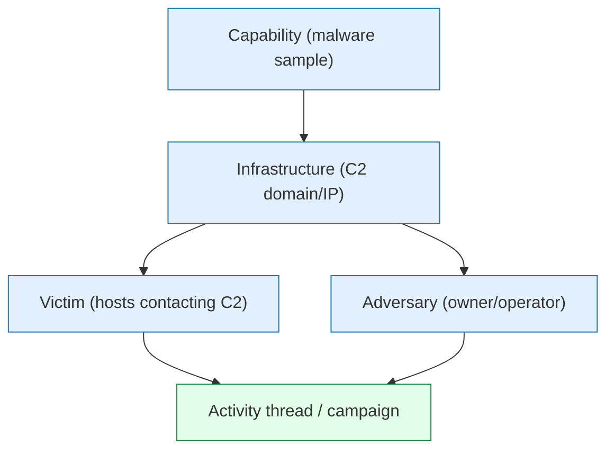

# Diamond Model of Intrusion Analysis

## Summary

The **Diamond Model** is a framework for analyzing and correlating intrusions by describing every malicious event in terms of four core features arranged as a diamond: **Adversary** (who is behind it), **Capability** (the tools/malware/techniques they use), **Infrastructure** (the systems they use to deliver and control — domains, IPs, C2), and **Victim** (the target). Every intrusion event connects these four vertices, and the model's central insight is that these elements are **linked by relationships (edges)** that let analysts **pivot**: knowing one vertex, you can discover others (from a malware sample's hard-coded domain → infrastructure → other victims contacting it → the adversary behind it). Chaining related events over time forms **activity threads** and groups them into campaigns, enabling attribution and tracking of an actor across incidents. The model also incorporates **meta-features** (timestamp, phase, result, direction) and axes like **social-political** (adversary intent/motivation) and **technology** (the capability-infrastructure relationship). Its value for threat intelligence is that it provides a rigorous, repeatable structure for **analytic pivoting and correlation** — turning isolated indicators into a connected understanding of who is attacking, how, from where, and against whom. The Diamond Model complements the Kill Chain (which orders phases) and ATT&CK (which catalogs techniques): the kill chain gives sequence, ATT&CK gives technique vocabulary, and the Diamond gives the relational structure for connecting events into campaigns and actors.

## The four core features

| Vertex | Question |
|---|---|
| **Adversary** | Who is conducting the intrusion? |
| **Capability** | What tools/techniques do they use? |
| **Infrastructure** | What systems deliver and control it? |
| **Victim** | Who is the target? |

The edges between vertices enable pivoting: known one, discover the rest — turning single indicators into connected campaigns and actors.

## Diamond pivoting

## Detection / value

- **Analytic pivoting**: one known feature (a domain, a sample) leads to the others, expanding understanding.
- **Correlation into campaigns**: linking events over time groups activity to a single actor.
- **Attribution structure**: organizing evidence by vertex supports rigorous, defensible attribution.
- **Intelligence enrichment**: each new event adds edges that strengthen the picture.

## Practices

- **Record events by vertex** (adversary, capability, infrastructure, victim) for consistent analysis.
- **Pivot deliberately**: use each known feature to discover related infrastructure, victims, and capabilities.
- **Build activity threads** to track an actor across incidents and over time.
- **Combine with Kill Chain and ATT&CK**: sequence and technique vocabulary enrich the relational picture.

## Explanation

When analysts study an intrusion, they need a way to connect scattered clues into a coherent story, and the Diamond Model gives them one by insisting that every malicious event has four basic ingredients, drawn as the points of a diamond: the adversary (who), their capability (the tools they used), their infrastructure (the servers and domains they operated from), and the victim (who they hit). The brilliance is in the lines connecting those points. If you discover just one corner, you can follow the connections to the others — a classic example: you analyze a piece of malware and find a web address buried in it; that address leads you to the attacker's control server; watching that server, you see which other victims are quietly reaching out to it; and digging into who registered it starts to reveal the adversary. This move is called pivoting, and it's how a single stray indicator blossoms into a full picture of a campaign. Stitch many such events together over time and you can track one attacker across dozens of incidents, building the kind of attribution that holds up. The Diamond doesn't replace the other models — the Kill Chain tells you the *order* of an attack and ATT&CK names the *techniques* — it supplies the connective structure that turns a jumble of alerts into "here is who is doing this, how, from where, and to whom."
