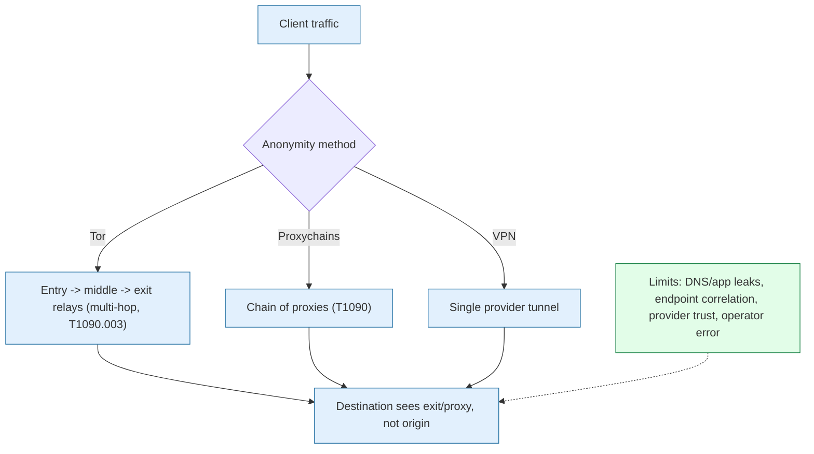

# Anonymity Tools on Linux (Tor, Proxychains, VPNs)

## Summary

Anonymity tools obscure the origin of network traffic, and they are genuinely dual-use: the same technology protects journalists, researchers, and privacy-conscious users, and is abused by attackers to hide the source of intrusions and command-and-control (proxy, T1090; multi-hop proxy, T1090.003). **Tor** routes traffic through a volunteer relay network in encrypted layers ("onion routing"), so no single relay knows both who you are and where you're going — a multi-hop proxy by design. **Proxychains** forces arbitrary programs' connections through one or more proxies (including Tor), chaining hops. **VPNs** tunnel traffic through a single provider, hiding the origin from the destination but trusting the provider. For a defender, two things matter: understanding these tools to recognize their *traffic signatures* (connections to known Tor entry nodes, proxy-chained patterns), and knowing their limits — anonymity leaks through misconfiguration, DNS leaks, correlation at the endpoints, and operator mistakes. The honest framing is capability plus limitation: these tools raise the cost of attribution, they do not make traffic untraceable.

## Tools and properties

| Tool | Mechanism | Hides | Trust model |
|---|---|---|---|
| **Tor** | Onion routing over volunteer relays | Origin from destination; path from any single relay | No single trusted party (T1090.003) |
| **Proxychains** | Forces apps through proxy chain | Origin via one/more hops | Trust each proxy in the chain |
| **VPN** | Single encrypted tunnel to provider | Origin from destination | Trust the VPN provider |

The key distinction: Tor spreads trust across many relays so no one point deanonymizes you, while a VPN concentrates that trust in one provider who *can* see your origin.

## Traffic obfuscation (and its limits)

## Detection / value

- **Defensive recognition**: outbound connections to known Tor relays or proxy-chained patterns can indicate hidden C2 (T1090) or exfiltration.
- **Attribution cost**: multi-hop routing (T1090.003) makes tracing an attacker's true origin much harder.
- **Leak awareness**: DNS leaks, non-proxied app traffic, and endpoint correlation can still deanonymize.
- Monitoring for anonymity-network usage from systems that shouldn't use it is a useful signal.

## Defense / practices

- **For defenders**: baseline normal egress; flag unexpected Tor/proxy usage from servers and endpoints; use threat intel on known relays.
- **Understand limits**: anonymity tools fail with DNS leaks, misconfigured apps, traffic correlation, and compromised endpoints.
- **Don't equate VPN with anonymity**: a VPN shifts trust to the provider, who sees the origin.
- **Policy and legality**: use anonymity tooling only for lawful, authorized purposes; abuse for intrusion is an offense.
- **Egress control**: where policy forbids it, block or alert on anonymity-network connections.

## ATT&CK mapping

| ID | Name | Tactic |
|---|---|---|
| T1090 | Proxy | Command and Control |
| T1090.003 | Proxy: Multi-hop Proxy | Command and Control |

(Anonymity networks are dual-use; adversaries abuse them for T1090/T1090.003 to obscure C2 and origin.)

## Explanation

Anonymity tools are about hiding the return address on an envelope, and they come in degrees of cleverness. A VPN is like handing your letter to a single trusted courier who swaps your address for theirs — the recipient can't see where it came from, but the courier knows exactly who you are, so you've just moved all your trust onto one company. Tor is more ingenious: it wraps your letter in several sealed envelopes and passes it through a relay of strangers, each of whom can only peel off one layer and see the next stop — so no single relay ever knows both the sender and the destination. Proxychains just lets you insist that a given program send its mail this roundabout way. The crucial honesty, for both the privacy user and the defender studying attacker tradecraft, is that none of this is magic invisibility. The return address leaks if your program blurts out a DNS lookup directly, or if someone watching both ends of the chain lines up the timing. These tools make you much harder to trace; they do not make you untraceable, and anyone who forgets that eventually gets found.
