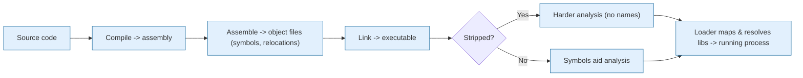

# Anatomy of a Binary (Compilation, Symbols, Stripping, Loading)

## Summary

A compiled program is the end of a pipeline — source code is **compiled** to assembly, **assembled** to object files, and **linked** into an executable — and each stage leaves traces that matter to reverse engineers. **Symbols** (function and variable names) are recorded during compilation and make analysis far easier; **stripping** removes them to hinder analysis, which is why stripped malware is harder to read. At runtime the kernel and the **dynamic loader** map the binary into memory, resolve shared-library dependencies, and begin execution. Understanding this lifecycle — from source to a running process — is the foundation of reverse engineering, malware analysis, and exploitation, because it explains what information survives into the binary and how the program actually comes alive.

## From source to running process

| Stage | What happens |
|---|---|
| **Compile** | Source → assembly; types/names known to the compiler |
| **Assemble** | Assembly → object files (machine code + symbol table + relocations) |
| **Link** | Objects + libraries → executable; resolve references |
| **Strip (optional)** | Remove symbol/debug info to impede analysis |
| **Load** | Kernel + dynamic loader map the binary, resolve shared libs, start execution |

Two facts drive analysis: symbols are a gift to the analyst (names reveal intent), so their presence or absence shapes difficulty; and dynamic linking means a program's real behaviour includes code pulled in from shared libraries at load time, not just what's in the file.

## Binary lifecycle

## Security relevance

- **Symbols vs stripping**: symbol presence hugely affects reverse-engineering difficulty; malware is often stripped.
- **Static vs dynamic linking**: dynamically-linked binaries pull in library code at load, so analysis must account for it.
- **Loader behaviour**: understanding load-time resolution underpins hijacking techniques (e.g. LD_PRELOAD, covered elsewhere).
- **Compilation artefacts**: build metadata, strings, and symbols can reveal toolchain and author traits.

## Defensive / analytical guidance

- **Recover structure from stripped binaries** using tooling, signatures (FLIRT-style), and cross-references.
- **Inspect dynamic dependencies** (`ldd`, dynamic symbol table) to see what library code runs.
- **Use symbols/debug info when present** to accelerate analysis.
- **Treat load-time behaviour as part of the program** (resolved libraries, init routines).
- **Correlate build artefacts** (strings, toolchain traces) for attribution and triage.

## ATT&CK mapping

No single ATT&CK technique; this is foundational context for reverse engineering, packing/obfuscation, and injection techniques documented in their own files.

## Explanation

A finished program is like a translated, printed, bound book whose author's notes have usually been thrown away. Writing it starts as readable source (the manuscript), gets translated down into the machine's terse language, and is bound together with other chapters it depends on into the final executable. Along the way the compiler jots helpful labels — the names of functions and variables (symbols) — and whether those labels survive makes all the difference to anyone later trying to read the book: keep them and it's annotated; strip them and you're reading an unlabelled instruction manual, which is exactly why malware authors strip them. And the book isn't truly "alive" until the loader opens it, fetches the referenced chapters from the shared library, and starts reading aloud — so understanding a program means understanding not just the file, but how it's brought to life.
