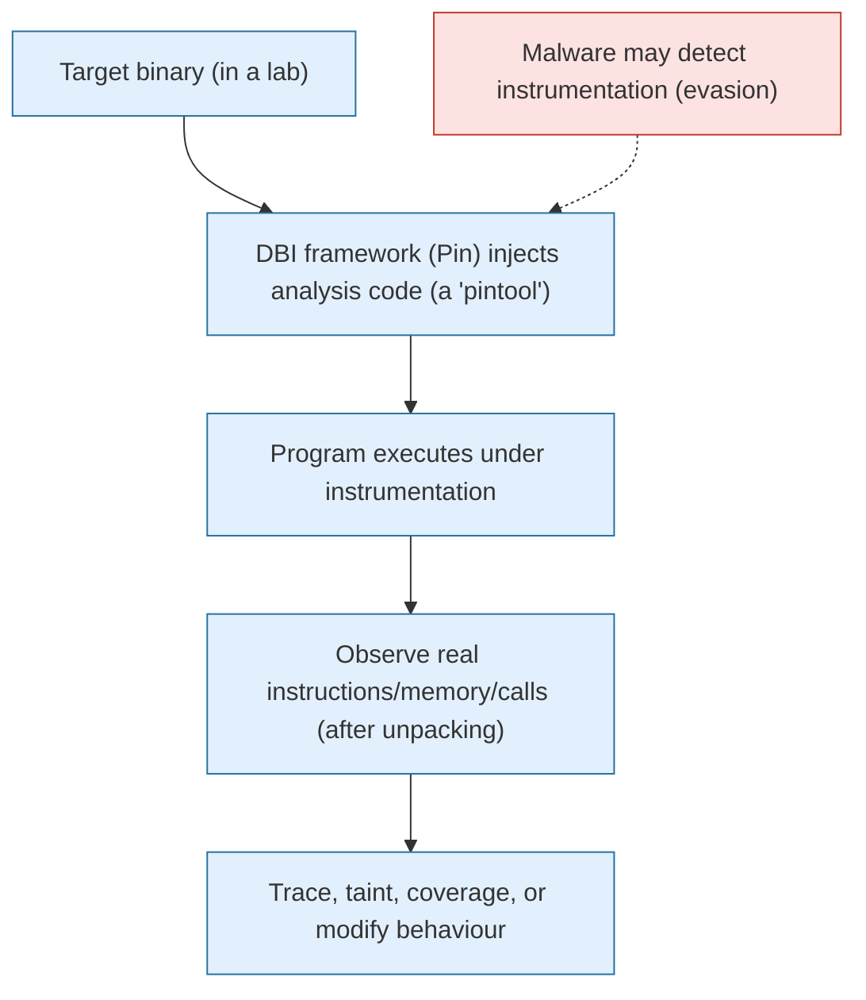

# Binary Instrumentation (Pin)

## Summary

Dynamic Binary Instrumentation (DBI) inserts analysis code into a program *as it runs*, without needing source or recompilation. Frameworks like Intel **Pin** (and alternatives such as DynamoRIO and Frida) let an analyst observe and manipulate a binary at the instruction level — counting instructions, logging memory accesses, tracing control flow, recording API/syscall arguments, or modifying behaviour on the fly. For security work this is invaluable against obfuscated or packed malware: because instrumentation sees the real instructions actually executed (after any self-decryption), it cuts through static anti-analysis. DBI underpins advanced techniques like dynamic taint analysis and coverage-guided fuzzing. The trade-off is overhead and the fact that sophisticated malware may detect the instrumentation environment.

## What DBI enables

| Capability | Use |
|---|---|
| **Instruction/basic-block tracing** | See exactly what code runs (defeats static obfuscation) |
| **Memory access logging** | Track reads/writes, find decryption, data flow |
| **API/syscall argument capture** | Observe real behaviour and parameters |
| **On-the-fly modification** | Patch behaviour, bypass checks, force paths |
| **Foundation for** | Taint analysis, coverage-guided fuzzing, unpacking |

The core advantage: DBI observes the code that *actually executes*, so packing and obfuscation that defeat static tools become visible once the program unpacks itself in memory and runs.

## Instrumentation flow

## Security relevance

- **Defeats static anti-analysis**: sees real executed code after self-decryption/unpacking.
- **Deep behavioural insight**: instruction-level tracing, memory and argument capture.
- **Enables advanced analysis**: taint tracking, coverage-guided fuzzing, automated unpacking.
- **Research and exploitation**: understanding complex logic and finding bugs.

## Defensive / analytical guidance

- **Run in an isolated, instrumented lab**; DBI executes the target.
- **Expect anti-instrumentation checks** in advanced malware; corroborate with other methods.
- **Mind the overhead**: DBI is slow; scope instrumentation to the regions of interest.
- **Combine with static analysis and tracing** for a complete picture.
- **Use DBI-based unpacking** to recover payloads for signature/static analysis.

## ATT&CK mapping

No single ATT&CK technique; binary instrumentation is an analysis method used to understand obfuscation (T1027) and other techniques documented elsewhere.

## Explanation

Static analysis reads a recipe; dynamic tracing watches the cook from across the room. Binary instrumentation is more intimate still — it's like slipping an observer into the kitchen who rides along with the cook, noting every single motion: each ingredient grabbed, each pot stirred, each glance at the timer. Tools like Pin inject that observer into a running program without needing its source, so you see the exact instructions it truly executes. This is the killer feature against malware that arrives shrink-wrapped in obfuscation: it has to unwrap itself to actually run, and the moment it does, your in-kitchen observer sees the real recipe plainly. The costs are that everything runs slower with someone looking over the cook's shoulder, and a paranoid cook may notice the observer and behave — which is why analysts pair instrumentation with other techniques.
