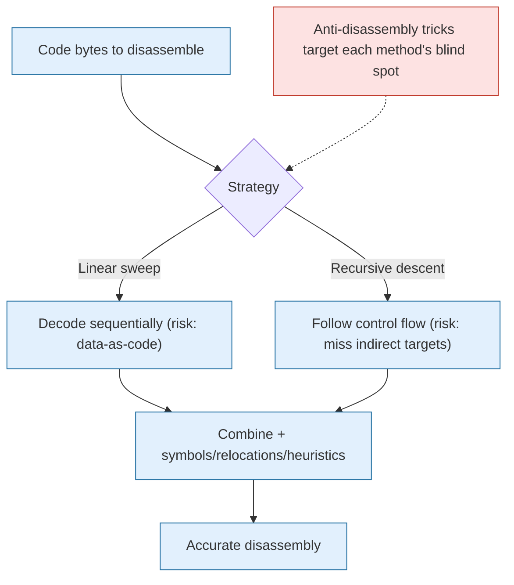

# Disassembly Approaches (Linear vs Recursive) and Binary Analysis Fundamentals

## Summary

Disassembly turns machine code back into human-readable assembly, and there are two fundamental strategies with different trade-offs. **Linear sweep** decodes instructions sequentially from the start of a code section to the end; it is simple and complete but is easily fooled when data is embedded among code, producing garbage instructions. **Recursive descent** (recursive traversal) follows the program's control flow — jumps, calls, and branches — decoding only reachable code; it handles interleaved data far better but can miss code reached indirectly (e.g. through computed jumps). Understanding the two explains why disassemblers sometimes disagree or misread a binary, and why attackers deliberately confuse disassemblers (anti-disassembly) to hinder analysis. Mature tools combine both approaches with heuristics.

## The two approaches

| Approach | Method | Strength | Weakness |
|---|---|---|---|
| **Linear sweep** | Decode sequentially, byte after byte | Complete coverage of the section | Misinterprets data as code; derails on padding/jump tables |
| **Recursive descent** | Follow control flow from entry points | Avoids decoding data; accurate code | Misses indirectly-reachable code (computed/indirect jumps) |

The practical upshot: neither is perfect, so anti-analysis tricks target their blind spots (e.g. junk bytes after an unconditional jump to desync a linear sweep), and good tooling cross-checks both plus symbol and relocation information.

## Choosing and combining

## Security relevance

- **Accuracy matters**: a mis-disassembled function can hide or misrepresent malicious logic.
- **Anti-disassembly**: malware inserts junk/opaque constructs to desync linear sweeps or hide code from recursive descent.
- **Tool disagreement**: knowing the methods explains why two disassemblers differ and which to trust where.
- **Coverage**: indirect/computed jumps require extra analysis (symbol/relocation info, dynamic tracing) to resolve.

## Defensive / analytical guidance

- **Use tools that combine approaches** and leverage symbols/relocations.
- **Cross-check suspicious regions** with dynamic tracing when static disassembly looks wrong.
- **Recognise anti-disassembly patterns** (junk after jumps, overlapping instructions) and resolve manually.
- **Resolve indirect jumps** via data-flow analysis or runtime observation.
- **Validate** by matching disassembly against observed behaviour.

## ATT&CK mapping

No single ATT&CK technique; disassembly fundamentals support reverse engineering and the analysis of obfuscation (T1027) covered elsewhere.

## Explanation

Machine code is a long ribbon of bytes with no punctuation telling you where one instruction ends and the next begins — and, awkwardly, data (like a table of numbers) can sit right in the middle of it. A disassembler has to guess where the instructions are. One method just reads straight through from the top, which is thorough but trips over any data it mistakes for code and can stay confused for a while. The other method follows the program like a reader following a choose-your-own-adventure book — only decoding pages you can actually reach by following the jumps — which neatly steps around embedded data but misses passages reached by a clue it can't compute. Because each method has a known blind spot, malware authors deliberately aim for those spots to make their code unreadable, and skilled analysts counter by combining both views and, when the static picture looks wrong, simply watching the code run.
