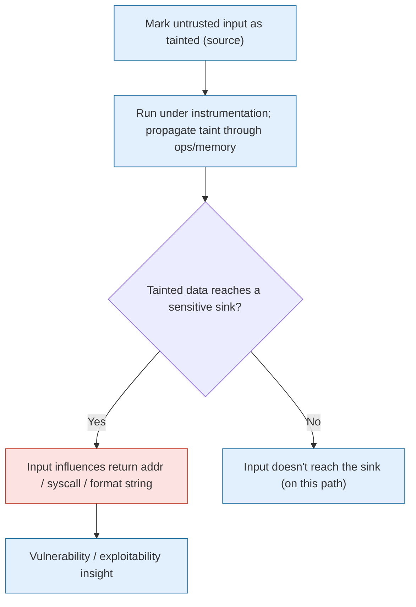

# Dynamic Taint Analysis

## Summary

Dynamic taint analysis tracks how data from a chosen source (untrusted input: a file, socket, or argument) propagates through a program as it runs. Each byte from the source is marked "tainted," and the analysis follows the taint as it flows through copies, arithmetic, and memory, flagging when tainted data reaches a sensitive sink (a return address, a format string, a system-call argument). It answers the question at the heart of vulnerability research and exploitation: *does attacker-controlled input reach a dangerous operation, and how?* Built on binary instrumentation, taint analysis is used to find and understand vulnerabilities, to triage crashes (was the controlling data attacker-influenced?), and to reason about exploitability. It is powerful but costly in overhead, and under-/over-tainting are practical challenges.

## Core concepts

| Concept | Meaning |
|---|---|
| **Taint source** | Where untrusted data enters (file, network, argv, env) |
| **Propagation** | Taint follows data through moves, arithmetic, memory |
| **Taint sink** | A sensitive location (return address, syscall arg, format string) |
| **Policy** | Rules for how taint spreads (explicit vs implicit flows) |
| **Result** | Whether/how attacker input influences the sink |

The central value: it connects input to impact. If tainted bytes reach the instruction pointer or a dangerous call, you have a concrete, data-flow-backed story of how input controls execution — the essence of an exploitability argument.

## Taint propagation

## Security relevance

- **Vulnerability discovery**: find where untrusted input reaches dangerous operations.
- **Crash triage**: determine whether crash-controlling data was attacker-influenced (exploitability).
- **Exploit development & defense research**: reason precisely about input-to-impact data flow.
- **Complements fuzzing**: taint guides where input matters.

## Defensive / analytical guidance

- **Define sources and sinks carefully** to match the threat you're analysing.
- **Account for implicit flows** (control-dependent data) that simple taint can miss (under-tainting).
- **Manage overhead**: scope analysis; combine with symbolic execution/fuzzing.
- **Use results to prioritise fixes**: input-reachable sinks are higher risk.
- **Run in an isolated lab** since the target executes.

## ATT&CK mapping

No single ATT&CK technique; taint analysis is a research/analysis method for understanding vulnerabilities and exploitation (e.g. T1068) documented elsewhere.

## Explanation

Imagine dyeing a drop of water bright red at the exact spot where untrusted input enters a program, then watching where the red colour spreads as the program runs. That's dynamic taint analysis. Every byte the attacker controls gets the dye, and as the program copies, combines, and moves data around, the dye follows. The whole point is to see whether any red ever reaches a dangerous place — the valve that decides where the program jumps next, or the dial that tells the operating system what to do. If it does, you've proven, with a visible trail, that the attacker's input can steer something it shouldn't, which is the crux of finding and weaponising (or fixing) a vulnerability. The practical hard parts are dye that fails to spread through sneaky indirect routes, and the fact that colouring every drop makes the program run much slower.
