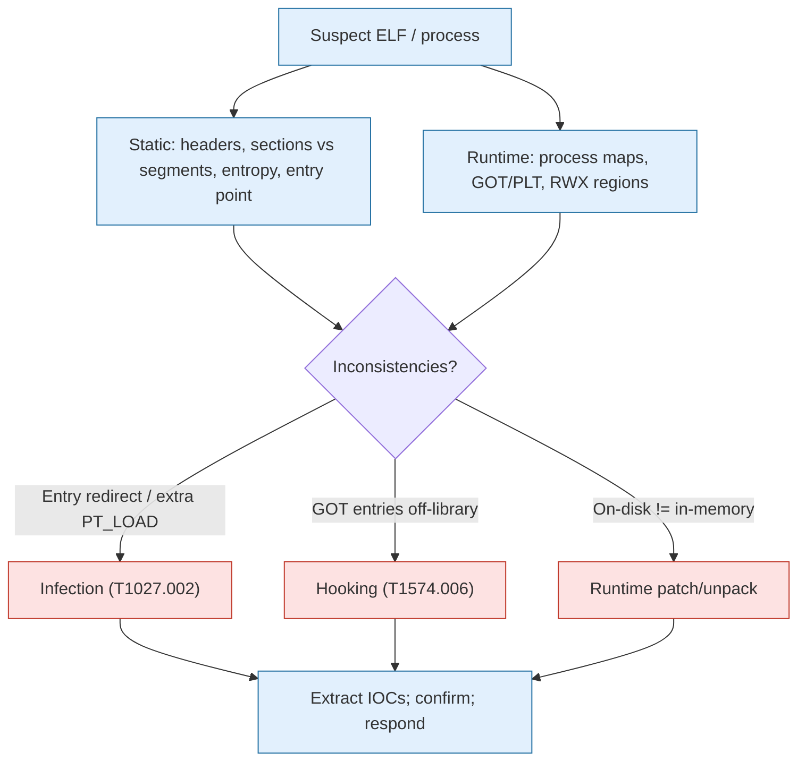

# ELF Binary Forensics (Detecting Infection and Hooks)

## Summary

ELF binary forensics inspects a Linux executable or a running process to decide whether it has been infected, patched, packed, or hooked. Because ELF infection techniques and runtime hooking all manipulate well-defined structures, they leave tell-tale inconsistencies: entry points that don't lead to the real `main`, mismatches between the section and segment views, unusual segment permissions, GOT/PLT entries pointing outside their libraries, suspicious `PT_LOAD` additions, or on-disk-vs-in-memory differences. Forensics combines static examination of the file with inspection of the process image in memory (the two can differ when malware modifies itself at runtime). The guiding principle, as with rootkit detection generally, is to find the contradiction between what the binary claims and what it actually is or does.

## Infection/hook indicators

| Indicator | Suggests |
|---|---|
| **Entry point not reaching real code / redirected** | Parasite or patched entry (infection) |
| **Section vs segment mismatch; extra `PT_LOAD`** | Injected code / ELF virus |
| **Unexpected RWX segment** | Self-modifying/packed or injected code |
| **GOT/PLT entries outside library ranges** | Runtime hooking (T1574.006) |
| **High-entropy sections; odd headers** | Packing/obfuscation (T1027.002) |
| **On-disk vs in-memory differences** | Runtime patching / unpacking |

The unifying theme: infection and hooking must bend ELF structures or process memory to work, and those bends are detectable as inconsistencies against a clean baseline or against what the format implies.

## Forensic workflow

## Detection

- Redirected/abnormal entry points and control flow that bypasses the original code.
- Section/segment inconsistencies, extra or oddly-permissioned `PT_LOAD` segments, unexpected RWX.
- GOT/PLT entries resolving outside their libraries (runtime hooks).
- High-entropy/packed sections and malformed headers (T1027.002).
- On-disk versus in-memory image differences (runtime modification).

## Defense / investigative guidance

- **Baseline known-good binaries** (hashes, structure) and compare.
- **Inspect both file and process memory** — they diverge under runtime modification.
- **Check GOT/PLT and segment permissions** for hooks and injected code.
- **Use integrity tooling** (package verification, AIDE/Tripwire) to catch patched system binaries.
- **Correlate** with behavioural and memory forensics; treat confirmed infection as compromise.

## ATT&CK mapping

| ID | Name | Tactic |
|---|---|---|
| T1027.002 | Obfuscated Files or Information: Software Packing | Stealth |
| T1574.006 | Hijack Execution Flow: Dynamic Linker Hijacking | Execution, Stealth |

## Explanation

Infecting or hooking an ELF binary is like forging a passport: to be useful the forgery has to pass as genuine, but the act of altering it almost always leaves a seam. Maybe the "start here" stamp now points to a page that was glued in (a redirected entry point into injected code), or the official page list and the physical pages no longer match (section-versus-segment mismatch), or the directory of contacts has a number that doesn't belong to the embassy it claims (a GOT entry pointing outside its library). ELF forensics is the passport inspector's craft: knowing exactly what a genuine document's structure must look like, then hunting for the seams where a forger bent it. And because some forgeries only appear once the document is "in use," the inspector compares the passport on the desk against the one actually being presented at the gate — the file on disk against the process in memory.
