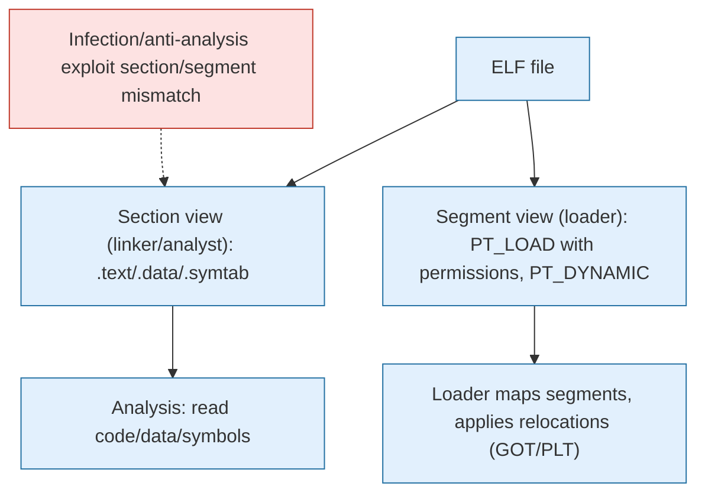

# ELF Binary Format (Segments, Sections, Symbols, Relocations)

## Summary

ELF (Executable and Linkable Format) is the standard binary format on Linux for executables, shared libraries (`.so`), object files, and core dumps. It has two complementary views: the **section view** (used by the linker and analysts — `.text` code, `.data`, `.rodata`, `.symtab`, etc.) and the **segment view** (used by the loader — `PT_LOAD` segments mapped into memory with their permissions). Key structures include the ELF header, program headers (segments), section headers, the symbol tables, and relocation entries that let the dynamic loader patch addresses. Fluency in ELF is the Linux counterpart to PE knowledge on Windows: it is the basis of reverse engineering, malware analysis, binary forensics, and injection/infection techniques, because almost every manipulation of a Linux binary operates on these structures.

## Key structures

| Structure | Role |
|---|---|
| **ELF header** | Magic, class (32/64), type (EXEC/DYN/REL), entry point |
| **Program headers (segments)** | Loader's view: `PT_LOAD`, `PT_DYNAMIC`, `PT_INTERP` with memory permissions |
| **Section headers** | Linker/analyst view: `.text`, `.data`, `.rodata`, `.bss`, `.symtab`, `.dynsym` |
| **Symbol tables** | `.symtab` (full) and `.dynsym` (dynamic) — names of functions/objects |
| **Relocations** | Fixups applied at link/load; drive the GOT/PLT for dynamic calls |
| **Dynamic section** | Libraries needed, symbol/relocation tables for runtime linking |

The two views are the crux: sections are convenient for analysis but can be stripped or faked, while segments are what the kernel actually maps — so forensics and anti-analysis both hinge on the gap between them.

## Section vs segment view

## Security relevance

- **Reverse engineering**: sections, symbols, and relocations guide disassembly and understanding.
- **Dynamic linking**: relocations and the GOT/PLT are the mechanism later hijacked (GOT/PLT hooking, LD_PRELOAD).
- **Infection & anti-analysis**: ELF viruses and packers manipulate headers/sections; mismatches between the section and segment views are forensic clues.
- **Injection**: understanding segment permissions and the dynamic section underpins shared-library and code injection.

## Defensive / analytical guidance

- **Parse with `readelf`/`objdump`** to inspect headers, sections, symbols, and relocations.
- **Compare section and segment views** — inconsistencies suggest tampering or infection.
- **Inspect the dynamic section** for required libraries and resolved symbols.
- **Check relocations/GOT** when investigating hooking or injection.
- **Treat stripped or malformed ELFs** as higher-suspicion and analyse dynamically.

## ATT&CK mapping

No single ATT&CK technique; ELF knowledge underpins reverse engineering, software packing (T1027.002), and process/library injection (T1055.x) documented in their own files.

## Explanation

ELF is the shipping container standard for Linux programs, and cleverly it comes with two packing lists. One list (the sections) is for the warehouse staff and inspectors: it neatly labels the code, the constants, the symbol names — everything an analyst wants. The other list (the segments) is for the delivery crew who actually load the container onto the truck: it only cares which blocks of stuff go where in memory and what each block is allowed to do (read, write, execute). Normally the two lists agree. The interesting security work lives in the gap between them: a stripped binary tears up the inspector's list to frustrate analysis, and ELF viruses forge entries so the warehouse list says one thing while the delivery crew quietly loads another — a discrepancy that, once you know to look for it, becomes the very fingerprint of tampering.
