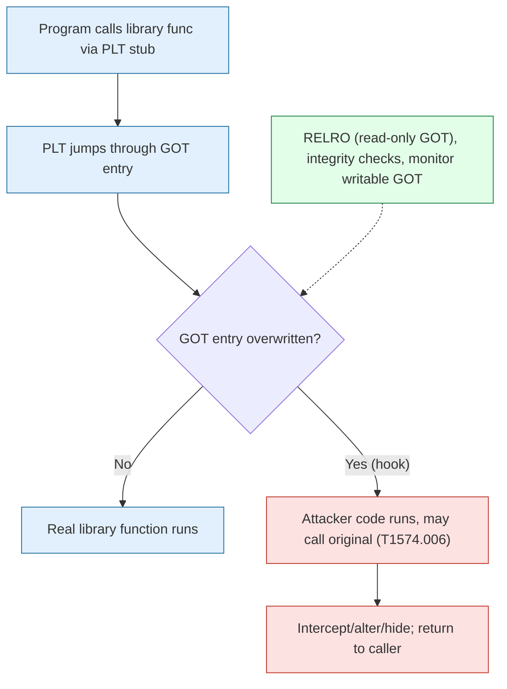

# GOT/PLT Hooking

## Summary

Dynamically-linked Linux programs don't hardcode the addresses of library functions; they call through two tables filled in at runtime — the **PLT** (Procedure Linkage Table), a set of stubs, and the **GOT** (Global Offset Table), which holds the resolved addresses. Lazy binding means a GOT entry is often resolved on first call. This indirection is a hooking target: an attacker (or a rootkit, or a legitimate instrumentation tool) who can overwrite a GOT entry redirects every subsequent call to that library function into their own code, transparently intercepting or altering behaviour. It is the Linux user-space analogue of IAT/inline hooking on Windows, used for interception, evasion, and in-process malware (hijack execution flow: dynamic linker hijacking, T1574.006; process injection, T1055). Because it changes a data table rather than code, it can be subtle.

## How GOT/PLT hooking works

| Element | Role |
|---|---|
| **PLT** | Per-function stubs the program calls instead of the real function |
| **GOT** | Table of resolved addresses the PLT jumps through |
| **Lazy binding** | GOT entries resolved on first call (via the dynamic linker) |
| **Hook** | Overwrite a GOT entry so calls go to attacker code |
| **Related** | `LD_PRELOAD` achieves similar interception at load time (its own file) |

The appeal for an attacker: overwriting one pointer in a writable GOT silently reroutes all future calls to, say, `read`, `open`, or `getpwnam`, enabling interception, credential theft, or hiding — without modifying the function's code.

## Hooking flow

## Detection

- A writable GOT being modified at runtime (GOT entries pointing outside expected library ranges).
- Library-call results inconsistent with the real library (interception symptoms).
- Injected code in a process combined with altered GOT/PLT (correlate with injection indicators).
- ELF forensics showing GOT entries resolving to unexpected memory.

## Defense

- **Enable Full RELRO** (`-z relro -z now`) so the GOT is resolved at load and marked read-only, blocking GOT overwrites.
- **Enforce W^X and integrity checks** so attacker code and table tampering are harder.
- **Monitor process memory** for GOT modifications and injected regions (EDR/forensics).
- **Reduce injection opportunities** (least privilege, `ptrace` restrictions — see ptrace file).
- **ELF forensics**: verify GOT/PLT integrity when investigating a suspect process.

## ATT&CK mapping

| ID | Name | Tactic |
|---|---|---|
| T1574.006 | Hijack Execution Flow: Dynamic Linker Hijacking | Execution, Stealth |
| T1055 | Process Injection | Privilege Escalation, Stealth |

## Explanation

A dynamically-linked program doesn't memorise where each library function lives; it keeps a little phone directory (the GOT) and always dials through it. That's convenient — the loader fills in the real numbers at runtime — but it means whoever can scribble in the directory controls who you actually reach. Overwrite the entry for "open a file" and from then on every attempt to open a file quietly rings the attacker's desk first, which can log it, alter it, or hide it, then forward the call so nothing seems amiss. Nothing about the program's own code changed; only a pointer in a table did, which is what makes it subtle. The clean defence is to print the directory in permanent ink before the program starts and then seal it (Full RELRO), so there's no writable entry left to tamper with.
