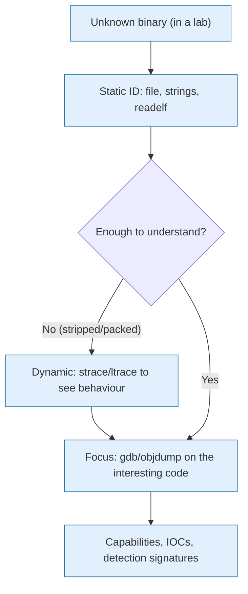

# Linux Binary Analysis Toolchain (objdump, readelf, strace, ltrace, ERESI)

## Summary

Analysing Linux binaries combines **static** tools (examine the file without running it) and **dynamic** tools (observe behaviour while it runs). The classic toolchain includes `readelf` and `objdump` for ELF structure and disassembly, `nm`/`strings` for symbols and text, `file` for identification, and `ldd` for dependencies; dynamically, `strace` traces system calls and `ltrace` traces library calls, while debuggers (`gdb`) and frameworks like **ERESI** enable deeper instrumentation. Each answers a different question — what the binary *is* and contains, versus what it *does* when executed — and together they let an analyst understand a program (including malware) efficiently. Dynamic tracing is especially powerful against stripped or obfuscated binaries, where static reading alone is slow.

## The toolchain

| Tool | Static/Dynamic | Reveals |
|---|---|---|
| **file / strings / nm** | Static | Type, embedded text, symbols |
| **readelf / objdump** | Static | ELF headers/sections, disassembly, relocations |
| **ldd** | Static | Shared-library dependencies |
| **strace** | Dynamic | System calls (files, network, process) |
| **ltrace** | Dynamic | Library-function calls |
| **gdb / ERESI** | Dynamic | Step execution, inspect memory, instrument |

The practical method pairs them: `strace` shows what a mystery binary touches (files opened, connections made, processes spawned) in seconds, pointing you to the interesting code that `objdump`/`gdb` then let you read and step through.

## Static + dynamic workflow

## Security relevance

- **Fast triage**: `file`/`strings`/`strace` quickly characterise an unknown binary.
- **Behavioural insight**: `strace`/`ltrace` expose file, network, and process activity — ideal for malware analysis and bypassing static obfuscation.
- **Structural understanding**: `readelf`/`objdump`/`gdb` reveal format, code, and runtime state.
- **IOC/signature extraction**: findings feed detection rules (YARA, behavioural).

## Defensive / analytical guidance

- **Analyse in an isolated lab** (no production network; snapshots) — dynamic tools run the code.
- **Start static, confirm dynamic**: cheap static triage first, then trace behaviour.
- **Use `strace -f`** to follow children; watch for sandbox-evasion checks.
- **Turn findings into detections** (IOCs, YARA, behavioural analytics).
- **Combine with memory forensics** for fileless or in-memory payloads.

## ATT&CK mapping

No single ATT&CK technique; this toolchain supports reverse engineering and malware analysis of techniques documented throughout the knowledge base.

## Explanation

To understand a mystery program you can either read its blueprint or watch it work, and the Linux toolchain gives you both. The static tools are the blueprint readers: `readelf` and `objdump` lay out the structure and translate the machine code, while `strings` and `file` tell you at a glance what you're holding. But a stripped or packed binary hands you a blueprint written in smudged shorthand, which is slow going — so you switch to watching it work. `strace` sits beside the running program and writes down every request it makes to the operating system ("opened this file, phoned this address, launched this process"), and `ltrace` does the same for library calls. In seconds those traces tell you what a sample is really up to, pointing you straight to the few lines of code worth reading closely under a debugger.
