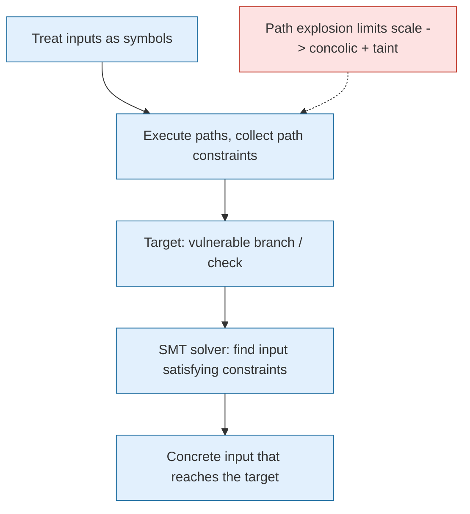

# Symbolic Execution (Triton)

## Summary

Symbolic execution analyses a program by treating its inputs as mathematical symbols rather than concrete values, building up logical formulas that describe what each path requires and computes. Instead of running with one input, it reasons about *all* inputs that would follow a given path, then uses an SMT solver to find concrete inputs that reach a target — for example, the exact bytes that trigger a vulnerable branch or satisfy a check. Frameworks like **Triton** (and angr) apply this to binaries for vulnerability discovery, automatic exploit generation, deobfuscation, and solving constraints (e.g. licence checks, crackmes). Its great strength is systematically exploring paths a fuzzer might rarely hit; its great weakness is **path explosion** — the number of paths grows combinatorially — so it is usually combined with concrete execution (concolic) and taint analysis.

## Core ideas

| Concept | Meaning |
|---|---|
| **Symbolic input** | Inputs are variables, not fixed bytes |
| **Path constraints** | Logical conditions that must hold to follow a path |
| **SMT solver** | Finds concrete inputs satisfying the constraints |
| **Concolic execution** | Mix concrete + symbolic to tame complexity |
| **Path explosion** | Combinatorial blow-up of paths — the key limitation |

The payoff: ask "what input reaches this dangerous line?" and symbolic execution can *solve* for it, rather than hoping a random fuzzer stumbles onto it — provided the path space stays manageable.

## Solving for an input

## Security relevance

- **Vulnerability discovery**: find inputs that reach and trigger bugs.
- **Automatic exploit generation**: solve the constraints that make an exploit work.
- **Deobfuscation**: simplify obfuscated logic by reasoning over it symbolically.
- **Constraint solving**: defeat checks (crackmes, licence logic) by computing satisfying inputs.

## Defensive / analytical guidance

- **Combine with fuzzing/taint (concolic)** to manage path explosion and reach depth.
- **Scope the analysis** (start points, symbolic ranges) to keep it tractable.
- **Use it to confirm exploitability** of fuzzer-found crashes by solving reachability.
- **Expect anti-symbolic tricks** (complex constraints, crypto) that defeat solvers; fall back to other methods.
- **Run targets in isolation** when concolic execution runs code.

## ATT&CK mapping

No single ATT&CK technique; symbolic execution is a research method for vulnerability analysis and exploitation (e.g. T1068) documented elsewhere.

## Explanation

Normal execution is like driving one specific route through a city and seeing where you end up. Symbolic execution is like handing the whole road map to a mathematician and asking, "what starting conditions would get me to *this* particular building?" Instead of trying inputs one at a time, it keeps the inputs as unknowns and writes down the conditions each turn imposes ("to go left here, the third byte must be greater than 10"), then hands the accumulated conditions to a solver that computes an exact input satisfying them. That's extraordinarily powerful for finding the precise bytes that trip a bug or pass a hidden check. The catch is that every fork in the road doubles the maps to consider, so the city's routes explode beyond counting — which is why, in practice, symbolic execution is driven in tandem with actually driving some routes (concolic execution) to keep the problem on the ground.
