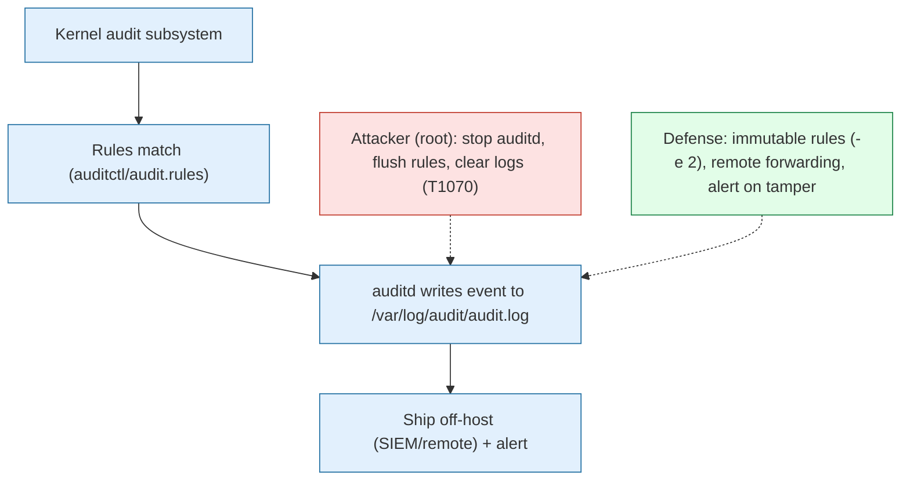

# Linux Auditing with auditd

## Summary

`auditd` is the Linux kernel's audit daemon, the primary built-in mechanism for recording security-relevant events: system calls, file accesses, authentication events, and command execution. Rules (set with `auditctl` or in `audit.rules`) tell the kernel what to watch — for example, writes to `/etc/passwd`, use of specific syscalls, or executions of particular binaries — and matching events are written to the audit log (typically `/var/log/audit/audit.log`) with details like the user, process, and arguments. For a defender this is the ground truth of "what actually happened on this host," which makes it both a detection source and a forensic record. Because it's so valuable, it's also a target: attackers who gain root may try to stop auditd, flush its rules, or clear the logs (indicator removal, T1070). The hardening response is to ship audit events off-host in near-real-time and to alert on tampering with the audit system itself.

## What auditd captures

| Category | Examples |
|---|---|
| **File/watch (`-w`)** | Writes/attribute changes to `/etc/passwd`, `/etc/sudoers`, sensitive dirs |
| **Syscall (`-a`)** | `execve`, `open`, `connect`, `ptrace`, module loads — filtered by user/arch |
| **Login/auth** | Logins, `sudo`, privilege changes (via PAM/audit integration) |
| **Immutable mode (`-e 2`)** | Locks rules until reboot so they can't be silently flushed |

Two practical anchors: watch the files that matter (credential and config files), and treat the audit log as evidence that must leave the host, because a local-only log is only as trustworthy as the host that holds it.

## Audit event flow

## Detection / value

- **Authoritative record**: kernel-level audit of syscalls, file access, and execution is hard for user-space to fake while it's running.
- **Tamper signals**: audit service stops, rule flushes, and gaps in the log sequence indicate anti-forensics (T1070).
- **Watch high-value targets**: changes to `/etc/passwd`, `/etc/sudoers`, SSH keys, and audit config itself.
- Correlating `execve` records reconstructs what commands an intruder ran.

## Defense / practices

- **Define a solid rule set**: watch credential/config files, key syscalls, and privilege changes; base it on a published baseline.
- **Forward events off-host** in near-real-time so local log clearing doesn't erase evidence.
- **Use immutable mode** (`-e 2`) to prevent silent rule flushing until reboot.
- **Alert on audit tampering**: service stops, config changes, and log truncation.
- **Protect the logs**: restrictive permissions, integrity monitoring, and retention.

## ATT&CK mapping

| ID | Name | Tactic |
|---|---|---|
| T1070 | Indicator Removal | Stealth |

(auditd is a detection/forensic control; T1070 is the adversary behavior it both records and is targeted by.)

## Explanation

`auditd` is the host's black-box flight recorder. You tell it which events are worth remembering — someone editing the password file, a program making a network connection, a particular command running — and the kernel dutifully writes each one down with who did it and how. For a defender that recording is gold: when something goes wrong, it's the difference between guessing and knowing exactly which account ran which command at which second. The catch is the same as with any recorder on the scene of a crime: a clever intruder who gets the keys will try to switch it off or wipe the tape. So the professional move is to copy the recording somewhere the intruder can't reach the moment it's made (forward to a remote server), bolt the recorder's settings shut (immutable rules), and treat any attempt to stop it or erase its tape as an alarm in its own right — because the act of silencing the recorder is itself evidence that something is wrong.
