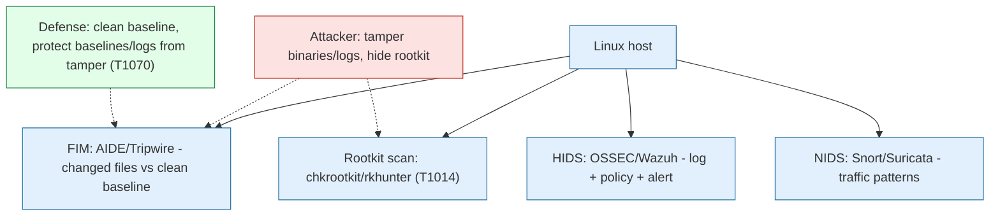

# Linux Intrusion Detection Tools (HIDS, File Integrity, Rootkit Scanners)

## Summary

Intrusion detection on Linux hosts combines several complementary tool classes, each catching what the others miss. **File Integrity Monitoring (FIM)** — **AIDE**, **Tripwire** — takes a cryptographic baseline of important files and alerts when they change unexpectedly, catching tampered binaries, planted backdoors, and modified configs. **Host IDS (HIDS)** — e.g. **OSSEC/Wazuh** — adds log analysis, rootkit checks, and real-time alerting across many hosts. **Rootkit scanners** — **chkrootkit**, **rkhunter** — look for known rootkit signatures and suspicious artifacts (rootkit, T1014). **Network IDS** — **Snort**, **Suricata** — inspect traffic for malicious patterns. No single tool is sufficient: FIM sees changed files but not live network C2; a NIDS sees traffic but not a quietly edited binary. The defensive discipline is layering them, protecting their baselines and logs from tampering (indicator removal, T1070), and — crucially — building the baseline on a known-clean system, because a baseline taken after compromise just certifies the attacker's version as "normal."

## Tool classes

| Class | Examples | Catches |
|---|---|---|
| **File integrity (FIM)** | AIDE, Tripwire | Changed/added/removed critical files, tampered binaries |
| **Host IDS** | OSSEC, Wazuh | Log anomalies, policy violations, rootkit checks, alerting |
| **Rootkit scanner** | chkrootkit, rkhunter | Known rootkit signatures/artifacts (T1014) |
| **Network IDS** | Snort, Suricata | Malicious traffic patterns, exploit/C2 signatures |

The essential rule cuts across all of them: a detection baseline is only meaningful if it was captured before the attacker arrived, and only trustworthy if the attacker can't quietly rewrite it.

## Layered host detection

## Detection / value

- **FIM** catches silent changes to binaries, config, and credential files that attackers rely on.
- **Rootkit scanners** flag known rootkit artifacts, though they miss novel/kernel-level ones (T1014).
- **HIDS/NIDS** add log and traffic context that file checks can't see.
- **Layering** closes gaps: combine host and network, file and behavioral views.

## Defense / practices

- **Baseline on a known-clean system** and store the baseline/keys off-host or read-only.
- **Layer tools**: FIM + HIDS + rootkit scanning + network IDS, not one alone.
- **Protect detection data**: logs and baselines are attacker targets (T1070) — forward and integrity-protect them.
- **Tune and respond**: investigate FIM/IDS alerts; unactioned alerts provide no protection.
- **Treat rootkit scanners as one signal**: clean results don't prove absence of a sophisticated rootkit; corroborate with offline/forensic checks.

## ATT&CK mapping

| ID | Name | Tactic |
|---|---|---|
| T1014 | Rootkit | Stealth |
| T1070 | Indicator Removal | Stealth |

(These tools detect T1014 and are targeted by T1070; they are defensive controls.)

## Explanation

Catching an intruder on a Linux box is like guarding a house with different kinds of alarms, because no single sensor sees everything. A file-integrity monitor is the tamper seal on every important drawer: take a photograph of the drawers while the house is clean, and later the system shouts if any seal is broken — perfect for spotting a swapped-out system binary or a planted backdoor. A rootkit scanner is a sniffer dog trained on known burglars' tricks; useful, but it only knows the tricks it's been taught. A host IDS is the guard reading the logbook for odd entries, and a network IDS is the camera on the street watching what goes in and out. The two unbreakable rules: photograph the drawers *before* the burglar visits (baseline a clean system), and keep those photos somewhere the burglar can't reach to doctor them — because an alarm system the intruder can quietly reprogram is no alarm at all.
