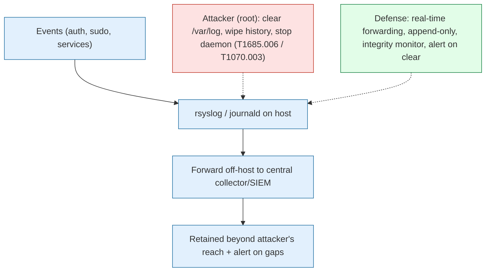

# Linux Log Management and Log Evasion

## Summary

Logs are the defender's memory, and attackers know it — so Linux log management is a two-sided topic: how to collect and protect logs, and how adversaries try to erase their tracks. Linux logging flows through **rsyslog/syslog-ng** (classic text logs under `/var/log/`: `auth.log`, `syslog`, etc.) and **systemd-journald** (the binary journal). After a compromise, attackers commonly clear or edit these to hide activity — wiping `/var/log/auth.log`, truncating logs, or deleting shell history (clear Linux or Mac system logs, T1685.006; indicator removal: clear command history, T1070.003). The single most effective countermeasure is **centralized, off-host logging in near-real-time**: once an event has already been forwarded to a remote collector, deleting the local copy no longer erases it. Combine that with append-only/immutable local logs, integrity monitoring, and alerting on the *act* of log clearing, which is itself a high-fidelity sign of intrusion.

## Collection vs. evasion

| Attacker action | ATT&CK | Defender countermeasure |
|---|---|---|
| Wipe/truncate `/var/log/*` | T1685.006 | Remote forwarding; append-only; integrity checks |
| Delete shell history (`.bash_history`) | T1070.003 | Ship shell audit via auditd; immutable history |
| Edit journald/syslog entries | T1070 | Central collector; signed/forwarded logs |
| Stop logging daemon | T1070 | Alert on rsyslog/journald stop; watchdog |

The core asymmetry: a log the attacker can reach and rewrite is untrustworthy, but a log already copied off-host is beyond their edit — so forwarding fast is what makes logs survive the very intrusion they're meant to record.

## Log flow and evasion

## Detection / value

- **Off-host copies survive** local log wipes, preserving evidence (counters T1685.006).
- **Clearing is itself a signal**: sudden log truncation, missing history, and sequence gaps indicate anti-forensics.
- **Daemon stops** (rsyslog/journald) are high-value alerts.
- Correlating remote-forwarded auth logs reconstructs intruder activity even if the host is scrubbed.

## Defense / practices

- **Forward logs off-host in near-real-time** to a central collector/SIEM.
- **Make local logs resistant**: append-only attributes, restrictive permissions, integrity monitoring.
- **Capture shell activity** via auditd rather than relying on `.bash_history` (which users/attackers can wipe, T1070.003).
- **Alert on log clearing and logging-daemon stops**; treat gaps as incidents.
- **Retain** forwarded logs per policy, protected from the hosts they came from.

## ATT&CK mapping

| ID | Name | Tactic |
|---|---|---|
| T1070 | Indicator Removal | Stealth |
| T1685.006 | Disable or Modify Tools: Clear Linux or Mac System Logs | Defense Impairment |
| T1070.003 | Indicator Removal: Clear Command History | Stealth |

## Explanation

Logs are the house's diary — who came in, what they touched, when they left. The problem is the diary usually sits on a shelf in the same house, so a burglar who finds it can tear out the incriminating pages, and on Linux that's exactly what happens: an intruder with root wipes `/var/log/auth.log` and deletes the shell history to make the break-in vanish. You can't stop someone with the keys from reaching the shelf, so the winning move is to photocopy each page and mail it out of the house the instant it's written (forward logs to a remote server in real time). Now tearing out the local page changes nothing — the copy is already safe elsewhere. Better still, the very act of ripping pages out is loud: a diary that suddenly goes blank, or a logging service that mysteriously stops, is one of the clearest signs you have that someone was here and didn't want you to know.
