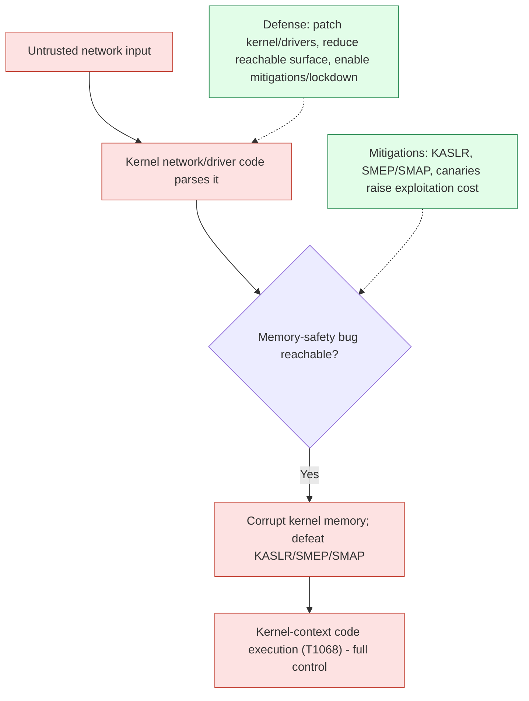

# Remote Kernel Exploitation (Linux)

## Summary

Most memory-corruption exploitation targets user-space programs, but the kernel itself processes untrusted input — network packets, filesystem data, and syscall arguments — and a bug in that handling can be exploited. **Remote kernel exploitation** reaches a vulnerability in kernel code that parses network-reachable input (e.g. a flaw in a network protocol handler or driver), without first having a local foothold. Success is catastrophic: code executing in kernel context has full control of the machine (exploitation for privilege escalation, T1068; exploitation of remote services, T1203 context). These bugs are rarer and harder to exploit than user-space ones because the kernel is a hostile target — modern defenses include **KASLR** (randomized kernel layout), **SMEP/SMAP** (block the kernel from executing/reading user-space memory), **stack canaries**, and **kernel lockdown**. Exploiting remotely typically means defeating these mitigations without the feedback a local attacker enjoys, which is why reliable remote kernel exploits are prized and uncommon. For defenders the message is stark: a remote kernel bug can mean full compromise from the network, so patching kernel and driver code and reducing network-reachable kernel attack surface is critical.

## Why it's high-impact and hard

| Factor | Detail |
|---|---|
| **Impact** | Kernel-context code execution = total machine control (T1068) |
| **Reachability** | Bug in network/packet/driver path = exploitable from the network (T1203 context) |
| **Difficulty** | KASLR, SMEP/SMAP, canaries, lockdown raise the bar |
| **Blind exploitation** | Remote attacker lacks local info leaks/feedback, so reliability is hard |

The defining tension: the payoff (ring-0 control) is the highest there is, but the kernel's modern mitigations and the attacker's lack of local feedback make a dependable remote kernel exploit genuinely difficult to build.

## Attack and defense surface

## Security relevance

- **Total compromise**: kernel-context execution bypasses all user-space protections (T1068).
- **Remote reach**: bugs in packet/protocol/driver handling are exploitable without a prior foothold.
- **Mitigations matter**: KASLR/SMEP/SMAP/canaries measurably raise exploit cost and reduce reliability.
- Unexpected kernel panics/crashes under crafted traffic can indicate exploitation attempts.

## Defense / practices

- **Patch promptly**: kernel and driver updates are the primary defense against known bugs.
- **Reduce reachable surface**: disable unused protocols, drivers, and kernel modules; firewall exposed services.
- **Enable mitigations**: KASLR, SMEP/SMAP, stack protector, and kernel lockdown where available.
- **Restrict module loading** and use signed modules to limit post-exploit persistence.
- **Monitor** for anomalous kernel crashes and traffic that triggers them.

## ATT&CK mapping

| ID | Name | Tactic |
|---|---|---|
| T1068 | Exploitation for Privilege Escalation | Privilege Escalation |
| T1203 | Exploitation for Client Execution | Execution |

(Remote kernel exploitation is high-impact offensive activity; the file documents it for defensive understanding and mitigation.)

## Explanation

The kernel is the referee of the whole machine — it decides what every program is allowed to do — so a flaw in the referee is uniquely dangerous: whoever exploits it doesn't win the game, they own the stadium. Normally you'd have to be inside the building to attack the referee, but the kernel also reads mail from outside: it parses network packets and device data directly. If one of those parsers has a memory bug, an attacker can reach the referee from across the internet, and success means total control of the box. The reason this doesn't happen constantly is that the kernel is armored in ways user programs often aren't — it scrambles its own memory layout so the attacker doesn't know where anything is (KASLR), and it refuses to run or read code from the untrusted user side of the house (SMEP/SMAP). Pulling off a reliable remote kernel exploit means beating all that armor while effectively blindfolded, with none of the feedback a local attacker gets. For defenders the takeaway is blunt: these are rare but devastating, so patch the kernel fast, turn off every network-facing piece of it you don't need, and keep the armor switched on.
