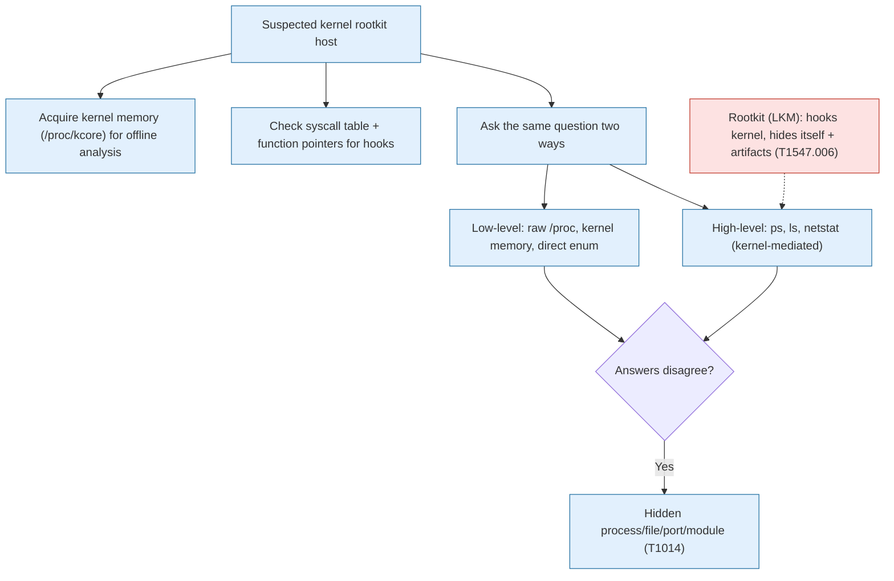

# Linux Kernel Rootkit Forensics

## Summary

A kernel-mode rootkit (typically a malicious loadable kernel module, T1547.006) runs with the same privilege as the operating system itself, so it can hide processes, files, network connections, and even its own module from every normal tool by subverting the kernel's own answers (rootkit, T1014). This breaks the usual assumption of forensics — that the system tells the truth — because the rootkit *is* the thing answering. Detecting and analyzing one therefore relies on **cross-view comparison** (asking the same question two different ways and finding where the answers disagree) and on reading kernel memory directly rather than trusting kernel-mediated listings. Investigators compare `ps`/`/proc` against lower-level enumeration, check the kernel's syscall table and function pointers for hooks, enumerate loaded modules against what the rootkit admits to, and acquire physical memory (e.g. via `/proc/kcore` or a memory capture) for offline analysis of kernel structures. The signature of a kernel rootkit is inconsistency: a process that shows up one way but not another, a syscall that points somewhere it shouldn't, a hidden module whose memory exists but whose name is scrubbed from the module list.

## Detection approaches

| Approach | What it reveals |
|---|---|
| **Cross-view diff** | Process/file/port visible via one method but hidden via another = concealment (T1014) |
| **Syscall table / hook check** | Syscall or function pointers redirected to rootkit code |
| **Module enumeration** | Loaded but hidden/unlisted modules (T1547.006) |
| **Kernel memory acquisition** | `/proc/kcore` or memory dump for offline struct analysis |
| **Known-good kernel compare** | In-memory kernel text differs from the on-disk image |

The unifying idea: never accept the suspect kernel's own summary. Ask in two independent ways and investigate every disagreement, and read raw kernel memory where the rootkit can't easily edit the answer in flight.

## Cross-view detection

## Detection / value

- **Concealment exposed by disagreement**: artifacts visible via one path but hidden via another indicate a rootkit (T1014).
- **Hooked syscalls/pointers** reveal how the rootkit intercepts kernel behavior.
- **Hidden modules** (loaded but scrubbed from the list) are classic LKM-rootkit tells (T1547.006).
- **Offline kernel memory analysis** sidesteps the live rootkit's ability to lie.

## Defense / practices

- **Prefer offline/memory analysis**: acquire physical/kernel memory and analyze away from the live, lying kernel.
- **Use cross-view tools**: compare high-level and low-level enumeration for every artifact class.
- **Verify kernel integrity**: compare in-memory kernel text and syscall table against a known-good image.
- **Harden proactively**: module signing, lockdown mode, and restricting module loading reduce LKM-rootkit footholds.
- **Preserve evidence** off-host with hashes; document methodology for chain of custody.

## ATT&CK mapping

| ID | Name | Tactic |
|---|---|---|
| T1014 | Rootkit | Stealth |
| T1547.006 | Boot or Logon Autostart Execution: Kernel Modules and Extensions | Persistence, Privilege Escalation |

## Explanation

A kernel rootkit is the nightmare witness: it isn't just lying to you, it *is* the narrator of everything you see, because it lives inside the operating system that answers all your questions. Ask the system "what processes are running?" and the rootkit simply edits its own hidden process out of the reply before handing it over. So you can't catch it by asking nicely — you catch it by asking the same thing two different ways and watching for the story to change. List the processes through the normal channel, then count them again through a lower-level path the rootkit forgot to doctor; wherever the two tallies disagree, something is being hidden. You also peek under the hood at the kernel's switchboard (the syscall table) to see if calls have been quietly rerouted to the intruder's code, and you photograph the kernel's raw memory so you can study it somewhere the rootkit can't keep editing reality in real time. The whole craft reduces to one refusal: don't trust the narrator, and chase every contradiction until the hidden thing falls out.
