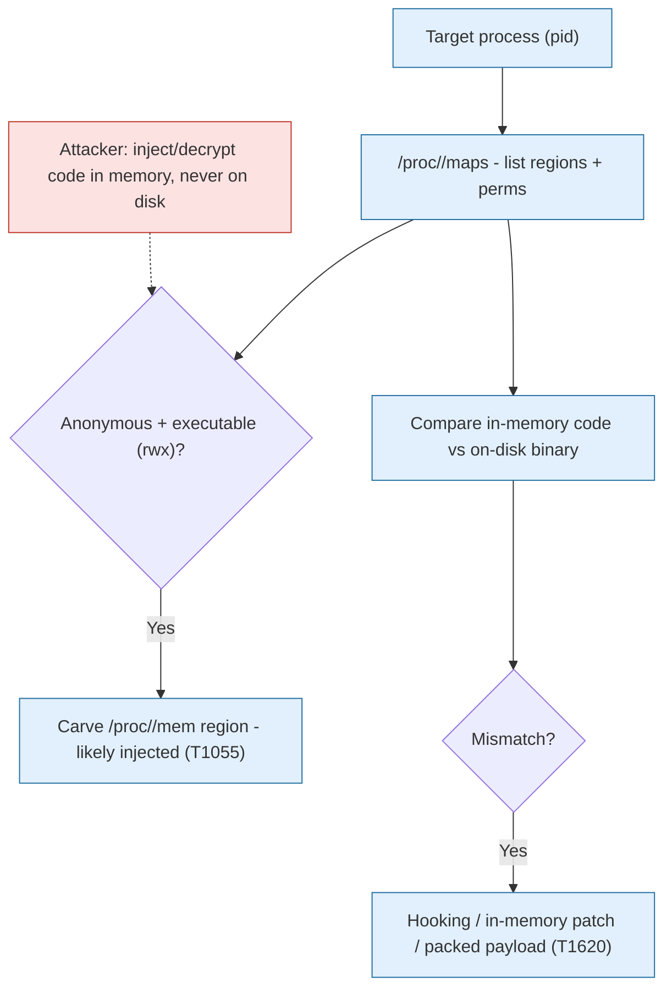

# Linux Process Memory Forensics

## Summary

Some malicious code never touches disk in a recognizable form: it runs only in a process's memory, having been injected into another process or loaded and decrypted in place (process injection, T1055; reflective/in-memory loading, T1620). Finding it means examining the live memory of running processes. On Linux the process's address space is exposed through `/proc/<pid>/`: `maps` lists memory regions and their backing files/permissions, `mem` exposes the bytes, and `/proc/<pid>/exe`, `cmdline`, and `fd/` describe the executable, arguments, and open files. Forensic techniques carve suspicious regions — anonymous memory that is executable (`rwx`) with no file backing, code whose in-memory bytes differ from the on-disk binary (a sign of hooking or patching), or injected shared objects not reflected in the loader's records. Tools range from live inspection of `/proc` to full memory captures analyzed with frameworks that reconstruct process lists, mappings, and injected code. The recurring tell is a mismatch between what *should* be in memory (per the on-disk file and loader metadata) and what *is*.

## What to look for

| Artifact | Why it's suspicious |
|---|---|
| Anonymous `rwx` regions | Writable+executable, no file backing = injected/staged code (T1055) |
| In-memory code ≠ on-disk binary | Runtime patching/hooking of functions |
| SO mapped but not in loader records | Injected library not loaded normally (T1055.001) |
| Decrypted payload in memory only | In-memory-only malware (T1620) |
| Unexpected `/proc/<pid>/exe` / deleted exe | Process running a since-deleted or masqueraded binary |

The analytical core: compare memory against the ground truth it claims to come from. Executable-writable anonymous memory and code that diverges from its disk image are the loudest signs of in-memory tampering.

## Memory inspection flow

## Detection / value

- **Catches fileless/in-memory malware** that disk scanning misses (T1620).
- **Injected code** shows as anonymous executable regions or SOs absent from loader records (T1055/T1055.001).
- **Hooking** surfaces as in-memory code diverging from the on-disk binary.
- `/proc/<pid>/exe` pointing at a deleted or renamed file flags masquerading or self-deleting malware.

## Defense / practices

- **Acquire memory on live suspect hosts** before shutdown; analyze with a reconstruction framework.
- **Diff memory vs. disk** for loaded modules and key functions to find hooks/patches.
- **Flag `rwx` anonymous regions** and SOs not reflected in loader metadata.
- **Correlate** with network/process state captured in the same window.
- **Preserve** captures off-host with hashes and documented methodology.

## ATT&CK mapping

| ID | Name | Tactic |
|---|---|---|
| T1055 | Process Injection | Privilege Escalation, Stealth |
| T1620 | Reflective Code Loading | Stealth |

## Explanation

Some burglars are careful never to leave anything on the floor you could photograph — instead they do all their work in mid-air, in the memory of a program that's already running, and vanish when the power goes off. To catch them you have to look at the air itself: the live memory of each process. Linux conveniently hands you a window into every process through `/proc`, listing exactly which chunks of memory it's using, which are backed by real files on disk, and which are just raw, nameless scratch space. The giveaways are telling. A chunk of memory that is both writable and executable but tied to no file is a workbench someone built to run smuggled code. And when the code *in* memory no longer matches the program *on* disk, someone has quietly rewritten the program while it ran. Forensics here is mostly one move repeated: hold what's in memory up against what should be there, and investigate wherever the two don't match.
