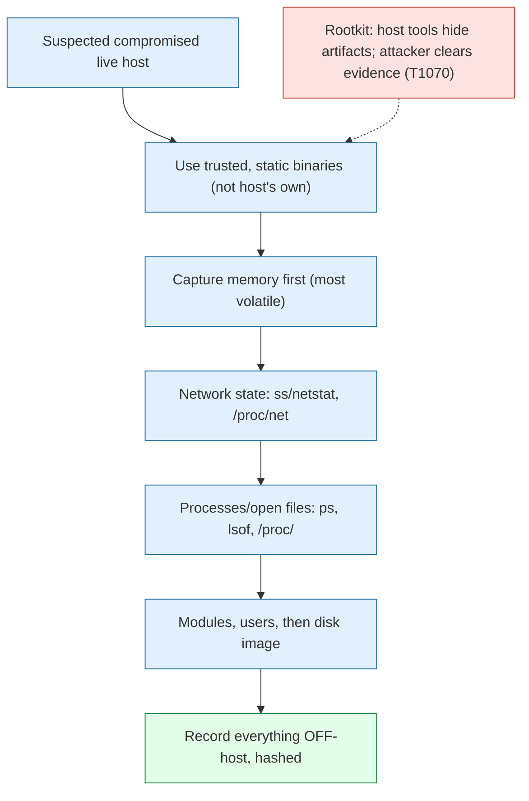

# Live Data Collection from Unix/Linux Systems

## Summary

When a Linux system is suspected of compromise, some of the most valuable evidence exists **only while it is running** — the contents of RAM, the list of running processes and open files, active network connections, loaded kernel modules, and logged-in users. Shut the box down and that volatile state is gone forever. Live data collection is the disciplined capture of this evidence from a live host, following the **order of volatility** (most-ephemeral first: memory and network state before disk) and minimizing changes to the system. Key sources are the `/proc` filesystem (per-process details, `/proc/<pid>/`, open files, maps), memory acquisition (e.g. via tools that read physical memory), `netstat`/`ss` for connections, `lsof` for open files, and `ps` for processes — ideally gathered with trusted, statically linked binaries, because a compromised host's own tools may be subverted by a rootkit to lie. The twin disciplines are *capture before you lose it* and *trust nothing on the box*, recording everything off-host so the evidence survives any attacker cleanup (indicator removal, T1070).

## Order of volatility (collect top-down)

| Priority | Evidence | Typical source |
|---|---|---|
| 1 | CPU/registers, RAM contents | Memory acquisition tools |
| 2 | Network connections, routing | `ss`/`netstat`, `/proc/net/` |
| 3 | Running processes, open files | `ps`, `lsof`, `/proc/<pid>/` |
| 4 | Loaded modules, kernel state | `lsmod`, `/proc/modules` |
| 5 | Logged-in users, recent logins | `who`, `last`, auth logs |
| 6 | Disk/files | Imaging (later, post-mortem) |

The guiding rule: capture the ephemeral evidence first and from trusted tools, because a rootkit can make the host's own `ps` or `netstat` hide the very process or connection you're hunting.

## Live collection flow

## Detection / value

- **Volatile evidence** (RAM, live connections, hidden processes) exists only on a running host.
- **`/proc` cross-checks**: comparing `/proc` directly against host tool output can expose rootkit-hidden processes.
- **Trusted binaries** defeat subverted host utilities that a rootkit uses to lie (T1014 context).
- **Off-host recording** preserves findings against attacker cleanup (T1070).

## Defense / practices

- **Follow order of volatility**: memory and network state before disk.
- **Use trusted, statically linked tools** from read-only media, not the host's own binaries.
- **Minimize footprint**: document every command; prefer read-only sources like `/proc`.
- **Hash and record off-host**: stream output to a remote collector; hash artifacts for integrity.
- **Preserve chain of custody**: timestamps, operator, and tool versions for every capture.

## ATT&CK mapping

| ID | Name | Tactic |
|---|---|---|
| T1070 | Indicator Removal | Stealth |

(Live collection is an incident-response/forensic activity; T1070 is the adversary cleanup it races against. Related: rootkit, T1014.)

## Explanation

A running computer is like a crime scene where half the evidence is written in smoke — the open connections, the processes in memory, the intruder's live session. The moment you power off, the smoke clears and that evidence is gone for good, which is why responders capture the most fleeting things first (what's in RAM and on the wire) before they ever touch the disk. There's a second twist unique to a hacked machine: you can't trust the scene's own instruments. A rootkit can quietly rewire the box's `ps` so it never lists the attacker's process, or its `netstat` so the malicious connection simply doesn't appear — the house's own security cameras edited in real time. So investigators bring their own trusted tools, read the raw truth from `/proc`, and write every finding to a notebook outside the house. Grab the smoke before it clears, and never believe the suspect's own cameras.
