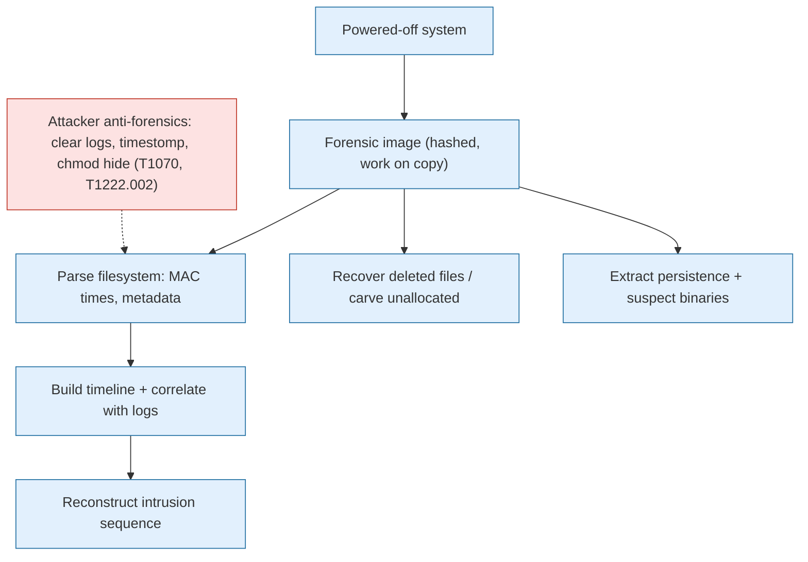

# Post-Mortem Malware Forensics on Linux

## Summary

Post-mortem (dead-box) forensics analyzes a Linux system from a disk image after it has been powered off, reconstructing what happened from the persistent artifacts left behind. Where live collection captures volatile memory, post-mortem work focuses on the filesystem: timestamps (MAC times on `ext4`/`xfs`), logs, shell histories, scheduled tasks and persistence entries, deleted-but-recoverable files, and malware binaries for static analysis. The forensic value lies in building a **timeline** — correlating file modification/access/creation times with log events to see the sequence of an intrusion — and in recovering artifacts the attacker tried to delete. Adversaries anticipate this: they clear logs and history, manipulate timestamps (timestomping), and change permissions to hide or lock artifacts (indicator removal, T1070; file/dir permission modification, T1222.002). The discipline is to work from a forensic copy (never the original), verify integrity with hashes, and cross-check multiple independent artifact sources, since any single one may have been tampered with.

## Key artifact sources

| Source | Yields |
|---|---|
| Filesystem MAC times | Timeline of file create/modify/access |
| Logs (`/var/log`, journal) | Auth, service, and system events |
| Shell histories, `at`/cron | Commands run; persistence/scheduled tasks |
| Persistence locations | Autostart, systemd units, `ld.so.preload`, rc scripts |
| Deleted/unallocated space | Recoverable removed files and fragments |
| Suspect binaries | Static analysis of recovered malware |

The method's strength is correlation: no single artifact is trusted alone, but weaving timestamps, logs, and recovered files together exposes both the intrusion and the attacker's cleanup.

## Post-mortem workflow

## Detection / value

- **Timeline reconstruction** from MAC times + logs shows the order of attacker actions.
- **Recovered deletions**: filesystem forensics can restore files the attacker removed.
- **Persistence discovery**: autostart, cron, systemd units, and `ld.so.preload` reveal footholds.
- **Anti-forensics tells**: timestomped files (inconsistent MAC times), cleared logs, and odd permission changes (T1222.002) are themselves evidence.

## Defense / practices

- **Image first, hash, work on copies**; never analyze the original disk.
- **Build a timeline** correlating filesystem times with logs and other hosts' records.
- **Cross-check artifacts**: distrust any single source; look for inconsistencies that reveal tampering.
- **Hunt persistence** across all standard Linux autostart/scheduling locations.
- **Recover deletions** and carve unallocated space for removed malware and logs.

## ATT&CK mapping

| ID | Name | Tactic |
|---|---|---|
| T1070 | Indicator Removal | Stealth |
| T1222.002 | File and Directory Permissions Modification: Linux and Mac Permissions | Defense Impairment |

(Post-mortem forensics reconstructs intrusions and detects the anti-forensic techniques T1070 and T1222.002.)

## Explanation

If live forensics is catching smoke before it clears, post-mortem forensics is the detective work done after the fire is out, reading the burned house for the story of what happened. A powered-off Linux disk is full of quiet testimony: every file carries hidden timestamps of when it was made, changed, and last read, and when you line those up against the logs you get a minute-by-minute reconstruction of the intruder's visit. Even files they deleted often aren't truly gone — the filesystem just marked the space reusable, so you can frequently recover them. The attacker knows all this and fights back: they wipe logs, falsify timestamps so the timeline lies, and twist permissions to hide things. That's why the detective never trusts one witness. The power of the method is cross-examination — when the timestamps say one thing, the logs another, and a recovered file a third, the contradictions themselves point straight at what the attacker did and tried to cover up. And you always work from a sealed copy of the evidence, hashed, so nobody can claim you altered the scene.
