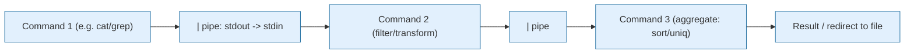

# Linux Command-Line Fundamentals for Security Work

## Summary

The Linux command line is the primary working surface for security practitioners — attackers and defenders alike — because so much of a system's state and control is exposed through the shell. Fluency with the shell (usually Bash), the filesystem hierarchy, pipes and redirection, text-processing tools, and process/permission commands is the foundation everything else builds on: enumeration, log analysis, incident response, exploitation, and automation all happen here. The shell's power comes from composition — small tools chained together (`grep | sort | uniq -c | sort -rn`) to answer questions quickly — and from its direct, scriptable access to files, processes, users, and the network. This file orients the core concepts rather than cataloguing every command.

## Core building blocks

| Area | Essentials |
|---|---|
| **Navigation & files** | `ls`, `cd`, `pwd`, `find`, `cat`, `less`, paths and the filesystem hierarchy (`/etc`, `/var`, `/proc`, `/home`) |
| **Streams & redirection** | stdin/stdout/stderr, pipes `|`, `>`/`>>`/`2>`, `tee` |
| **Text processing** | `grep`, `cut`, `sort`, `uniq`, `wc`, `sed`, `awk` (own file) |
| **Processes** | `ps`, `top`, `kill`, `&`/`jobs`, signals |
| **Permissions & identity** | `chmod`, `chown`, `id`, `sudo`, user/group model |
| **Networking & packages** | `ss`/`netstat`, `curl`/`wget`, `ip`, package managers |

The defining skill is composition: because each tool reads text and writes text, chaining them turns the shell into a flexible investigation and automation engine — the same reason it's central to both offense and defense.

## How shell composition works

## Security relevance

- **Enumeration and triage** (what's installed, running, listening, writable) happen through shell commands.
- **Log analysis and hunting** rely on text-processing pipelines over `/var/log` and other sources.
- **Incident response** uses the shell to inspect processes, connections, and files on a live host.
- **Automation**: shell scripting turns repetitive security tasks into repeatable tooling.

## Defensive / practical guidance

- **Learn the composition model**, not just individual commands — chaining is where the leverage is.
- **Know where things live** (`/etc`, `/var/log`, `/proc`, `/tmp`) for fast investigation.
- **Prefer safe, read-only inspection** on live systems during IR; be deliberate with destructive commands.
- **Script carefully**: quote variables, handle errors, and avoid running untrusted input.
- **Audit shell history and command logging** as both an investigative source and a hardening concern.

## ATT&CK mapping

No single ATT&CK technique; command-line fluency underlies execution, discovery, and defensive techniques documented throughout this knowledge base.

## Explanation

The Linux command line is a workbench of tiny, single-purpose tools and a universal way to clip them together. One tool lists files, another searches text, another counts duplicates — and because every tool speaks the same simple language (text in, text out), you can snap them into a custom pipeline on the spot to answer almost any question: "which IP hit this server most?", "what's listening on the network?", "which files did this user just change?" That composability is why the shell is the beating heart of security work. You don't memorise a thousand commands; you learn a few dozen small ones and the art of connecting them, and suddenly the whole system is queryable and automatable from a single line.
