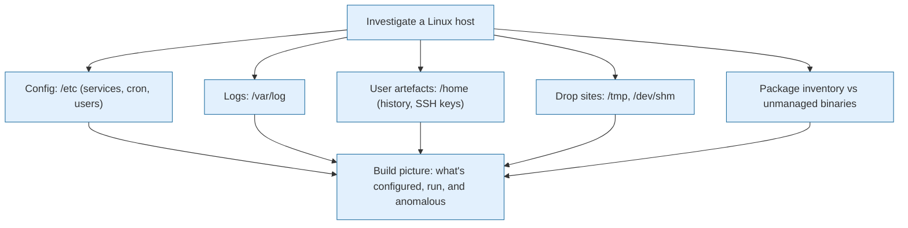

# Linux Filesystem Management and Software Installation

## Summary

Linux organises everything under a single rooted tree (`/`), following the Filesystem Hierarchy Standard (FHS), where directories have defined purposes: binaries in `/bin` and `/usr/bin`, configuration in `/etc`, logs and variable data in `/var`, user homes in `/home`, and kernel/process interfaces in `/proc` and `/sys`. Software is normally installed through a package manager (apt/dpkg, dnf/rpm, pacman) that resolves dependencies, verifies signatures, and records what was installed where. Understanding the hierarchy and the package model matters for security because it tells investigators where to look (configs, logs, cron, startup), tells defenders what to protect and monitor, and tells attackers where persistence and misconfigurations commonly live. Software installed outside the package manager (manual builds, dropped binaries) is itself a signal worth noticing.

## Key locations and mechanisms

| Path / mechanism | Purpose |
|---|---|
| `/etc` | System and service configuration (prime target & evidence source) |
| `/var/log` | Logs for investigation |
| `/home`, `/root` | User data, shell history, SSH keys |
| `/proc`, `/sys` | Live kernel/process interfaces (no on-disk files) |
| `/tmp`, `/dev/shm` | World-writable scratch (common malware drop sites) |
| **Package manager** (apt/dnf/pacman) | Installs, signs, and tracks software and dependencies |
| **Mounts & permissions** | `mount`, FHS layout, per-file ownership/mode |

Two security-relevant facts stand out: package managers verify signatures and keep an inventory (so unmanaged binaries are anomalous), and world-writable directories like `/tmp` and `/dev/shm` are favourite staging areas for dropped payloads.

## Investigation map

## Security relevance

- **Known layout speeds investigation**: configs, logs, cron, and startup live in predictable places.
- **Package inventory** gives a baseline; manually-installed or dropped binaries stand out.
- **World-writable dirs** (`/tmp`, `/dev/shm`) are common malware staging and persistence points.
- **File integrity**: unexpected changes to `/etc`, `/bin`, or service files are strong signals.

## Defensive / practical guidance

- **Prefer signed packages** from trusted repositories; monitor for unmanaged binaries.
- **Monitor sensitive paths** (`/etc`, startup, cron, SSH config) for change with file-integrity tooling.
- **Restrict and watch world-writable directories**; consider `noexec` mounts for `/tmp` where feasible.
- **Baseline installed software** and alert on drift.
- **Protect user artefacts** (SSH keys, history) and understand `/proc`/`/sys` as live-state sources.

## ATT&CK mapping

No single ATT&CK technique; filesystem and package knowledge underpins persistence, defense-evasion, and forensic techniques documented in their own files.

## Explanation

Linux keeps everything in one big, well-labelled filing system, so once you know the labels you know where to look. Configuration lives in `/etc`, the system's diary (logs) in `/var/log`, each person's desk in `/home`, and a couple of communal scratch tables (`/tmp`, `/dev/shm`) that anyone can dump things on — which is exactly why intruders love those tables for stashing tools. Software normally arrives through a vetted supplier (the package manager) that checks the goods are genuine and keeps a receipt of everything delivered. That receipt is quietly powerful for defenders: anything running on the machine that has no receipt — a binary nobody's package manager installed — is immediately worth a second look.
