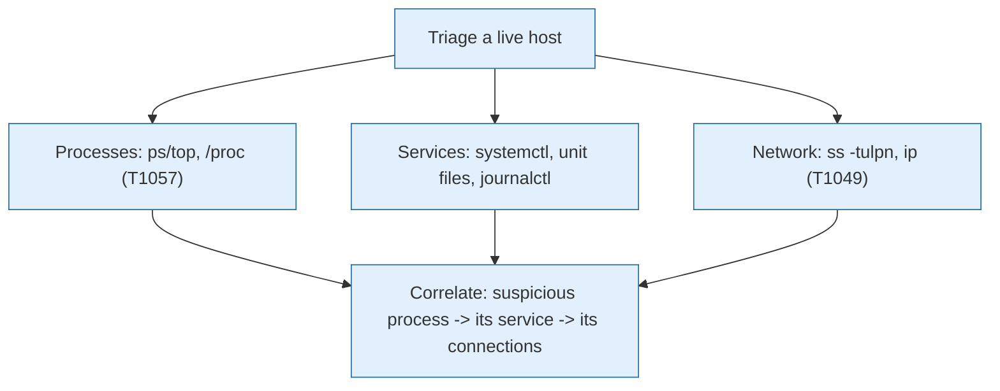

# Linux Process, Service and Network Management Basics

## Summary

Operating a Linux system means understanding three live subsystems: **processes** (running programs, viewed with `ps`/`top` and the `/proc` filesystem), **services** (long-running daemons managed today by `systemd` via `systemctl`), and **networking** (interfaces, listening sockets, and connections, viewed with `ip` and `ss`). These are exactly the areas both attackers and defenders examine first on a live host: what is running, what starts automatically, and what is talking on the network. For defenders this is the basis of triage and detection (process discovery, T1057; network connection discovery, T1049); for attackers the same commands reveal the lay of the land. Knowing how to read and manage them is prerequisite to persistence analysis, incident response, and hardening.

## The three subsystems

| Subsystem | Tools / interfaces | Security use |
|---|---|---|
| **Processes** | `ps`, `top`, `/proc/<pid>`, `kill` | What's running, parent/child, open files/sockets (T1057) |
| **Services (systemd)** | `systemctl`, unit files in `/etc/systemd`, `journalctl` | What auto-starts (persistence), service state and logs |
| **Networking** | `ip`, `ss`, `netstat` | Interfaces, listening ports, active connections (T1049) |

`systemd` is central: service units define what starts at boot and how, so they are both the modern service-management tool and a persistence location (its own treatment appears in the persistence material). `/proc/<pid>` exposes a live process's command line, environment, open files, and maps — invaluable for investigation.

## Live-state triage

## Security relevance

- **Process inspection** reveals running malware, unusual parents, and (via `/proc`) command lines, open files, and sockets.
- **Service enumeration** shows what auto-starts — a key persistence and attack-surface question.
- **Network state** (`ss -tulpn`) reveals listeners (backdoors, C2) and active connections.
- **Correlation** across the three (process → service → connection) is how triage builds a picture.

## Defensive / practical guidance

- **Baseline** normal processes, services, and listening ports; alert on deviations.
- **Use `/proc`** for live investigation (command line, environment, open files, maps).
- **Review systemd units** for unexpected or modified services (persistence).
- **Monitor listening sockets** and outbound connections for backdoors/C2.
- **Combine with auditing** (auditd) and logs for durable evidence.

## ATT&CK mapping

| ID | Name | Tactic |
|---|---|---|
| T1057 | Process Discovery | Discovery |
| T1049 | System Network Connections Discovery | Discovery |

(These are discovery techniques; the same tools are core to defensive triage.)

## Explanation

Checking the health of a Linux machine is like walking through a workshop. First you look at who's actually working and what they're doing (processes) — and Linux is unusually candid here, because the `/proc` area lets you read each worker's exact instructions, tools in hand, and who hired them. Next you check the standing staff roster that clocks in automatically every morning (services, run by systemd), since that's where an intruder would add themselves to keep coming back. Finally you check the loading docks and phone lines (the network) to see what's listening for visitors and who's currently on a call. The real skill is joining the three: a stranger at a workbench, traced to a fake entry on the staff roster, making a phone call to an unknown number, is the whole intrusion told in three questions.
