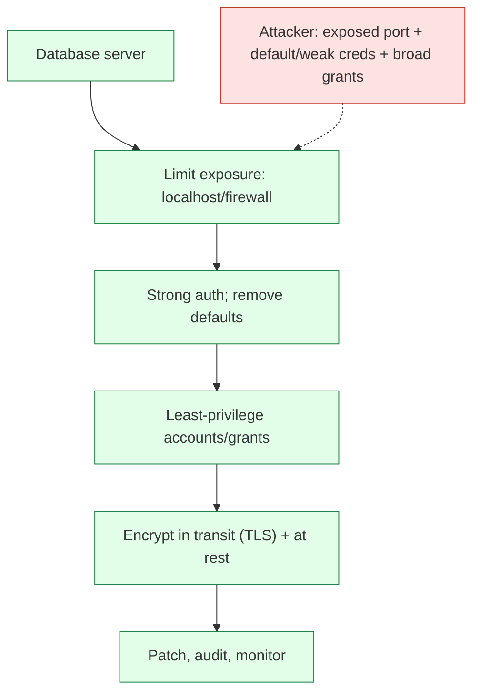

# Database Server Hardening and Encryption

## Summary

Databases hold the data attackers most want, so hardening them is high-value. The core measures are: restrict network exposure (bind to localhost or a protected network, firewall the port), enforce strong authentication and least-privilege accounts (no shared admin, per-app users with only needed grants), encrypt data in transit (TLS) and often at rest (transparent data encryption or disk encryption), remove default/demo accounts and databases, keep the engine patched, and enable auditing/logging. Databases are commonly exposed to the internet by accident, run with default or weak credentials, or granted overly broad privileges — the same misconfiguration themes as elsewhere, with higher stakes. Hardening removes these easy paths and ensures that even a breach yields limited, ideally encrypted, data.

## Hardening areas

| Area | Measures |
|---|---|
| **Exposure** | Bind to localhost/protected net; firewall; no public access |
| **Authentication** | Strong, unique credentials; remove defaults; per-app least-privilege users |
| **Authorization** | Minimal grants; separate admin from app accounts; no wildcard hosts |
| **Encryption** | TLS in transit; TDE/disk encryption at rest |
| **Maintenance** | Patch engine; remove demo DBs/accounts; secure config files |
| **Audit** | Enable query/connection auditing and monitor |

The recurring failure modes — internet-exposed instances, default credentials, and over-broad privileges — are exactly what hardening targets, and encryption limits the damage if data is nonetheless reached.

## Hardening flow

## Detection / value

- **Reduced exposure**: databases unreachable from untrusted networks can't be remotely attacked.
- **Least privilege** limits what a compromised app account can read/modify.
- **Encryption** protects data in transit and limits value of stolen files/disks.
- Unexpected connections, failed auth spikes, and privilege changes are detection signals.

## Defense / practices

- **Don't expose databases to the internet**; bind locally or to a protected segment and firewall.
- **Remove defaults**, enforce strong unique credentials, and use per-application least-privilege accounts.
- **Encrypt in transit (TLS)** and at rest (TDE/disk) where data sensitivity warrants.
- **Patch the engine**, secure config/credential files, and remove demo databases.
- **Enable auditing** of connections, queries, and privilege changes; monitor for anomalies.

## ATT&CK mapping

No single ATT&CK technique; database hardening mitigates exploitation of public-facing services (T1190), valid-account abuse, and data theft documented in their own files.

## Explanation

A database is the treasure room, so it deserves the strongest locks — yet in practice it's astonishing how often the treasure room is left with its door opening onto the street (exposed to the internet), guarded by the lock it shipped with (default credentials), and handing every clerk a master key (over-broad privileges). Hardening is mostly fixing those three habits: pull the door back inside the building where only trusted staff can reach it, change the locks to strong unique ones, and give each worker a key that opens only the drawers they actually need. On top of that, you keep the valuables in sealed boxes (encryption in transit and at rest) so that even if someone does get in, or walks off with the disk, what they grab is unreadable. None of it is clever; it's just refusing to make the most valuable room the least defended.
