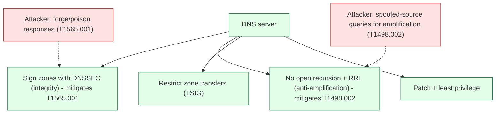

# DNS Server Security (DNSSEC, Amplification and Rate Limiting)

## Summary

DNS is critical infrastructure and a frequent abuse target. Two problem classes dominate. First, **data integrity**: classic DNS answers are unauthenticated, so attackers can forge or poison responses to redirect victims — **DNSSEC** addresses this by cryptographically signing records so resolvers can verify authenticity (defending against stored-data manipulation, T1565.001, in the DNS context). Second, **abuse of open resolvers**: an attacker sends small queries with a spoofed victim source address and the server replies with much larger responses, flooding the victim — a **DNS amplification/reflection** DDoS (reflection amplification, T1498.002). Hardening a DNS server means signing zones (DNSSEC), not running an open resolver, applying Response Rate Limiting (RRL), restricting recursion and zone transfers, and keeping the software patched.

## Threats and defences

| Threat | Defence |
|---|---|
| **Forged/poisoned responses** | DNSSEC (sign zones; validate) |
| **Amplification/reflection DDoS (T1498.002)** | Don't run open resolvers; Response Rate Limiting (RRL); BCP38 anti-spoofing upstream |
| **Unauthorised zone transfer** | Restrict AXFR to known secondaries (TSIG) |
| **Cache poisoning** | DNSSEC validation; source-port/txid randomisation; patched resolver |
| **Software vulns** | Patch BIND/Unbound/Knot; least privilege, chroot |

The two headline measures: DNSSEC authenticates answers so forgeries are detected, and closing open recursion plus RRL stops your server from being weaponised to flood others.

## Securing a DNS server

## Detection

- High volumes of DNS responses to a single destination (your server used for reflection) or inbound floods (you're the victim).
- Queries from unexpected clients for recursion (open-resolver abuse).
- DNSSEC validation failures (possible tampering) and unexpected zone-transfer attempts.
- Anomalous query patterns (randomised subdomains = possible attack/tunneling).

## Defense

- **Deploy DNSSEC** (sign authoritative zones; enable validation on resolvers).
- **Don't run open resolvers**; restrict recursion to known clients and enable **Response Rate Limiting**.
- **Restrict zone transfers** with TSIG to authorised secondaries.
- **Patch** the DNS software; run least-privileged/chrooted; randomise source ports/transaction IDs.
- **Monitor** query/response volumes and DNSSEC failures.

## ATT&CK mapping

| ID | Name | Tactic |
|---|---|---|
| T1498.002 | Network Denial of Service: Reflection Amplification | Impact |
| T1565.001 | Data Manipulation: Stored Data Manipulation | Impact |

## Explanation

DNS is the internet's phone book, and it has two classic weaknesses. The first is that, in its original form, nobody signs the entries — so a liar can hand you a forged listing and send you to the wrong "bank." DNSSEC fixes this by stamping each entry with a tamper-proof seal, so your resolver can reject forgeries. The second weakness is that a DNS server will cheerfully answer anyone, and its answers are often much bigger than the questions — so an attacker forges the return address on a tiny question to make your server blast a huge answer at a victim, turning your helpful server into an unwitting cannon. The cure is to stop answering strangers (no open recursion) and to cap how fast you'll reply (rate limiting). Sign your entries, don't answer strangers, and don't let your server become someone else's weapon.
