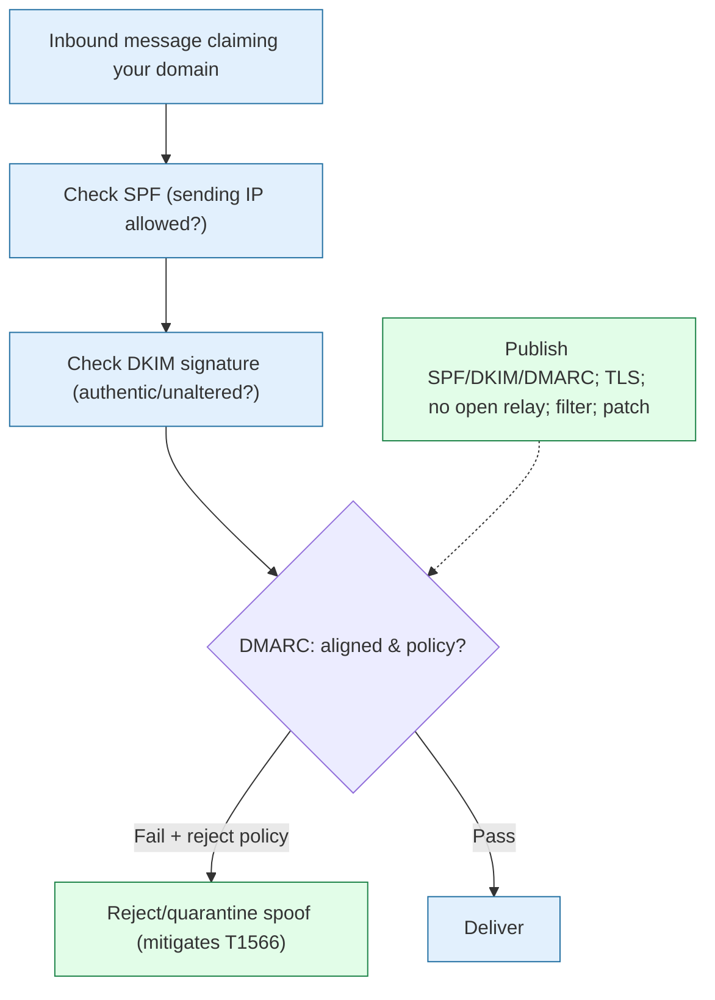

# Email Server Hardening (Authentication and Encryption)

## Summary

Email is a top attack vector (phishing, spoofing) and email servers are frequently abused as open relays, so hardening covers both protecting your users and preventing your infrastructure from being weaponised. The key measures are **sender authentication** — **SPF** (which servers may send for a domain), **DKIM** (cryptographic signatures on messages), and **DMARC** (policy tying SPF/DKIM to the visible From, with reporting) — which together make spoofing your domain much harder (mitigating phishing, T1566). Add **transport encryption** (TLS/STARTTLS, ideally MTA-STS to resist downgrade), **close open relays** (authenticate submission), apply spam/malware filtering, and keep the MTA patched. Properly configured SPF/DKIM/DMARC is one of the highest-leverage anti-phishing controls available.

## Core controls

| Control | Purpose |
|---|---|
| **SPF** | Declare which servers may send for your domain |
| **DKIM** | Cryptographically sign outbound mail; detect tampering/forgery |
| **DMARC** | Enforce alignment of SPF/DKIM with the From header; get reports |
| **TLS / STARTTLS / MTA-STS** | Encrypt mail in transit; resist downgrade |
| **No open relay; authenticated submission** | Stop your server sending spam for others |
| **Spam/malware filtering; patching** | Block malicious inbound; close vulns |

The anti-spoofing trio is the headline: SPF says who may send, DKIM proves the message wasn't forged or altered, and DMARC ties both to what the user actually sees and tells you who's abusing your domain.

## Mail authentication flow

## Detection / value

- **DMARC reports** reveal who is spoofing your domain and whether legitimate mail passes.
- **Spoofing resistance**: SPF/DKIM/DMARC make domain impersonation (phishing) much harder.
- **Relay abuse prevention**: authenticated submission stops your server sending spam.
- Inbound auth failures and filtering hits are detection signals for phishing campaigns.

## Defense / practices

- **Publish SPF, DKIM, and an enforcing DMARC policy** (`p=quarantine`/`reject`) and monitor reports.
- **Require TLS** (STARTTLS, MTA-STS) for transport encryption and anti-downgrade.
- **Close open relays**: require authentication for submission; restrict relay hosts.
- **Filter spam/malware** on inbound; sandbox attachments where possible.
- **Patch the MTA** (Postfix/Exim/Sendmail) and run least-privileged.

## ATT&CK mapping

| ID | Name | Tactic |
|---|---|---|
| T1566 | Phishing | Initial Access |

(Email authentication hardening mitigates phishing/spoofing; it is a defensive control.)

## Explanation

Email was built in a trusting era where anyone could put any name in the "From" line, which is why phishing works so well. The modern fix is three cooperating stamps on your domain's mail. SPF is a public notice saying "only these post offices are allowed to send letters in my name." DKIM adds a wax seal that proves a letter really came from you and wasn't steamed open and altered. DMARC is the instruction to recipients: "if a letter claims to be from me but has no valid notice or seal, bin it — and send me a report of who tried." Publish all three with teeth and impersonating your domain becomes very hard, which cuts off a huge amount of phishing. The other half is hygiene: encrypt mail in transit, and make sure your own mail server won't cheerfully send spam on a stranger's behalf.
