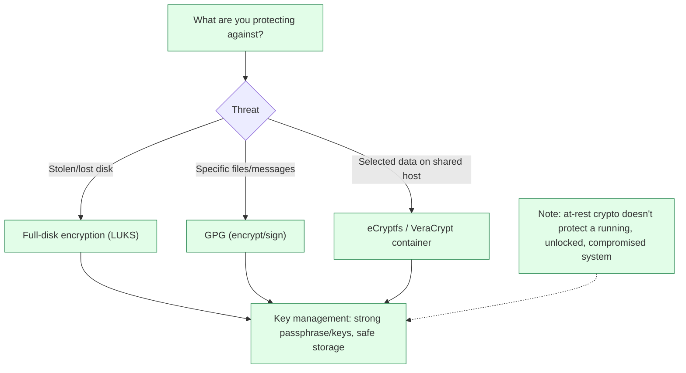

# Linux Encryption Tools (GPG, LUKS, eCryptfs, VeraCrypt)

## Summary

Encryption protects data confidentiality (and often integrity) at rest and in transit, and Linux offers mature tools for each scope. **GPG** encrypts and signs files and messages (data at rest / in transit, symmetric or public-key). **LUKS** (via `cryptsetup`/dm-crypt) provides full-disk or block-device encryption so a lost or stolen disk reveals nothing without the key. **eCryptfs** encrypts at the filesystem/per-directory level, and **VeraCrypt** offers cross-platform encrypted containers. Choosing the right tool depends on the threat: full-disk encryption defends against physical theft but not a compromised running system; file/container encryption protects selected data even on a shared host. Understanding scope and key management is the crux — encryption is only as strong as how the keys are generated, stored, and protected.

## Tools and scope

| Tool | Scope | Protects against |
|---|---|---|
| **GPG** | Files, messages (sym/asym) | Interception, at-rest exposure of specific data |
| **LUKS/dm-crypt** | Full disk / block device | Physical theft of powered-off disk |
| **eCryptfs** | Per-directory filesystem | Selective data at rest, per-user |
| **VeraCrypt** | Encrypted containers (cross-platform) | Portable encrypted storage |

The essential caveat: encryption at rest defends a disk that's off or data that's locked, but once the system is running and the volume is unlocked, a compromise of that live system can read the plaintext — so disk encryption is not a substitute for host security.

## Choosing by threat

## Defensive value

- **Full-disk (LUKS)**: lost/stolen devices reveal no data without the key.
- **File/message (GPG)**: protect and sign specific data in transit and at rest; verify authenticity.
- **Selective (eCryptfs/VeraCrypt)**: protect chosen data on multi-user or portable storage.
- **Integrity/authenticity** via signatures (GPG) for software and messages.

## Defense / practices

- **Match tool to threat**: disk encryption for physical loss; file/container for selective at-rest.
- **Manage keys well**: strong passphrases, protected private keys, secure backups, consider hardware tokens/TPM.
- **Remember the limits**: unlocked volumes on a live, compromised host are readable — keep the host secure too.
- **Verify signatures** (GPG) on software and updates.
- **Use vetted algorithms/defaults**; keep tooling updated.

## ATT&CK mapping

No single ATT&CK technique; encryption is a protective control. Related adversary techniques (e.g. credential/key theft from memory) are covered in forensic and credential-access files.

## Explanation

Encryption scrambles data so only someone with the key can read it, but "which data, and when" matters enormously, so Linux gives you different tools for different jobs. If you're worried about a laptop being stolen, you encrypt the whole disk (LUKS) so the thief gets a brick of noise. If you want to email a sensitive file or prove it came from you, you reach for GPG, which both locks and signs. If you share a machine and only some data is secret, you encrypt just that folder or a container. The one thing people forget is that locking the disk only helps while it's locked: once you've booted up and typed your passphrase, the data is sitting there in the clear for any program — including malware that's broken into the running system — to read. Encryption at rest guards the safe while it's shut; it does nothing if you've left the safe open and let a burglar inside.
