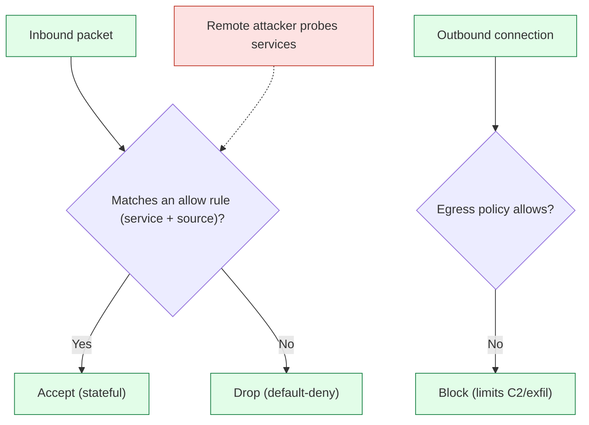

# Linux Firewalls and Network Hardening (iptables, TCP Wrappers)

## Summary

A host firewall limits which network services are reachable and from where, shrinking the attack surface that remote attackers can touch. On Linux this is built on the kernel's **netfilter** framework, configured via `iptables` (and its successor `nftables`, with front-ends like `ufw` and `firewalld`). The principle is **default-deny**: block everything inbound, then allow only the specific services and sources that are needed. Complementary controls include egress filtering (limiting outbound connections to catch C2/exfiltration), connection-state tracking, rate limiting, and the older per-service access control of **TCP Wrappers** (`hosts.allow`/`hosts.deny`). Host firewalling is a foundational hardening step because even a vulnerable service can't be exploited by someone who can't reach it.

## Building blocks

| Mechanism | Role |
|---|---|
| **netfilter / iptables / nftables** | Kernel packet filtering: inbound/outbound/forward rules |
| **Default-deny policy** | Block all, allow only what's needed |
| **Stateful filtering** | Track connections (established/related) for correct allow rules |
| **Egress filtering** | Restrict outbound to detect/limit C2 and exfiltration |
| **Rate limiting** | Blunt brute-force and some floods |
| **TCP Wrappers** (`hosts.allow/deny`) | Per-service source restriction (legacy, service-dependent) |

The default-deny model is the heart of it: you don't try to enumerate every bad thing to block; you block all and permit the short list of known-good, which fails safe as services come and go.

## Firewall decision

## Defensive value

- **Reduces remote attack surface**: unreachable services can't be remotely exploited.
- **Limits lateral movement and C2/exfil** via egress and source restrictions.
- **Rate limiting** slows brute-force and some abuse.
- **Defence in depth**: a safety net even when a service is misconfigured.

## Defense / practices

- **Default-deny inbound**; allow only required services from required sources.
- **Add egress filtering** to constrain outbound traffic (catch C2/exfiltration).
- **Use stateful rules** and keep rulesets documented and version-controlled.
- **Rate-limit** exposed auth services; combine with fail2ban-style blocking.
- **Prefer nftables/modern front-ends**; treat TCP Wrappers as a legacy supplement, not a primary control.

## ATT&CK mapping

No single ATT&CK technique; host firewalling mitigates remote exploitation (T1190), lateral movement, and C2/exfiltration techniques documented in their own files.

## Explanation

A host firewall is the bouncer on each machine's door, and the only sane way to run it is "nobody comes in unless they're on the list." Instead of trying to recognise every possible troublemaker (an endless, losing game), you simply turn everyone away except the handful of services and sources you've explicitly approved. That single policy quietly neutralises a huge class of attacks, because a service with a dangerous bug can't be exploited by someone the bouncer never lets near it. The smartest setups also watch the *exit*: by limiting what the machine is allowed to connect out to, they make it far harder for malware already inside to phone home or ship stolen data out. It's unglamorous, but a tight default-deny firewall is one of the highest-value things you can put on a Linux host.
