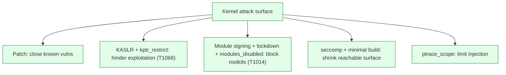

# Linux Kernel Configuration and Hardening

## Summary

The kernel is the most privileged code on a Linux system, so hardening it reduces the impact of both kernel exploits and post-exploitation abuse. Kernel hardening spans build-time options (removing unneeded drivers/features, enabling self-protection like stack protector, KASLR, and structure hardening) and runtime `sysctl` settings (`kernel.yama.ptrace_scope`, `kernel.kptr_restrict`, `kernel.dmesg_restrict`, `kernel.unprivileged_bpf_disabled`, module-loading controls). Complementary mechanisms include kernel **lockdown**, module signing, `kernel.modules_disabled`, seccomp to restrict syscalls per-process, and KASLR to randomise kernel addresses. The aim is to shrink the kernel's attack surface and make exploitation (exploitation for privilege escalation, T1068) and kernel rootkits (T1014) harder — layered with keeping the kernel patched, which closes the vulnerabilities themselves.

## Hardening measures

| Measure | Effect |
|---|---|
| **KASLR** | Randomise kernel addresses — harder exploitation |
| **Module signing + lockdown** | Only signed modules load; restrict kernel tampering (anti-rootkit) |
| **`modules_disabled`** | Forbid further module loading after boot |
| **`ptrace_scope` (Yama)** | Restrict which processes can ptrace others (anti-injection) |
| **`kptr_restrict` / `dmesg_restrict`** | Hide kernel pointers/logs that aid exploits |
| **seccomp** | Per-process syscall allowlists to shrink kernel surface |
| **Minimal build** | Remove unneeded drivers/features (less attack surface) |

The theme is layered reduction: shrink what the kernel exposes, make addresses unpredictable, forbid untrusted kernel code, and constrain how user space reaches the kernel — so even a bug is harder to exploit and a rootkit is harder to install.

## Hardening the kernel surface

## Detection / value

- **Reduces exploitability** of kernel bugs (KASLR, info-leak restrictions).
- **Blocks kernel rootkits** via module signing/lockdown (LKM rootkits can't load unsigned).
- **Limits injection** (ptrace_scope) and per-process kernel surface (seccomp).
- Changes to these settings (e.g. re-enabling module loading) are themselves suspicious signals.

## Defense / practices

- **Patch the kernel promptly** — hardening complements, not replaces, fixing vulnerabilities.
- **Enable module signing and lockdown**; set `modules_disabled` where feasible.
- **Set protective `sysctl`s** (`ptrace_scope`, `kptr_restrict`, `dmesg_restrict`, restrict unprivileged BPF/userns as appropriate).
- **Use seccomp** for exposed services; enable KASLR and build-time self-protections.
- **Monitor** for changes to kernel hardening settings and unexpected module loads.

## ATT&CK mapping

| ID | Name | Tactic |
|---|---|---|
| T1068 | Exploitation for Privilege Escalation | Privilege Escalation |
| T1014 | Rootkit | Stealth |

(Kernel hardening mitigates these techniques.)

## Explanation

The kernel is the vault at the centre of the building, and everything else trusts it completely — so the day an attacker cracks it, the whole building is theirs. Kernel hardening is about making that vault harder to crack and harder to tamper with once someone's near it. You shuffle the vault's internal layout each time the system boots so a thief's map is useless (KASLR), you refuse to install any new vault machinery that isn't factory-sealed (module signing and lockdown, which shuts out kernel rootkits), you stop leaking the blueprints lying around (hiding kernel addresses and logs), and you fit each visiting program with a narrow set of permitted requests so it can't poke at parts of the vault it has no business touching (seccomp). None of this replaces simply fixing the vault's known flaws — you still patch — but layered together it turns many would-be break-ins into expensive failures.
