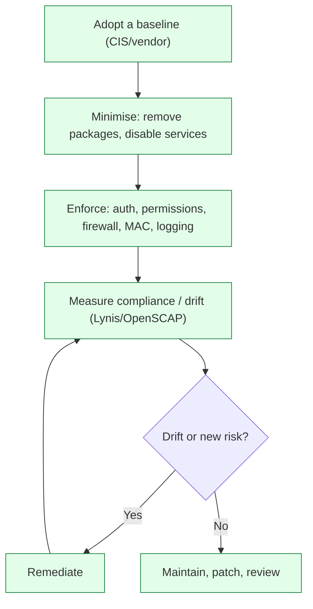

# Linux Security Policy and Hardening Basics

## Summary

Hardening a Linux system means reducing its attack surface and enforcing least privilege through a consistent set of configuration choices, ideally driven by a published baseline (CIS Benchmarks, vendor guides) rather than ad-hoc tweaks. The fundamentals span account and authentication policy (strong auth, limited sudo, no shared accounts), minimising installed software and running services, correct file permissions, host firewalling, logging and auditing, and timely patching. None of these is exotic, but applied together and maintained they remove the easy footholds that most intrusions rely on — default credentials, unnecessary exposed services, weak permissions, and missing patches. This file frames the core areas; the specific topics (PAM/sudo, SSH, firewalls, SELinux, kernel hardening, auditing) have their own detailed files.

## Core hardening areas

| Area | Measures |
|---|---|
| **Accounts & auth** | Strong passwords/keys, limited sudo, no shared/root logins, lock unused accounts |
| **Minimise surface** | Remove unneeded packages; disable/stop unused services |
| **Permissions** | Correct file/dir modes, minimal SUID/SGID, safe umask |
| **Network** | Host firewall (default-deny), restrict listening services |
| **Logging & audit** | Central logging, auditd, time sync |
| **Updates** | Patch OS and software promptly; manage vulnerabilities |
| **MAC** | SELinux/AppArmor enforcing where possible |

The leverage comes from using a vetted baseline: it encodes expert decisions across hundreds of settings, so you enforce proven defaults and spend effort on maintenance and drift rather than researching each knob.

## Hardening lifecycle

## Defensive value

- **Removes common footholds**: default creds, needless services, weak permissions, missing patches.
- **Consistency at scale**: baselined hosts are easier to monitor and anomalies stand out.
- **Defence in depth**: layered controls (least privilege + MAC + firewall + logging).
- **Measurable**: compliance scanning shows posture and drift.

## Defense / practices

- **Adopt and tailor a baseline** (CIS/vendor) rather than ad-hoc settings.
- **Minimise software and services**; close unused ports.
- **Enforce least privilege** (sudo, permissions, MAC) and strong authentication.
- **Enable logging/auditing** and central collection; keep time synced.
- **Scan for compliance/vulnerabilities** (Lynis, OpenSCAP) and patch continuously.

## ATT&CK mapping

No single ATT&CK technique; baseline hardening reduces attack surface across many techniques (valid accounts, exploitation of services, privilege escalation) documented in their own files.

## Explanation

Hardening a Linux box is mostly about not leaving the easy doors open, because that's how the overwhelming majority of break-ins happen — a default password, a forgotten service listening to the internet, a file anyone can write, a patch never applied. A security baseline is a checklist written by people who've cleaned up thousands of these messes; it tells you safe settings for hundreds of details at once, so instead of agonising over each one you apply the whole proven standard and get on with your day. The ongoing work isn't picking settings — it's keeping them. Machines drift, new software arrives, patches lag, so the real discipline is measuring your systems against the baseline regularly and fixing what has quietly slipped back toward "convenient but insecure."
