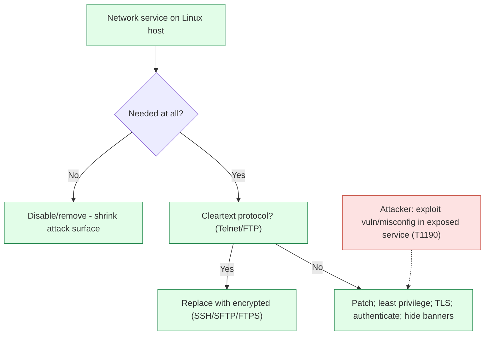

# Linux Service Security (Web, FTP, Mail, Remote Shell)

## Summary

Every network service a Linux host runs is an entry in its attack surface, and a vulnerable or misconfigured service is a classic way in (exploit public-facing application, T1190). The common offenders are web servers (Apache/nginx), file transfer (FTP), mail (SMTP), and legacy remote shells (Telnet, rlogin). The through-line of hardening them is the same: **run only what you need**, run it **least-privileged**, **encrypt** its traffic, **authenticate** access, keep it **patched**, and **don't leak** version banners, directory listings, or default pages. Two services deserve a blunt verdict: **Telnet and plain FTP send credentials in cleartext and should be replaced** (SSH and SFTP/FTPS) rather than hardened. For the rest, the work is trimming configuration down to the minimum and putting a patched, confined daemon behind proper authentication and TLS.

## Services and key measures

| Service | Main risks | Hardening |
|---|---|---|
| **Web (Apache/nginx)** | Vulns, exposed configs, directory listing, info leak | Patch; disable unused modules; no autoindex; hide version; TLS; limit methods; run as non-root worker |
| **FTP** | Cleartext credentials, bounce, anon write | Prefer SFTP/FTPS; disable anonymous write; chroot users; TLS if FTP required |
| **Mail (SMTP)** | Open relay, cleartext auth, spoofing | Authenticated submission; no open relay; TLS; SPF/DKIM/DMARC (see email hardening) |
| **Telnet / rlogin** | Cleartext credentials and session | **Replace with SSH**; do not expose |

The single highest-value rule is to stop running the cleartext protocols at all: Telnet and unprotected FTP hand an eavesdropper the password directly, and no amount of other tuning fixes that.

## Hardening a service

## Detection / value

- **Smaller surface**: a service that isn't running can't be exploited (T1190).
- **No cleartext**: encrypted protocols defeat credential sniffing on the wire.
- **Least privilege**: a compromised worker process can't trivially become root.
- Unexpected listening ports, version-scan hits, and auth failures are detection signals.

## Defense / practices

- **Run only required services**; disable or remove the rest and audit listening ports.
- **Replace cleartext protocols** (Telnet, plain FTP) with SSH/SFTP/FTPS.
- **Patch** daemons promptly and subscribe to their security advisories.
- **Confine**: run as dedicated non-root users, chroot/jail where supported, apply SELinux/AppArmor profiles.
- **Harden config**: disable unused modules, directory listings, and verbose banners; enforce TLS; restrict allowed methods/commands.

## ATT&CK mapping

| ID | Name | Tactic |
|---|---|---|
| T1190 | Exploit Public-Facing Application | Initial Access |

(Service hardening reduces the exploitable surface that T1190 targets; it is a defensive control.)

## Explanation

Think of each network service as a door into the building. The first question is never "how strong is the lock?" but "do we need this door at all?" — every door you brick up is one nobody can pick. For the doors you keep, two of them, Telnet and old-style FTP, are made of glass: they shout the password across the street for anyone to hear, so you don't reinforce them, you rip them out and fit a solid encrypted one (SSH, SFTP). The rest you harden the boring way: keep the lock up to date (patch), don't let the door open straight into the vault (run the service as a limited user, not root), don't post a sign saying exactly which model of lock it is (hide version banners), and don't leave the hallway lights showing every room (no directory listings). None of it is exotic; it's just refusing to leave unnecessary, unlocked, or glass doors in a building full of valuables.
