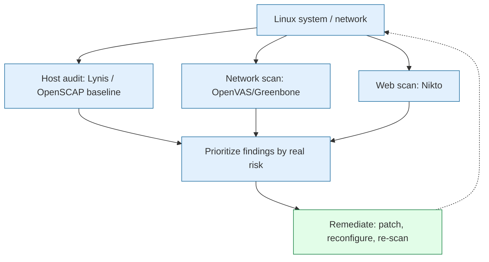

# Linux Vulnerability Scanning and Compliance Auditing

## Summary

You can't harden what you don't measure, so the complement to configuration is **assessment**: scanning a Linux system for known vulnerabilities and auditing it against a hardening standard. The tooling splits by scope. **System/host auditing** — **Lynis** (host hardening audit) and **OpenSCAP** (automated checks against SCAP content such as CIS/DISA STIG baselines) — tells you where a box deviates from a secure configuration. **Network vulnerability scanning** — **OpenVAS/Greenbone** — probes services across the network for known CVEs and misconfigurations. **Web application scanning** — **Nikto** and similar — checks web servers for dangerous files, outdated software, and common issues. Run defensively and with authorization, these are how you *find* the exposed service, missing patch, or weak setting before an attacker does, and how you *prove* a system meets a baseline. The discipline is to scan regularly, prioritize by real risk, and feed findings back into patching and configuration — a scan that nobody acts on is just a report.

## Tooling by scope

| Scope | Tool(s) | What it answers |
|---|---|---|
| **Host hardening audit** | Lynis | How far does this box deviate from good practice? |
| **Compliance/baseline** | OpenSCAP + SCAP content (CIS/STIG) | Does this system meet the required baseline? |
| **Network vuln scan** | OpenVAS / Greenbone | Which networked services have known CVEs/misconfigs? |
| **Web app scan** | Nikto | Does this web server expose risky files/versions? |

Host audit and compliance tools look inward at configuration; network and web scanners look outward at what's exposed. A full picture usually needs both.

## Assess-and-remediate loop

## Detection / value

- **Find before the attacker**: scanning surfaces missing patches and exposed services you can fix first.
- **Prove a baseline**: OpenSCAP/Lynis turn "we think it's hardened" into evidence against CIS/STIG.
- **Continuous view**: regular scans catch drift as systems change over time.
- Unexpected new services or regressions between scans are themselves signals.

## Defense / practices

- **Scan regularly and with authorization**: schedule host audits and network/web scans, not one-offs.
- **Baseline with SCAP content** (CIS/DISA STIG via OpenSCAP) and track compliance over time.
- **Prioritize by exploitability and exposure**, not raw CVE counts; fix internet-facing and high-severity first.
- **Close the loop**: feed findings into patching and configuration, then re-scan to confirm.
- **Keep scanners and their feeds updated** so checks reflect current vulnerabilities.

## ATT&CK mapping

No single ATT&CK technique; vulnerability scanning and compliance auditing are defensive assessment activities that reduce the exploitable surface (e.g. T1190) by finding and fixing weaknesses before adversaries exploit them.

## Explanation

Hardening without scanning is like locking up the house in the dark — you *feel* secure, but you never actually checked which windows you left open. Scanning turns the lights on. Some tools walk through the house with a checklist comparing it to the building code (Lynis, OpenSCAP against CIS or STIG baselines) and tell you "this latch is missing, this door doesn't meet spec." Others stand in the street and rattle every door and window from outside, the way a burglar would, to see which ones give (OpenVAS for the network, Nikto for web servers). The trap people fall into is treating the resulting report as the finish line. The report is worthless until someone fixes the open window and walks the house again to confirm it's shut. So the real practice is a loop: check, fix, re-check — on a schedule, forever — because every software update and config change can quietly open a new window while you weren't looking.
