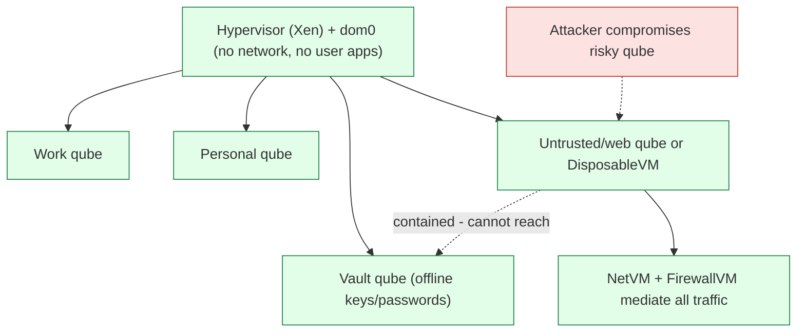

# Qubes OS and Workstation Hardening (Compartmentalization)

## Summary

A normal desktop runs your browser, email, work tools, and crypto wallet in one shared environment, so a single compromise — one malicious attachment, one browser exploit — can reach everything. **Qubes OS** takes the opposite stance: **security by compartmentalization**. It uses the **Xen hypervisor** to run your activities in separate virtual machines ("qubes") — e.g. a *work* qube, a *personal* qube, an untrusted *web* qube — so a compromise is contained to that one qube and can't automatically touch the others. Sensitive components are isolated further: a network-less *vault* qube holds keys and passwords, networking is pushed into a dedicated *NetVM*, and a *firewall* qube mediates traffic. The administrative domain (*dom0*) has no network access and runs no user apps. The general lesson for any workstation is the same even without Qubes: **separate trust levels**, minimize what each context can reach, and don't do high-risk and high-value activities in the same place.

## Qubes model

| Component | Role |
|---|---|
| **dom0** | Admin domain; no networking, no user apps; controls the rest |
| **App qubes** (work/personal/untrusted) | Isolated VMs per trust level/activity |
| **NetVM** | Owns network hardware; isolates the network stack |
| **FirewallVM** | Enforces per-qube network policy |
| **Vault qube** | Offline store for keys/passwords (no network) |
| **DisposableVMs** | Throwaway qubes for opening risky files/links |

The core idea: if the browser qube is popped, the attacker is trapped in a disposable or untrusted VM, not sitting next to your keys, work files, and banking session.

## Compartmentalized workstation

## Detection / value

- **Containment**: a compromised qube can't reach other qubes' data or your offline vault.
- **Blast-radius control**: risky activity in disposable qubes leaves nothing persistent.
- **Reduced dom0 exposure**: no networking or apps in the admin domain shrinks its attack surface.
- Unexpected inter-qube traffic or policy violations are signals worth monitoring.

## Defense / practices

- **Separate trust levels**: distinct qubes/VMs for work, personal, and untrusted activity.
- **Isolate secrets**: keep keys/passwords in an offline, network-less context (vault qube).
- **Use disposables** for opening untrusted documents and links.
- **Keep dom0 minimal**: no networking, no general apps, updates via the controlled path.
- **General workstation lesson**: even without Qubes, use VMs/containers/separate users to split high-risk from high-value activities, and keep the host patched.

## ATT&CK mapping

No single ATT&CK technique; compartmentalization is an architectural mitigation that limits lateral movement and data access after an initial compromise.

## Explanation

Most computers are open-plan offices: one intruder who gets through the front door can wander into every room, read every file, and rifle every drawer. Qubes OS rebuilds the office as a set of sealed vaults with no connecting doors — the web browser works in one room, your job in another, your keys in a locked safe that isn't even wired to the phone lines, and the building's manager (dom0) sits in a room with no outside line at all. If a burglar climbs in through the browser window, they're stuck in that one room; they can't stroll over to the safe. You can even give visitors a paper room that you shred the moment they leave (disposable VMs). The deeper point survives even if you never run Qubes: don't keep your most dangerous activity and your most valuable secrets in the same room. Put walls between trust levels, and a single break-in stays a single break-in.
