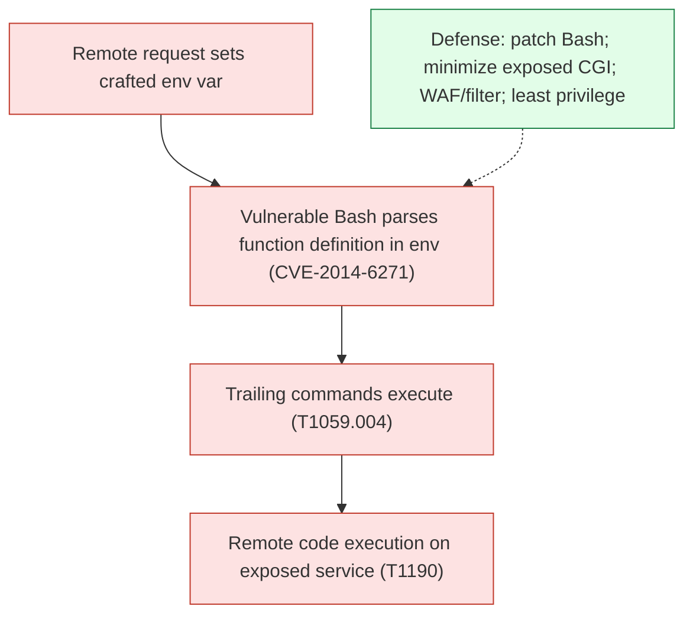

# Security-Focused Distributions and the Shellshock Lesson

## Summary

"Security-focused" Linux distributions come in two very different flavors, and conflating them is a mistake. **Offensive/testing distros** (Kali, Parrot) ship preloaded with scanning, exploitation, and forensics tools for authorized security work — they are a toolbox, not a hardened OS, and are deliberately not meant as a daily-driver server. **Privacy/hardening distros** (Tails for amnesic, Tor-routed browsing; Whonix for Tor isolation; hardened/minimal server builds) aim to reduce exposure and leakage. Picking a distro doesn't make you secure; patching and configuration do. The canonical reminder is **Shellshock (CVE-2014-6271, 2014)**: a flaw in the widely used **Bash** shell let attackers smuggle commands through environment variables, and because Bash sat behind CGI web servers, DHCP clients, and more, a remote attacker could run commands on vulnerable systems (exploit public-facing application, T1190, via command/scripting interpreter, T1059.004). The lesson endures: ubiquitous, trusted components fail too, and the only durable defense is rapid patching, minimal exposure, and defense in depth.

## Two kinds of "security" distro

| Type | Examples | Purpose | Caveat |
|---|---|---|---|
| **Offensive/testing** | Kali, Parrot | Preloaded pentest/forensics tooling | A toolbox, not a hardened daily OS |
| **Privacy/anonymity** | Tails, Whonix | Amnesic/Tor-routed, isolate identity | Protects privacy, still needs updates |
| **Hardened/minimal server** | Minimal server builds, hardened configs | Reduced attack surface | Configuration does the work, not the label |

The point isn't which logo boots up; it's that the distro only sets a starting posture. Shellshock showed that even a component as trusted and universal as Bash can carry a critical remote flaw.

## Shellshock in one view

## Detection / value

- **Patch urgency**: a ubiquitous component's flaw (Bash) can be remotely exploitable at scale, so fast patching is decisive.
- **Exposure matters**: Shellshock was dangerous because Bash sat behind network-reachable interfaces (CGI, DHCP).
- Anomalous environment variables in web/CGI requests and unexpected child shells are detection signals.
- Choosing the right distro for the job (offensive vs. hardened) avoids running a toolbox where you need a locked-down server.

## Defense / practices

- **Patch promptly**, especially core components (shells, libraries) that many services depend on.
- **Minimize exposure**: don't expose CGI/legacy interfaces that pipe untrusted input into shells; prefer modern app servers.
- **Defense in depth**: WAF/input filtering, least privilege, and segmentation so one component's flaw isn't game over.
- **Use distros for their purpose**: Kali/Parrot for authorized testing; hardened/minimal builds for servers; Tails/Whonix for privacy — and keep all of them updated.

## ATT&CK mapping

| ID | Name | Tactic |
|---|---|---|
| T1190 | Exploit Public-Facing Application | Initial Access |
| T1059.004 | Command and Scripting Interpreter: Unix Shell | Execution |

## Explanation

People sometimes think installing a "security" Linux makes a machine secure, the way buying a toolbox makes you a carpenter. It doesn't. Kali and Parrot are toolboxes for attackers-with-permission; Tails and Whonix are for travelling without leaving footprints; a hardened server build is a stripped-down, bolted-shut box. Each is a starting point, not a guarantee. And the thing that undoes guarantees is best captured by Shellshock: Bash, the humble command interpreter running on nearly every Linux box on earth, turned out to have a hole where a cleverly worded environment variable would make it run attacker commands. Because Bash was quietly standing behind web servers and network services, that hole was remotely reachable on a staggering number of machines overnight. The moral isn't "distrust Bash"; it's that even the most trusted, everywhere-present part can fail, so you patch fast, you don't expose more than you must, and you never bet the whole house on any single wall holding.
