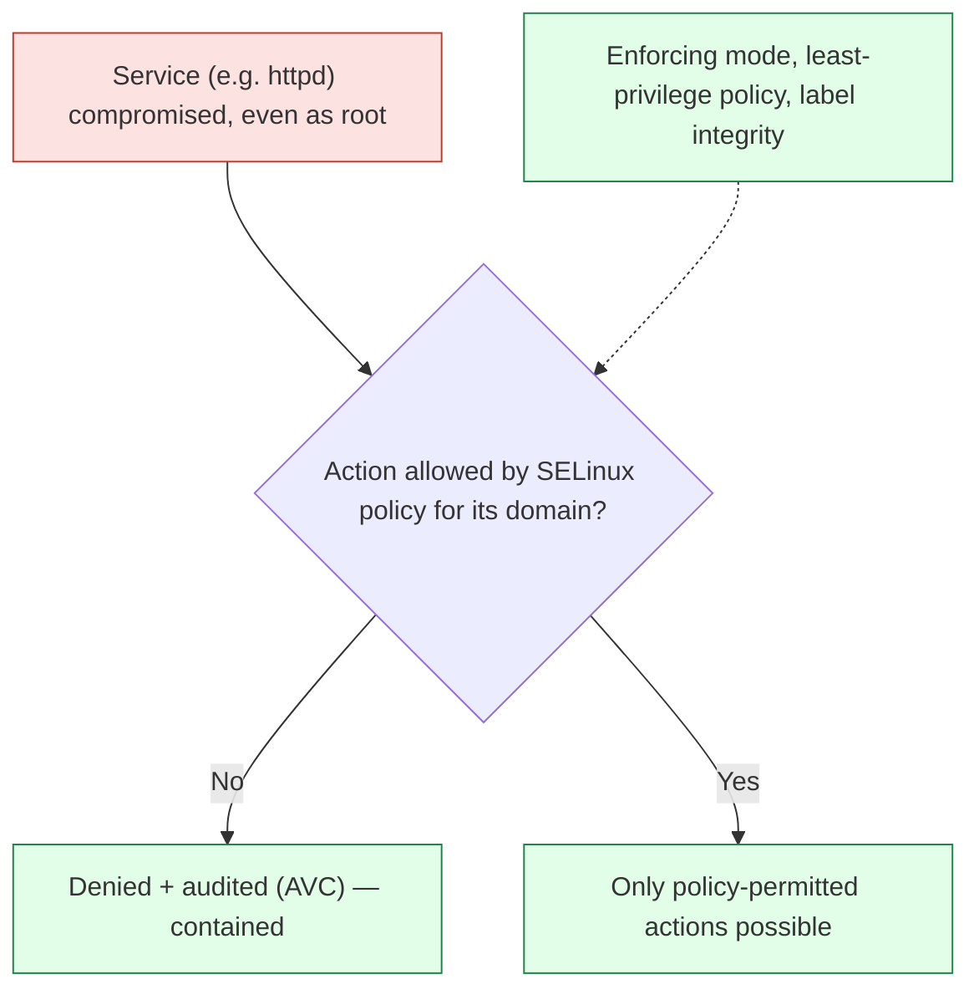

# SELinux and Mandatory Access Control

## Summary

Traditional Linux permissions are **discretionary** (DAC): the owner of a resource decides who may access it, and root can do anything. **Mandatory Access Control (MAC)** adds a system-wide policy that even root and resource owners cannot override, so a process is confined to exactly what the policy allows regardless of file permissions. **SELinux** (and the simpler **AppArmor**) implement MAC through the Linux Security Module framework. SELinux labels every process and object with a security context and enforces a policy of allowed interactions (type enforcement), so a compromised service — say a web server — is boxed into its domain and cannot read `/etc/shadow` or spawn a shell even if it's running as root. This containment dramatically limits the blast radius of exploited services, which is why MAC in enforcing mode is a key hardening control.

## DAC vs MAC

| Model | Who decides | Limitation / strength |
|---|---|---|
| **DAC** (standard perms) | Owner; root overrides all | A compromised root process can do anything |
| **MAC** (SELinux/AppArmor) | System-wide policy; owner/root can't override | Confines processes to allowed actions regardless of UID |
| **SELinux type enforcement** | Labels + allow rules | Fine-grained domain confinement |
| **Enforcing vs permissive** | Policy blocks vs only logs | Enforcing actually contains; permissive only audits |

The decisive property: MAC confines by policy, not by identity, so even a root-level compromise of a confined service stays inside its box — the exploit succeeds but reaches far less than it otherwise would.

## How MAC contains a compromise

## Detection / value

- **Contains exploited services**: a compromised daemon can't step outside its domain (read secrets, spawn shells, write system files) even as root.
- **AVC audit denials** reveal both attacks and misconfigurations (what the policy blocked).
- **Limits lateral/privilege escalation** from a service foothold.
- Attempts to set SELinux permissive/disabled are strong tamper signals.

## Defense / practices

- **Run SELinux (or AppArmor) in enforcing mode**; don't disable it to "fix" problems — fix the policy.
- **Use least-privilege, confined policies** for services; keep labels correct.
- **Monitor AVC denials** for both attacks and needed policy adjustments.
- **Alert on MAC being set permissive/disabled** (tampering).
- **Combine with DAC and other hardening** — MAC is defence in depth, not a replacement.

## ATT&CK mapping

No single ATT&CK technique; MAC mitigates privilege escalation, exploitation of services (T1190/T1068), and lateral movement by confining compromised processes.

## Explanation

Normal Linux permissions work like a house where the owner of each room decides who gets a key, and the landlord (root) has a master key to everything — which is fine until a burglar becomes the landlord. Mandatory Access Control adds a rulebook written by building management that *even the landlord must obey*: "the person who waters the plants may enter the greenhouse and nowhere else, no exceptions, master key or not." SELinux enforces exactly that for programs. Your web server is assigned a role and may only do web-server things; if an attacker hijacks it and tries to read the password file or open a shell, the rulebook refuses — even though the process is technically root — and logs the attempt. The exploit still fires, but it finds itself locked in a small room, which is the whole point: MAC doesn't prevent every compromise, it shrinks what a compromise can reach.
