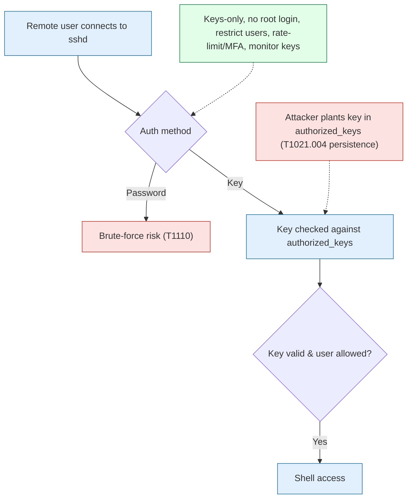

# SSH Hardening and Remote Access

## Summary

SSH is the standard secure remote-access protocol for Linux, and because it grants shell access it is one of the most attacked services on the internet — brute-forced for weak passwords and abused with stolen keys for lateral movement (remote services: SSH, T1021.004; brute force, T1110). Hardening SSH is therefore high-value and well understood: disable password authentication in favour of keys (ideally with passphrases), disable direct root login, restrict who may log in, move or rate-limit to blunt brute-forcing, and keep the server patched. Key management matters as much as the server config: an attacker who plants a key in `authorized_keys` has quiet, password-less persistence. Hardened SSH plus key hygiene removes the easiest and most common remote foothold.

## Key hardening measures

| Measure | Why |
|---|---|
| **Key-based auth; disable passwords** | Defeats password brute-force (T1110) |
| **`PermitRootLogin no`** | No direct root login; forces per-user accountability |
| **Restrict users/groups** (`AllowUsers`) | Least privilege for remote access |
| **Rate-limit / fail2ban / MFA** | Slow or stop brute-force; add a second factor |
| **Monitor `authorized_keys`** | Planted keys = silent persistence (T1021.004) |
| **Patch sshd; strong ciphers/KEX** | Close vulnerabilities and weak crypto |

Two points carry most of the value: turning off password auth eliminates the entire password-guessing attack, and watching `authorized_keys` catches the quiet backdoor an intruder leaves to walk back in without any password at all.

## Access and attack surface

## Detection

- Brute-force patterns: many failed SSH logins (T1110), then a success.
- New or modified `~/.ssh/authorized_keys` entries (silent key-based persistence).
- Logins from unexpected sources/times, or for accounts that shouldn't log in remotely.
- Root logins (if not disabled) and use of weak/legacy ciphers.

## Defense

- **Use key-based auth and disable passwords and root login.**
- **Restrict who can SSH** (`AllowUsers`/`AllowGroups`), and add MFA where possible.
- **Rate-limit/block brute-force** (fail2ban), and consider non-default exposure controls (VPN/bastion).
- **Monitor `authorized_keys`** and SSH logs for new keys and anomalous logins.
- **Patch sshd** and enforce strong ciphers/key-exchange.

## ATT&CK mapping

| ID | Name | Tactic |
|---|---|---|
| T1021.004 | Remote Services: SSH | Lateral Movement |
| T1110 | Brute Force | Credential Access |

## Explanation

SSH is the front door to a Linux machine, and because it opens straight onto a command prompt, the whole internet is constantly jiggling the handle. The single biggest improvement is to stop using a password at all and switch to cryptographic keys: a password can be guessed by a tireless robot, a good key cannot. The next is to forbid logging in directly as root, so every session is tied to a named person. But the subtle, often-missed risk is the key list itself — `authorized_keys`. Anyone who can slip their own key into that file has a permanent, password-free way back in that no amount of password policy will catch, which is why a hardened setup watches that file as closely as it watches the login attempts. Keys instead of passwords, no root door, and a close eye on the key list: that trio removes the most common way Linux boxes fall.
