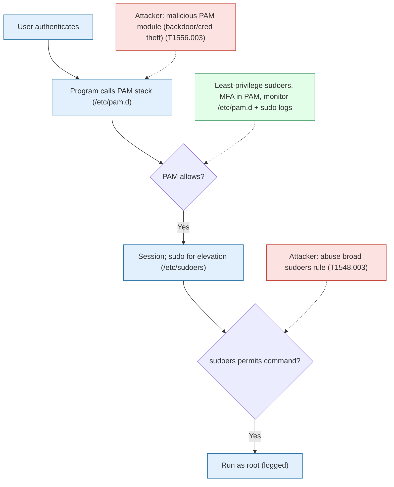

# Linux User Authentication, PAM and sudo

## Summary

Linux authentication is pluggable: **PAM (Pluggable Authentication Modules)** is the framework that programs call to authenticate users, enforce password policy, and apply session rules, configured through stacks in `/etc/pam.d`. **sudo** provides controlled privilege elevation, letting specified users run specified commands as root (or another user) with logging, governed by `/etc/sudoers`. Together they are central to Linux access control — and to its abuse: attackers target sudo misconfigurations to escalate (abuse elevation control mechanism: sudo and sudo caching, T1548.003) and tamper with PAM to create authentication backdoors or steal credentials (modify authentication process: pluggable authentication modules, T1556.003). Hardening centres on least-privilege sudoers rules, strong PAM policy (including MFA), and monitoring both for tampering.

## The components

| Component | Role / risk |
|---|---|
| **PAM** (`/etc/pam.d`) | Auth, account, password, session stacks; MFA integration — a backdoor target (T1556.003) |
| **sudo** (`/etc/sudoers`) | Controlled elevation with logging; misconfig = escalation (T1548.003) |
| **sudo caching** | A timestamp lets repeated sudo without re-auth (abuse window) |
| **NSS** | How users/groups are resolved (files, LDAP, etc.) |

Two classic risks: overly broad sudoers entries (e.g. allowing a command that can spawn a shell, or `ALL` without need) grant root; and a malicious PAM module can log every password or accept a magic one — a stealthy, persistent backdoor.

## Auth and elevation flow

## Detection

- Changes to `/etc/pam.d/*` or new/modified PAM modules (`.so`) — a backdoor indicator (T1556.003).
- Changes to `/etc/sudoers`/`sudoers.d` and sudo use of commands that can spawn shells.
- Successful sudo to root by unexpected users, or failed-then-successful patterns.
- Authentication anomalies (odd hours/sources), and sudo logs showing privilege use.

## Defense

- **Least-privilege sudoers**: grant specific commands, avoid `ALL` and shell-spawning binaries; use `sudo` logging.
- **Strong PAM policy**: password quality, lockout, and MFA (e.g. pam modules for OTP).
- **Monitor `/etc/pam.d` and sudoers** for tampering (file integrity, auditd).
- **Review sudo caching** timeout; require re-auth for sensitive actions.
- **Centralise auth logs** and alert on privilege escalation and PAM changes.

## ATT&CK mapping

| ID | Name | Tactic |
|---|---|---|
| T1548.003 | Abuse Elevation Control Mechanism: Sudo and Sudo Caching | Privilege Escalation |
| T1556.003 | Modify Authentication Process: Pluggable Authentication Modules | Credential Access, Defense Impairment, Persistence |

## Explanation

Two mechanisms decide who gets in and who gets to act as root. PAM is the configurable front door: a stack of checks that programs run you through when you log in, where an admin can demand a strong password, a second factor, or lockouts after failures. sudo is the controlled key to the executive floor: it lets named people run specific privileged commands and writes down every use. Both are prime targets. Give someone a sudo rule that's a little too generous — a command that can quietly launch a shell — and they've got full root. Slip a tampered module into the front door and it can pocket every password typed or swing open for a secret knock, a backdoor that survives reboots. So the hardening is symmetrical: make sudo rules as narrow as possible and watch the door's configuration like a hawk, because a change there is one of the quietest and most dangerous things an intruder can make.
