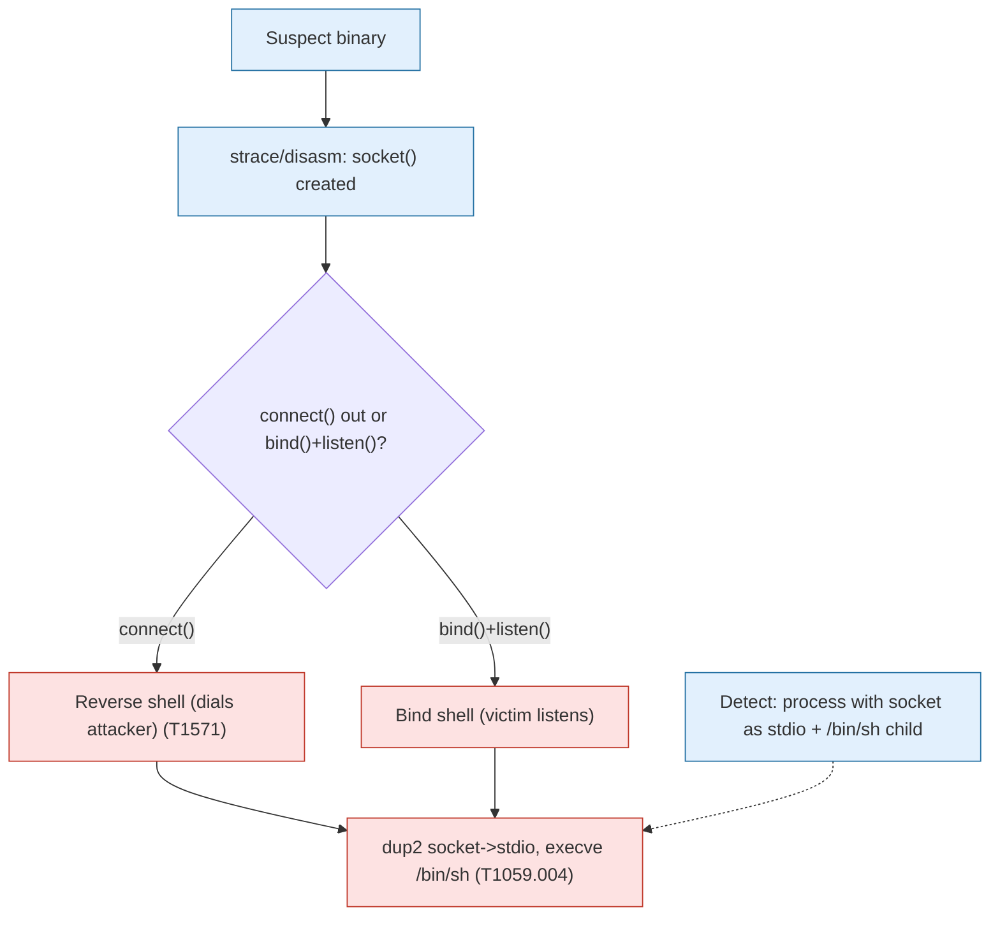

# Analyzing Bind and Reverse Shell Binaries on Linux

## Summary

A shell payload gives an attacker command execution over the network, and the two classic shapes are the **bind shell** (the victim listens on a port and the attacker connects in) and the **reverse shell** (the victim connects *out* to the attacker, which beats inbound firewalls and is far more common today). Both ultimately wire a shell's standard input/output to a socket. Analysing such a binary — recognising the socket setup, the connect/listen call, the `dup2` of file descriptors onto the socket, and the `execve` of `/bin/sh` — is a core Linux malware-analysis skill (command and scripting interpreter: Unix shell, T1059.004). Understanding the pattern makes these payloads easy to spot both in reverse engineering and in behavioural detection, since the syscall sequence is distinctive.

## The shell-payload pattern

| Step | Bind shell | Reverse shell |
|---|---|---|
| **Socket** | `socket()` | `socket()` |
| **Direction** | `bind()` + `listen()` + `accept()` (victim listens) | `connect()` to attacker (victim dials out) |
| **Wire up I/O** | `dup2()` socket → stdin/stdout/stderr | `dup2()` socket → stdin/stdout/stderr |
| **Execute** | `execve("/bin/sh", ...)` | `execve("/bin/sh", ...)` |

The `dup2`-then-`execve("/bin/sh")` sequence on a socket is the signature of a shell payload; reverse shells dominate because an outbound connection evades inbound firewall rules (non-standard ports are common, T1571).

## Analysis / detection view

## Detection

- A process whose standard input/output file descriptors are a network socket, then spawning `/bin/sh` (strong shell-payload signal).
- `dup2` of a socket onto FDs 0/1/2 followed by `execve` of a shell (syscall trace).
- Unexpected listeners (bind shell) or outbound connections from odd processes (reverse shell), often on non-standard ports (T1571).
- Shell processes with a network parent/ancestry.

## Defense

- **Egress filtering** to block reverse-shell callouts; restrict inbound to stop bind shells.
- **Monitor for shells with socket stdio** and anomalous process-network relationships (auditd/EDR).
- **Alert on `/bin/sh` spawned by network-facing or unexpected processes.**
- **Least privilege and app control** to limit payload execution.
- **Correlate** listeners/connections (`ss`) with process ancestry.

## ATT&CK mapping

| ID | Name | Tactic |
|---|---|---|
| T1059.004 | Command and Scripting Interpreter: Unix Shell | Execution |
| T1571 | Non-Standard Port | Command and Control |

## Explanation

A remote shell is just a normal command shell whose keyboard and screen have been re-routed down a network cable to the attacker. There are two ways to run the cable. A bind shell has the victim sit by an open door waiting for the attacker to walk in — simple, but modern firewalls slam that door. A reverse shell flips it: the victim dials *out* to the attacker, like a kidnapped employee calling the boss, which sails through firewalls that only worry about people coming in. Under the hood both do the same tell-tale thing — create a network connection, staple the shell's input and output onto it, and launch `/bin/sh`. That staple-then-launch move is so distinctive that once you know it, these payloads are easy to recognise whether you're reading the binary or watching the system's behaviour: a shell whose keyboard is secretly a socket is almost never innocent.
