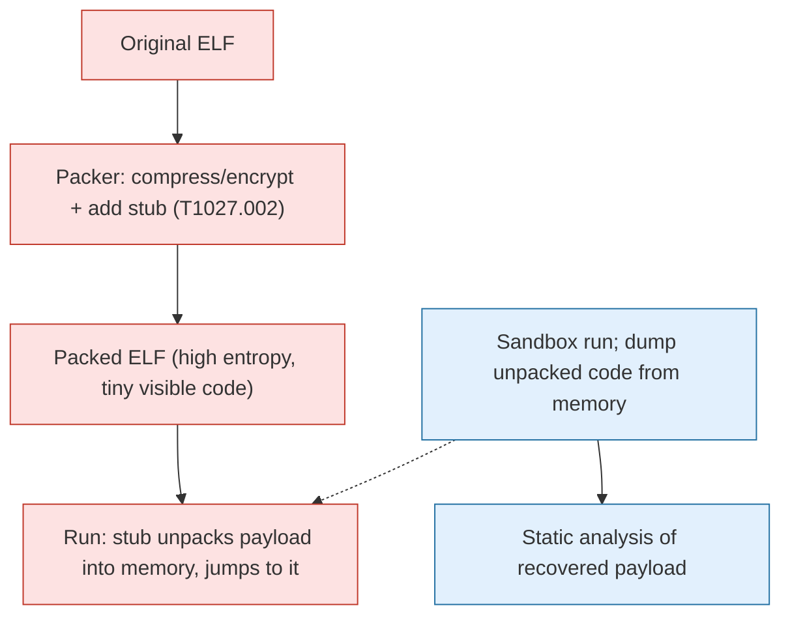

# ELF Binary Packers and Protectors

## Summary

A packer compresses and/or encrypts an executable and wraps it in a small **stub** that, at runtime, unpacks the original into memory and runs it. Legitimate packers (like UPX) exist for size reduction, but malware uses packing to defeat static analysis and signature detection: the real code only appears in memory after the stub runs, so the on-disk file reveals little (obfuscated files or information: software packing, T1027.002). Protectors go further with anti-debugging, anti-tampering, and encryption. On Linux, packed ELFs show characteristic signs — high entropy, a tiny apparent code section, unusual segment layout, and a stub entry point — and the standard defeat is dynamic: let the stub unpack in a sandbox, then dump the real code from memory for analysis.

## Packing concepts

| Concept | Meaning |
|---|---|
| **Stub** | Small loader that unpacks the payload at runtime |
| **Packed payload** | Compressed/encrypted original code (high entropy) |
| **Runtime unpack** | Stub reconstructs and jumps to the real code in memory |
| **Protector extras** | Anti-debug, anti-VM, integrity checks, encryption |
| **Tell-tales** | High entropy, tiny visible code, odd segments, stub entry |

The analysis principle mirrors other anti-static defences: whatever the stub must do to run — decompress the payload into executable memory and jump to it — is the moment the real code becomes visible, so dynamic analysis beats packing.

## Pack / unpack / analyse

## Detection

- High section/file entropy and a very small apparent code section (packing indicator).
- Known packer signatures (e.g. UPX markers) or stub patterns; unusual ELF segment layouts.
- Runtime behaviour: a process allocating executable memory and jumping to freshly-written code (unpacking).
- On-disk vs in-memory code differences (the unpacked payload appears only in memory).

## Defense

- **Flag high-entropy/packed binaries** for deeper analysis (they're disproportionately malicious).
- **Unpack dynamically in a sandbox** and dump memory to recover the real payload for signatures.
- **Behavioural detection**: watch for self-unpacking (RWX, write-then-execute) rather than relying on static signatures.
- **Application control** to limit unknown/packed binaries executing.
- **Combine** static entropy triage with dynamic unpacking and memory forensics.

## ATT&CK mapping

| ID | Name | Tactic |
|---|---|---|
| T1027.002 | Obfuscated Files or Information: Software Packing | Stealth |

## Explanation

A packer is shrink-wrap for a program. It squashes the real executable down into an unreadable block and bolts on a tiny opener (the stub) whose only job is to tear off the wrapping at runtime and start the real thing. For malware this is gift-wrapping with a purpose: the file sitting on disk is just a compressed blob plus an opener, so a static scanner peering at it sees almost nothing recognisable. But the trick has an unavoidable tell — to actually run, the program *must* unwrap itself into memory, and that's the moment the real code stands exposed. So analysts let a packed sample open its own wrapping inside a sealed sandbox, then photograph the contents from memory. On the way in, the high "randomness" of the squashed block and a suspiciously tiny visible code section are the fingerprints that say "this is wrapped — look closer."
