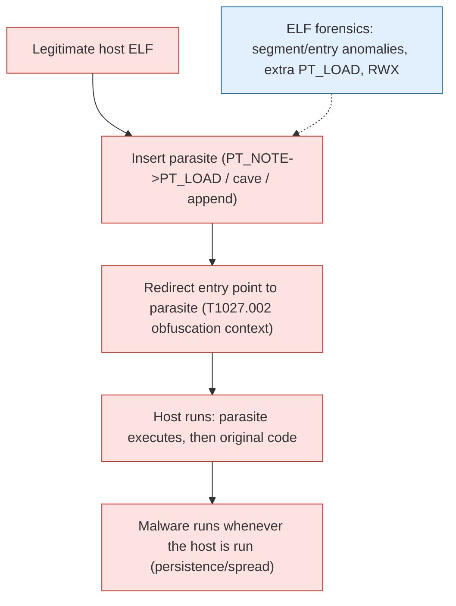

# ELF Virus and Parasite Infection Techniques

## Summary

ELF infection is the art of embedding malicious code into an existing, legitimate ELF binary so that running the host also runs the parasite — a classic file-infecting virus approach adapted to Linux. The challenge is inserting code without breaking the host or leaving obvious damage, which has produced a family of techniques: **PT_NOTE-to-PT_LOAD** conversion (repurpose a note segment to map attacker code), **text/code cave** insertion, appending a new segment and redirecting the entry point, and **reverse text padding** infection. Each manipulates ELF headers, segments, and the entry point so execution detours through the parasite before (or instead of) the original code. Understanding these techniques is essential for ELF forensics and malware analysis, because each leaves structural fingerprints — mismatched segments, redirected entry points, unexpected RWX regions — that detection exploits.

## Infection techniques

| Technique | Mechanism |
|---|---|
| **PT_NOTE → PT_LOAD** | Convert an unused note segment into a loadable segment for the parasite |
| **Code cave** | Insert code into unused space (padding/alignment gaps) |
| **Segment append + entry redirect** | Add a new segment; point the entry point at the parasite |
| **Reverse text padding** | Use space before the text segment for the parasite |
| **Entry-point redirection** | Hijack the start so the parasite runs first, then jumps to original |

All of them share a visible consequence: the binary's declared structure and its actual execution no longer line up cleanly — exactly the inconsistency ELF forensics hunts for.

## Infection flow

## Detection

- Entry point not leading to the original start code, or control flow that detours before `main`.
- Converted note segments (PT_NOTE repurposed), extra/odd `PT_LOAD` segments, or unexpected RWX.
- Section-vs-segment inconsistencies and binaries whose size/structure changed from a known-good baseline.
- Integrity-check failures on system binaries (package verification mismatch).

## Defense

- **File integrity monitoring** and package verification to detect altered binaries.
- **ELF forensics** (segment/entry analysis) on suspect executables — see the ELF forensics file.
- **Baseline known-good hashes** of system and application binaries; alert on change.
- **Least privilege** so attackers can't rewrite shared/system binaries.
- **Application control / signed binaries** to limit running tampered executables.

## ATT&CK mapping

| ID | Name | Tactic |
|---|---|---|
| T1027.002 | Obfuscated Files or Information: Software Packing | Stealth |

(ELF infection is a file-manipulation/obfuscation technique; this is the closest ATT&CK mapping for the packed/obfuscated parasite, with detection in the ELF Binary Forensics file.)

## Explanation

Infecting an ELF binary is like a parasite that slips into a healthy host and hitches a ride: whenever the host goes about its business, the parasite wakes up and does its own first. The hard part for the attacker is getting inside without obviously injuring the host — a crashing program invites inspection — so virus writers developed a toolkit of quiet insertion tricks: squeezing code into unused gaps, repurposing a harmless-looking segment into a live one, or tacking on a new section and quietly moving the "start here" marker to run the parasite before handing control back. Each trick works, but each also nudges the binary's official description out of line with how it actually runs. That mismatch is the parasite's lasting footprint, and spotting it — a start marker that points somewhere odd, a segment that shouldn't be executable — is the heart of catching ELF infection.
