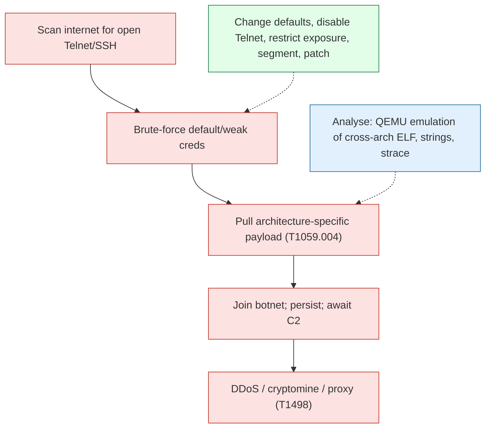

# Linux and IoT Malware Analysis

## Summary

Linux and IoT malware has its own character, shaped by the devices it targets: many architectures (ARM, MIPS, x86, etc.), often statically-linked binaries (to run on minimal systems), weak or absent security controls, and goals that skew toward building botnets for DDoS, cryptomining, and proxying. The archetype is the Mirai-style IoT botnet — spreading by brute-forcing default Telnet/SSH credentials, pulling architecture-specific payloads, and marshalling devices for volumetric attacks (network denial of service, T1498; Unix shell execution, T1059.004). Analysis must handle cross-architecture binaries (emulation with QEMU), statically-linked ELFs, and simple but effective persistence and C2. Understanding the ecosystem — cheap, unpatched, internet-exposed devices — explains both why this malware thrives and where defence (credentials, exposure, segmentation) is most effective.

## Characteristics

| Trait | Implication |
|---|---|
| **Multi-architecture** | ARM/MIPS/x86 payloads; analyse via emulation (QEMU) |
| **Static linking** | Self-contained ELFs for minimal systems; no library deps to trace |
| **Credential brute-force spread** | Default/weak Telnet/SSH creds are the main entry (T1498 botnets) |
| **Goals** | DDoS botnets, cryptomining, proxying/relays |
| **Weak host defences** | Little logging/EDR on IoT; detection shifts to the network |

The defining dynamic: huge numbers of cheap, internet-exposed, rarely-patched devices with default credentials make mass compromise trivial, so the malware favours simple, reliable brute-force spread and volumetric monetisation over stealth.

## Analysis and lifecycle

## Detection

- Devices making unexpected outbound connections (C2) or participating in traffic floods (DDoS).
- Brute-force login attempts against Telnet/SSH, and successful logins with default credentials.
- New processes/binaries on IoT devices (where observable), often statically-linked ELFs.
- Network-side anomalies, since host telemetry on IoT is usually minimal.

## Defense

- **Change default credentials and disable Telnet**; use key-based SSH.
- **Reduce exposure**: don't expose device management to the internet; segment IoT networks.
- **Patch/firmware-update** devices; retire unsupportable ones.
- **Monitor at the network** (egress, flood patterns, C2) where host visibility is poor.
- **Analyse samples via emulation** (QEMU) across architectures; extract C2 IOCs.

## ATT&CK mapping

| ID | Name | Tactic |
|---|---|---|
| T1059.004 | Command and Scripting Interpreter: Unix Shell | Execution |
| T1498 | Network Denial of Service | Impact |

## Explanation

Imagine millions of cheap smart gadgets — cameras, routers, DVRs — shipped with the same factory password, plugged into the internet, and never updated. That's the world Linux/IoT malware lives in, and it shapes everything about it. Why be stealthy when you can simply try "admin/admin" against a million devices and own a huge fraction of them? So this malware spreads by knocking on open Telnet and SSH doors with default passwords, grabs a version of itself built for whatever chip the device uses, and conscripts the gadget into an army used to flood victims offline or mine coins. For the analyst the quirks are practical: the binaries are built for unfamiliar processors (so you emulate them) and are self-contained. For the defender the fixes are humble but decisive: change the default password, stop exposing the device to the internet, and watch the network — because the device itself usually can't watch itself.
