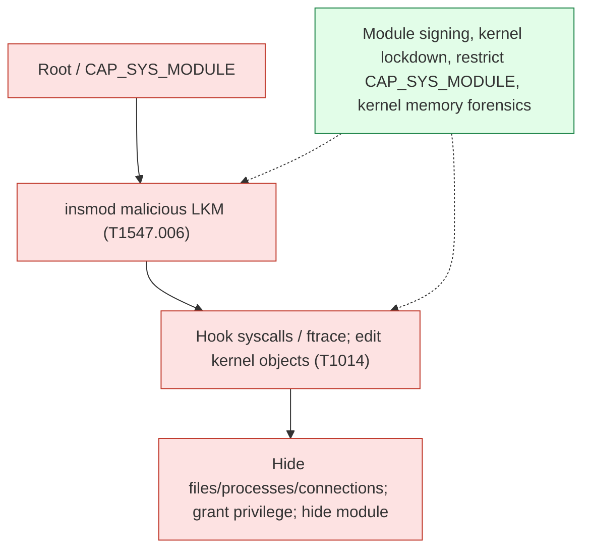

# Linux Kernel Rootkits (LKM)

## Summary

A Linux kernel rootkit runs inside the kernel, usually loaded as a **Loadable Kernel Module (LKM)**, giving it the same full privilege as the OS itself. From there it can hide processes, files, network connections, and even itself, intercept kernel operations, and grant privilege — all by manipulating kernel data and the system-call path (rootkit, T1014; boot or logon autostart execution: kernel modules and extensions, T1547.006). Classic techniques include hooking the system-call table or specific syscalls, using ftrace-based hooks, and manipulating kernel structures to unlink objects from the lists the OS enumerates. Because the lie is told by the kernel, user-space tools that trust the kernel are blinded; detection relies on kernel-memory inspection, module scrutiny, and the fact that loading a module requires privilege — so controlling kernel module loading is the decisive defence.

## Techniques

| Technique | Effect |
|---|---|
| **Syscall table hooking** | Intercept `getdents`, `read`, etc. to hide files/processes |
| **ftrace-based hooking** | Hook kernel functions via the tracing framework |
| **Object unlinking (DKOM-style)** | Remove a process/module from kernel lists to hide it |
| **Module hiding** | Unlink the rootkit from the loaded-module list |
| **Privilege grant** | Modify credentials of a process to give root |

The install requirement is the defender's leverage: loading an LKM needs `CAP_SYS_MODULE`/root, so preventing untrusted module loads (signing, lockdown) blocks the whole class.

## Install and operate

## Detection

- Unexpected or hidden kernel modules (compare `/proc/modules`, `/sys/module`, and kernel memory).
- Syscall-table or kernel-function hooks (entries pointing outside the kernel's own code).
- Cross-view discrepancies: processes/files/connections visible via `/proc`-independent means but hidden from normal tools.
- Kernel integrity/lockdown violations and module-load events for unsigned modules.

## Defense

- **Enforce kernel module signing** and **kernel lockdown**; restrict `CAP_SYS_MODULE`.
- **Disable module loading** entirely where feasible (`modules_disabled`).
- **Kernel-memory forensics** (e.g. via `/proc/kcore`, Volatility) to find hooks and hidden objects — see the rootkit-forensics file.
- **Measured/secure boot and IMA** for integrity; monitor module-load events.
- **Response**: a confirmed kernel rootkit means rebuild; verify firmware too.

## ATT&CK mapping

| ID | Name | Tactic |
|---|---|---|
| T1014 | Rootkit | Stealth |
| T1547.006 | Boot or Logon Autostart Execution: Kernel Modules and Extensions | Persistence, Privilege Escalation |

## Explanation

The Linux kernel is the ultimate authority on the machine — it keeps the master lists of what's running, what files exist, and what's on the network, and every tool trusts those lists. A kernel rootkit, usually slipped in as a loadable module, becomes part of that authority and quietly rewrites the lists before anyone reads them: your process vanishes from `ps`, your files vanish from `ls`, your connection vanishes from `netstat`, and even the rootkit module itself disappears from the module list. When the record-keeper is the forger, asking the system politely gets you nothing but lies. The one comfort is the cost of entry: you can't load a kernel module without being root, so the strongest defences slam that door — demand that modules be signed, lock the kernel down, or forbid module loading altogether — and when you do suspect an infection, you stop trusting the kernel and read its memory from the outside.
