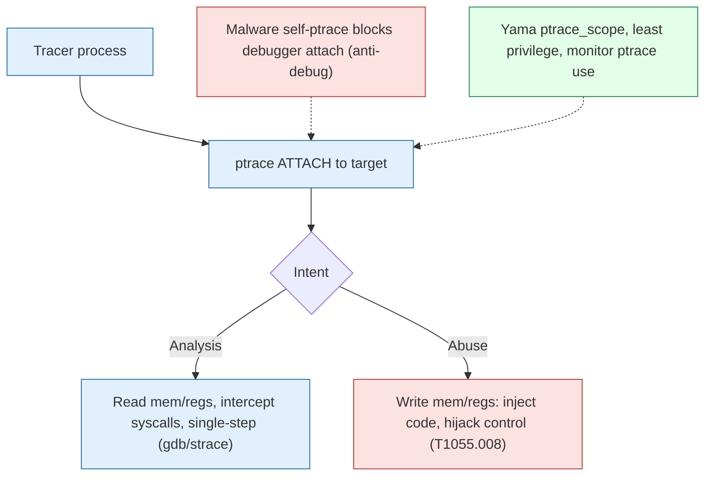

# Linux Process Tracing with ptrace

## Summary

`ptrace` is the Linux system call that lets one process observe and control another — read and write its memory and registers, intercept its system calls, and single-step its execution. It is the foundation of legitimate tools (debuggers like `gdb`, tracers like `strace`) and is equally a dual-use primitive: attackers use it to inject code into and hijack other processes (process injection: ptrace system calls, T1055.008), and malware uses `ptrace`-based tricks for anti-debugging (a process can `ptrace` itself so a debugger can't attach). Understanding `ptrace` explains both how debugging/analysis works and how in-process injection and anti-analysis are achieved, which is why restricting it (the Yama LSM) is a standard hardening step.

## What ptrace can do

| Capability | Use |
|---|---|
| **Attach / read memory & registers** | Debugging, analysis (gdb, strace) |
| **Write memory & registers** | Inject code, change execution (T1055.008) |
| **Intercept syscalls** | Sandboxing, tracing, manipulation |
| **Single-step** | Step-by-step debugging/analysis |
| **Self-ptrace (anti-debug)** | A process traces itself so a debugger can't attach |

The dual-use nature is the key point: the same mechanism that powers debuggers lets an attacker reach into a victim process and rewrite its memory and control flow — so access to `ptrace` is itself security-sensitive.

## ptrace: analysis and abuse

## Detection

- `ptrace` attaches between processes that have no legitimate debugging relationship.
- Memory/register writes to another process followed by altered behaviour (injection).
- Malware that `ptrace`s itself (anti-debug) — a failed debugger attach with `EPERM`/already-traced.
- Correlate with injection indicators (unexpected mapped code, RWX regions).

## Defense

- **Restrict ptrace with the Yama LSM** (`kernel.yama.ptrace_scope=1` or higher) so a process can't attach to arbitrary others.
- **Least privilege** so attackers can't `ptrace` processes they don't own.
- **Monitor ptrace system calls** (auditd) for unexpected tracer/target pairs.
- **Harden sensitive processes** against attach; combine with memory-injection monitoring.
- **For analysis**, use environments/tools that handle anti-ptrace malware.

## ATT&CK mapping

| ID | Name | Tactic |
|---|---|---|
| T1055.008 | Process Injection: Ptrace System Calls | Privilege Escalation, Stealth |

## Explanation

`ptrace` is Linux's built-in puppeteering mechanism: it lets one program take hold of another and look inside it, read its thoughts (memory and registers), pause it, and even move its strings. In the right hands that's how every debugger and system-call tracer works — indispensable for analysis. In the wrong hands it's a way to reach into a running, trusted program and rewrite what it's doing, slipping attacker code into a victim's skin. Malware also uses a cute inversion of it: a program can grab its *own* strings first, and since only one puppeteer is allowed at a time, a debugger that tries to attach is turned away — a simple anti-analysis trick. Because the same power serves debuggers and attackers alike, hardened systems limit who may puppeteer whom (the Yama setting), so a process can no longer reach into any other it fancies.
