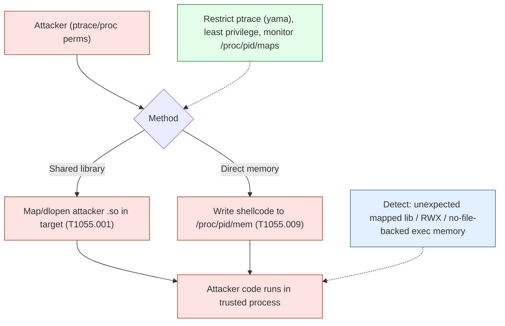

# Linux Shared Library and Code Injection (.so, ET_REL)

## Summary

Code injection on Linux means forcing a target process to load and run attacker code in its address space — to hide inside a trusted process, evade detection, or escalate. Techniques include injecting a shared library (`.so`) into a running process, injecting relocatable object code (ET_REL), and writing shellcode directly into process memory. The usual delivery mechanisms are `ptrace` (attach to a process and manipulate its memory/registers — its own file), writing to `/proc/<pid>/mem`, and the loader abuse of `LD_PRELOAD` for launch-time injection (process injection: dynamic-link/shared library injection, T1055.001; proc memory injection, T1055.009). The payoff for attackers is running inside a legitimate process's context; the structural cost is detectable evidence — unexpected mapped libraries, RWX regions, or memory not backed by a file — which detection and forensics target.

## Injection techniques

| Technique | Mechanism |
|---|---|
| **Shared-library (.so) injection** | Force the target to `dlopen`/map an attacker `.so` (T1055.001) |
| **ET_REL object injection** | Inject relocatable object code and resolve it in-process |
| **Direct memory / shellcode** | Write code to `/proc/<pid>/mem` or via ptrace, then execute (T1055.009) |
| **Delivery: ptrace** | Attach, write memory, hijack execution (own file) |
| **Delivery: LD_PRELOAD** | Launch-time library injection (own file) |

The common result is attacker code executing with the target's identity and trust, which is why injection is prized for evasion — and why "executable memory with no backing file" or an unexpected mapped library is such a strong indicator.

## Injection flow

## Detection

- Unexpected shared libraries mapped into a process (`/proc/<pid>/maps`) not matching its dependencies.
- Executable memory regions with no backing file, or RWX mappings (injected code/shellcode).
- `ptrace` attaches and writes to `/proc/<pid>/mem` by unexpected processes.
- A process behaving (network, file) inconsistently with its normal role (injected logic).

## Defense

- **Restrict ptrace** with the Yama LSM (`kernel.yama.ptrace_scope`) so processes can't freely attach.
- **Least privilege** so attackers lack the rights to inject into other users' processes.
- **Monitor `/proc/<pid>/maps`** for unexpected libraries and RWX regions; use EDR/memory scanning.
- **Harden sensitive processes** and reduce injectable surface.
- **Memory forensics** to recover injected code and confirm compromise.

## ATT&CK mapping

| ID | Name | Tactic |
|---|---|---|
| T1055.001 | Process Injection: Dynamic-link Library Injection | Privilege Escalation, Stealth |
| T1055.009 | Process Injection: Proc Memory | Privilege Escalation, Stealth |

## Explanation

Code injection is the art of smuggling your own worker into someone else's trusted workshop so your work gets done under their good name. On Linux there are a few ways in: hand the target process a new tool library and make it pick it up (shared-library injection), or reach straight into its memory — through the `ptrace` debugging mechanism or the `/proc/<pid>/mem` window — and write your instructions there directly. Either way, your code now runs wearing the host process's badge, which is exactly what makes it stealthy and dangerous. But smuggling leaves traces: the host process now has a tool on its bench it never requested (an unexpected mapped library) or a patch of memory that's both writable and runnable yet corresponds to no file on disk. Defenders lock the obvious doors — restricting who can `ptrace` whom — and watch each process's inventory of mapped memory for anything that shouldn't be there.
