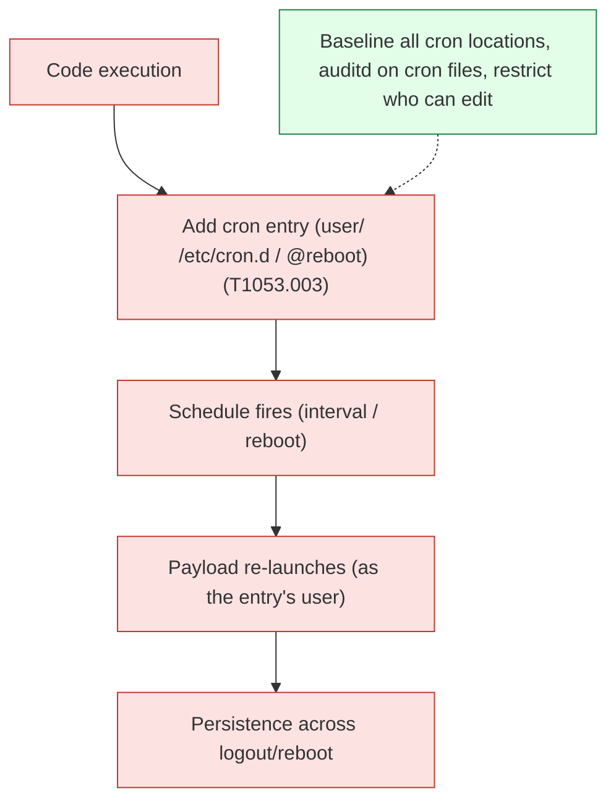

# Cron Job Scheduling and Persistence

## Summary

`cron` is the classic Linux job scheduler: it runs commands on a time schedule defined in crontab files. Legitimate for backups and maintenance, it is also a simple and popular persistence mechanism — an attacker adds a cron entry that re-launches their payload on a schedule (e.g. every minute, at reboot), surviving logouts and reboots (scheduled task/job: cron, T1053.003). Cron entries live in several places: per-user crontabs, the system `/etc/crontab`, and drop-in directories (`/etc/cron.d`, `/etc/cron.{hourly,daily,weekly,monthly}`), plus `@reboot` entries that run at boot. Because these locations are well known and finite, baselining and monitoring them is an effective defence, and reviewing them is a standard step in Linux incident response.

## Where cron persistence lives

| Location | Scope |
|---|---|
| **User crontab** (`crontab -e`, `/var/spool/cron/...`) | Per user, runs as that user |
| **`/etc/crontab`** | System-wide, specifies the run-as user |
| **`/etc/cron.d/`** | Drop-in system cron files |
| **`/etc/cron.{hourly,daily,...}`** | Scripts run on those intervals |
| **`@reboot` entries** | Run at system boot |

A root-owned cron entry runs its command as root, so cron is a persistence *and* (via a writable root cron file/script) a privilege-escalation vector; `@reboot` gives boot persistence without a service.

## Persistence flow

## Detection

- New or modified crontab entries and files across all cron locations (auditd/file monitoring).
- `@reboot` entries and cron jobs invoking shells, interpreters, or binaries in user-writable/temp paths.
- cron (`CRON`) syslog entries running unexpected commands.
- Root-owned cron files/scripts writable by non-root users (escalation risk).

## Defense

- **Baseline and monitor all cron locations**, including drop-in directories and `@reboot`.
- **Audit cron files** with auditd and alert on changes.
- **Restrict cron** (`cron.allow`/`cron.deny`) and tighten permissions on cron files/scripts.
- **Investigate the command and the writing user**, not just the entry.
- **Correlate** cron activity with process-creation and network telemetry.

## ATT&CK mapping

| ID | Name | Tactic |
|---|---|---|
| T1053.003 | Scheduled Task/Job: Cron | Execution, Persistence, Privilege Escalation |

## Explanation

`cron` is Linux's kitchen timer: tell it "run this every morning" or "run this each time we switch the machine on" and it faithfully obliges. That's wonderful for backups and chores, and just as wonderful for an intruder who wants their program to keep coming back — one line in a crontab and their payload reappears every minute, or at every reboot, no matter how many times you kill it. The saving grace is that the timer's instruction sheets live in a short list of well-known files and folders. A defender who keeps a copy of what those should say, and gets alerted when a new line appears, turns the attacker's reliable comeback into an obvious tripwire — which is why reviewing cron is a reflex step whenever a Linux box is suspected of compromise.
