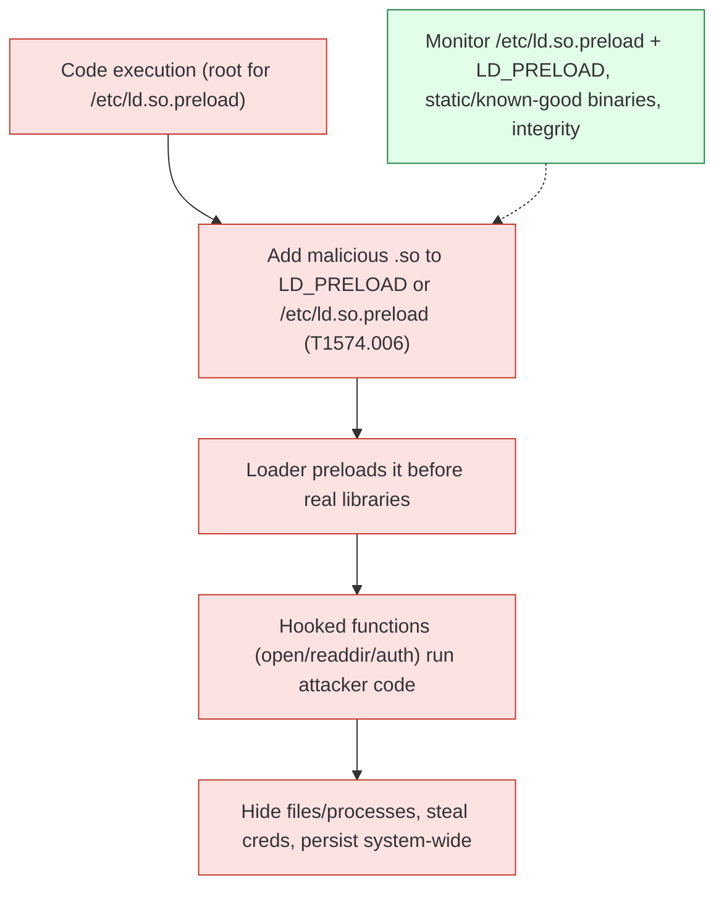

# LD_PRELOAD Hijacking

## Summary

The Linux dynamic loader (`ld.so`) can be told to load a shared library *before* all others via the `LD_PRELOAD` environment variable (or the system-wide `/etc/ld.so.preload` file). Symbols in the preloaded library override those in later libraries, so a function like `open`, `read`, or `getpwnam` can be transparently replaced. Attackers abuse this to hook library calls across programs — hiding files and processes, stealing credentials, or injecting behaviour — and to persist, since `/etc/ld.so.preload` makes the hook apply to (almost) every dynamically-linked program on the system (hijack execution flow: dynamic linker hijacking, T1574.006). It is a favourite userland-rootkit technique precisely because it needs no kernel code: a single preload library can filter what the whole system reports. Detection relies on knowing the few controlling locations and watching them.

## How it works

| Vector | Effect |
|---|---|
| **`LD_PRELOAD` env var** | Preloads a library for a specific execution |
| **`/etc/ld.so.preload`** | System-wide preload for all dynamically-linked programs (persistence) |
| **Symbol override** | Preloaded functions shadow the real library functions |
| **Common abuse** | Hook `open`/`readdir`/`read`/auth functions to hide artefacts or steal creds |

The persistence and stealth power comes from `/etc/ld.so.preload`: one line there injects the attacker's library into essentially every program, letting them filter listings, hide processes, and intercept credentials system-wide — a userland rootkit without touching the kernel.

## Hijack flow

## Detection

- Presence or modification of `/etc/ld.so.preload` (it is empty/absent on most systems — any content is suspicious).
- `LD_PRELOAD` set in unexpected environments, service configs, or profiles.
- Processes with an unexpected preloaded library in their maps (`/proc/<pid>/maps`).
- Cross-view discrepancies (files/processes hidden via hooks) and credential-theft symptoms.

## Defense

- **Monitor `/etc/ld.so.preload` and `LD_PRELOAD`** usage; alert on any `/etc/ld.so.preload` content.
- **Inspect process maps** for unexpected preloaded libraries.
- **Use statically-linked, known-good tools** for investigation (preloads can't hook them).
- **File integrity monitoring** and least privilege (root is needed for the system-wide file).
- **Correlate** with rootkit detection (cross-view, memory forensics).

## ATT&CK mapping

| ID | Name | Tactic |
|---|---|---|
| T1574.006 | Hijack Execution Flow: Dynamic Linker Hijacking | Execution, Stealth |

## Explanation

When a Linux program needs a function like "open a file," it asks the dynamic loader to find it in the shared libraries. `LD_PRELOAD` is a way to say "before you look anywhere else, check *this* library first" — so whatever functions that library defines win. Legitimately it's used for debugging and testing; maliciously it's a master skeleton key. Drop a line in the system-wide `/etc/ld.so.preload` and your chosen library gets first say in nearly every program on the machine, so you can quietly rewrite what "list files" returns (hiding your tools), what "log in" does (stealing passwords), and what "list processes" shows (hiding yourself) — a whole rootkit without a scrap of kernel code. The reassuring part for defenders is that the control switch is a single, normally-empty file: if `/etc/ld.so.preload` has anything in it, that alone is worth an investigation.
