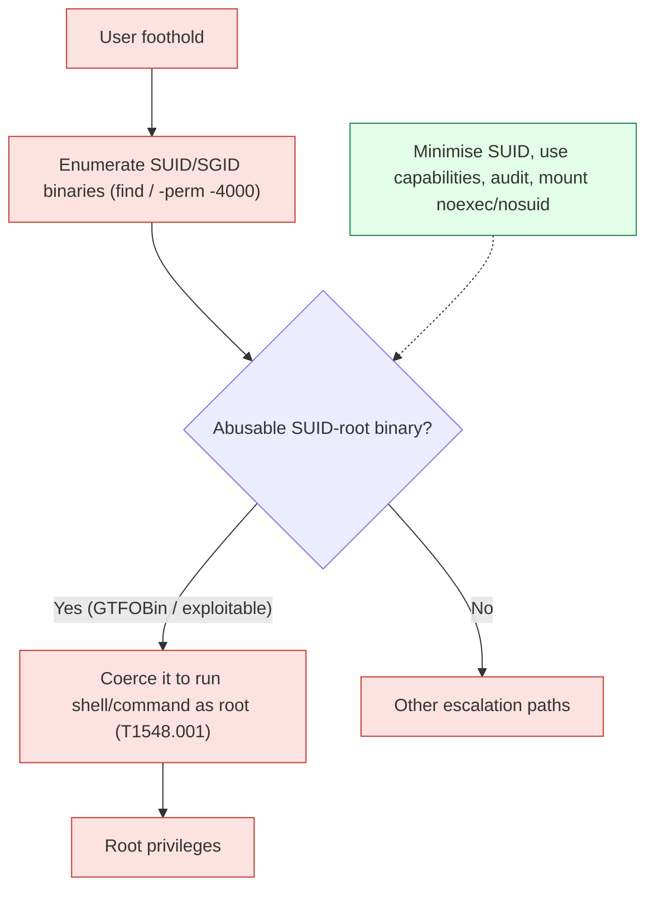

# Linux File Permissions, SUID/SGID and Privilege Escalation

## Summary

Linux controls access with a user/group/other permission model (read, write, execute), plus special bits. The most security-critical are **SetUID (SUID)** and **SetGID (SGID)**: a program with the SUID bit runs with the privileges of its *owner* (often root) regardless of who launched it. This is how legitimate tools like `passwd` work, but it is also a prime escalation route: if a SUID-root program can be made to run arbitrary commands, read/write arbitrary files, or is itself exploitable, a normal user gains root (abuse elevation control mechanism: setuid and setgid, T1548.001). Enumerating SUID/SGID binaries is one of the first things attackers do on a Linux foothold, and misusing a legitimate SUID binary (a "GTFOBin") is a classic technique. Hardening centres on minimising and auditing these bits.

## The mechanism

| Element | Effect |
|---|---|
| **rwx (user/group/other)** | Base read/write/execute permissions |
| **SUID bit** | Executable runs as its file owner (e.g. root) |
| **SGID bit** | Executable runs with its file group; on dirs, new files inherit the group |
| **Sticky bit** | On dirs (e.g. `/tmp`), only owners can delete their files |
| **Capabilities** | Fine-grained root powers on a binary (an alternative to full SUID) |

The escalation crux: a SUID-root binary that can be coerced into running a shell, executing a command, or writing a file does so *as root*. Many standard utilities can be abused this way if they carry the bit unnecessarily.

## Escalation flow

## Detection

- Enumeration of SUID/SGID files shortly after a foothold (`find` with `-perm` masks).
- SUID-root binaries spawning shells or unexpected children.
- New or unexpected SUID/SGID binaries (especially in user-writable or unusual paths).
- Abuse patterns of known GTFOBins running privileged actions.

## Defense

- **Minimise SUID/SGID**: remove the bit from anything that doesn't strictly need it; audit regularly.
- **Prefer capabilities** over full SUID for fine-grained privilege.
- **Mount with `nosuid`/`noexec`** where appropriate (e.g. `/tmp`, removable media).
- **Monitor** for new SUID files and SUID binaries spawning shells.
- **Keep SUID binaries patched** and avoid shipping risky ones.

## ATT&CK mapping

| ID | Name | Tactic |
|---|---|---|
| T1548.001 | Abuse Elevation Control Mechanism: Setuid and Setgid | Privilege Escalation |

## Explanation

On Linux most programs run with your own permissions, but a few carry a special badge (the SUID bit) that says "run me with my owner's authority, not the caller's." That's deliberately useful: changing your password needs to touch a root-only file, so the `passwd` program wears root's badge for that moment. The danger is any badged-as-root program that can be talked into doing something general — opening a shell, running a command you choose, overwriting a file — because it does so with root's authority, handing a normal user the keys. That's why a Linux attacker's opening move is to list every badged program on the box and check whether any can be bent to their purpose, and why the defender's job is to make sure as few programs as possible wear that badge, and that the ones that do can't be tricked.
