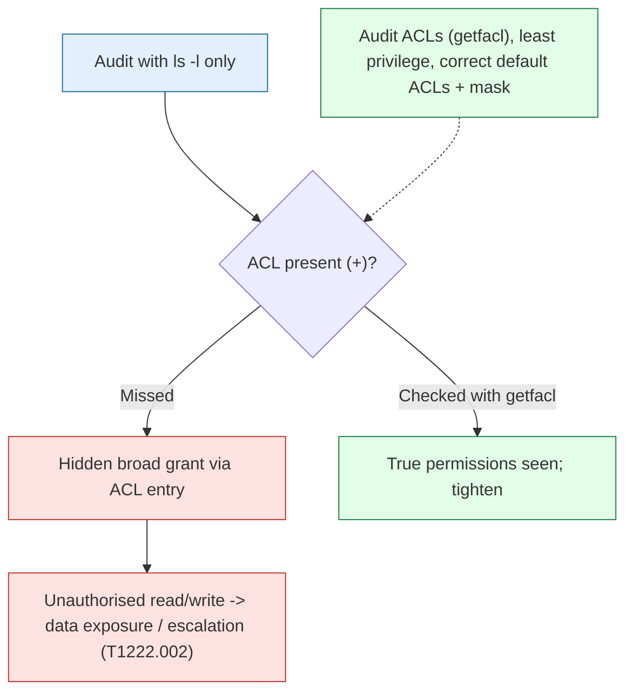

# Linux ACLs and Shared Directory Management

## Summary

The traditional user/group/other permission model is coarse: it can't easily grant one extra user access without changing group membership. **POSIX Access Control Lists (ACLs)**, managed with `getfacl`/`setfacl`, add fine-grained per-user and per-group permissions on top of the base mode, and **default ACLs** on a directory control what new files inherit — the clean way to run shared directories. From a security standpoint ACLs cut both ways: they let administrators grant least-privilege access precisely, but overly permissive or forgotten ACL entries create escalation and data-exposure paths that a quick `ls -l` won't reveal (the base mode shows a `+`, but the real grants live in the ACL). Attackers modify permissions/ACLs to open up access or persist (file and directory permissions modification: Linux, T1222.002), so auditing ACLs — not just mode bits — is part of hardening.

## Core concepts

| Element | Role |
|---|---|
| **Base mode (ugo/rwx)** | Coarse owner/group/other permissions |
| **Access ACL** | Extra per-user/per-group entries (`setfacl -m u:alice:rw file`) |
| **Default ACL** | On a directory, the ACL inherited by new files (`setfacl -d`) |
| **Mask** | Upper bound on effective ACL permissions |
| **`+` in `ls -l`** | Indicates an ACL is present (look with `getfacl`) |

The key trap: a file can look innocuous in `ls -l` yet grant broad access through ACL entries, so permission audits that only read mode bits miss real exposure — and attackers exploit exactly that blind spot.

## Permission exposure flow

## Detection

- ACL modifications (`setfacl`) on sensitive files/directories, especially broad grants.
- Files with ACLs (`+` flag) granting access beyond intended users/groups.
- Default ACLs on shared directories that over-expose new files.
- Permission/ownership changes as part of attacker activity (T1222.002).

## Defense

- **Audit with `getfacl`, not just `ls -l`** — ACLs hide real grants from the base mode.
- **Apply least privilege** via precise ACL entries; avoid broad `other` or world grants.
- **Set correct default ACLs and masks** on shared directories so inheritance is safe.
- **Monitor ACL changes** on sensitive paths (auditd).
- **Review shared-directory design** (group ownership + SGID + default ACLs) for least exposure.

## ATT&CK mapping

| ID | Name | Tactic |
|---|---|---|
| T1222.002 | File and Directory Permissions Modification: Linux and Mac Permissions | Defense Impairment |

## Explanation

The old Linux permission system is like a door with exactly three keys: one for the owner, one for a single group, one for everybody else. That's fine until you need to let in just one extra person without handing a key to "everybody." ACLs are the upgrade that lets you cut a precise key for named individuals, and default ACLs let a shared room automatically issue the right keys for anything placed inside it. The subtlety — and the security trap — is that the quick glance everyone uses to check a door (`ls -l`) only shows the three original keys and a tiny `+` hinting that extra keys exist; to see who really has access you must ask `getfacl`. Attackers count on administrators glancing and moving on, so they cut themselves a quiet extra key, and the defender's rule is simple: when access matters, read the full keyring, not just the three obvious locks.
